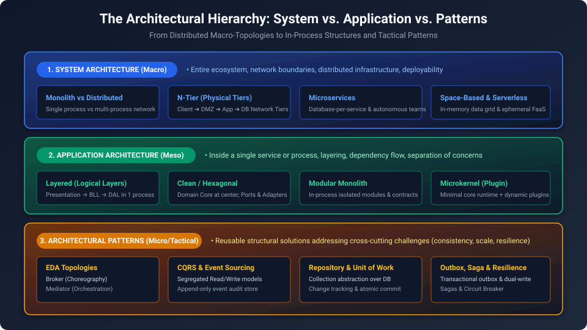
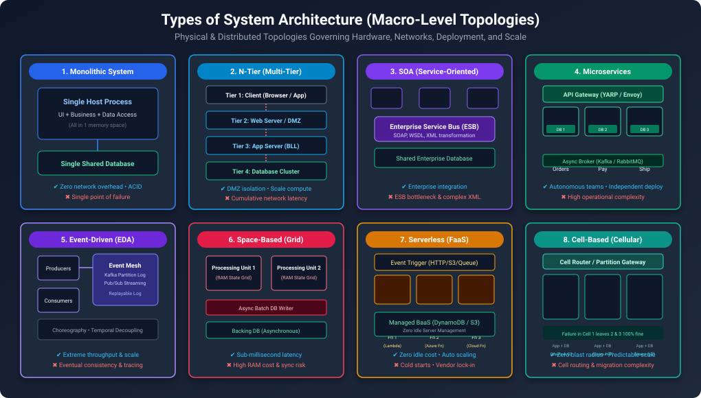
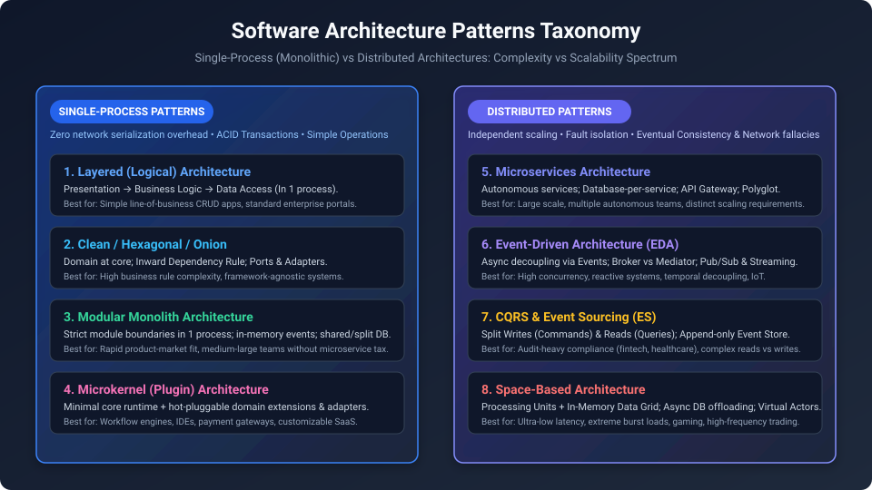
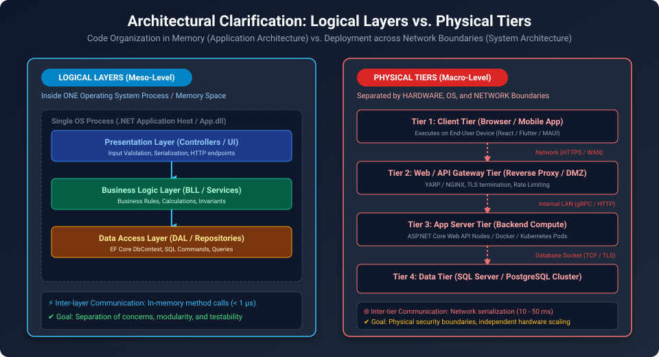
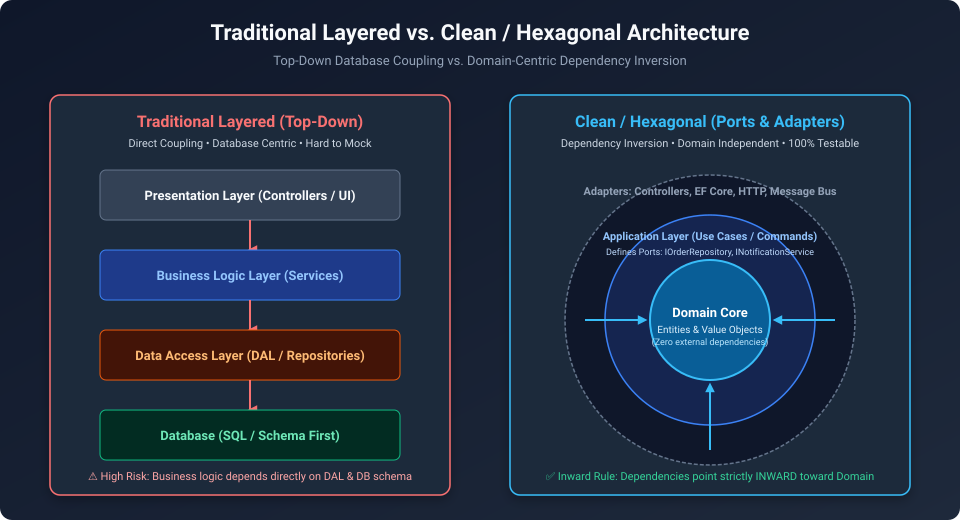
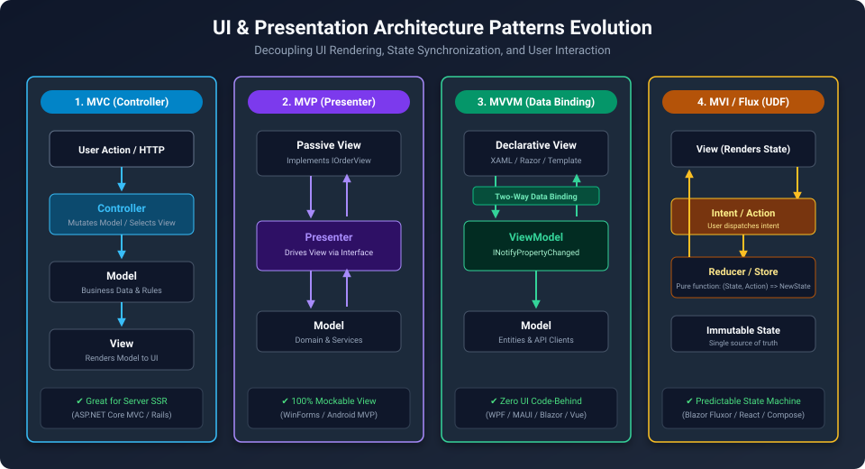
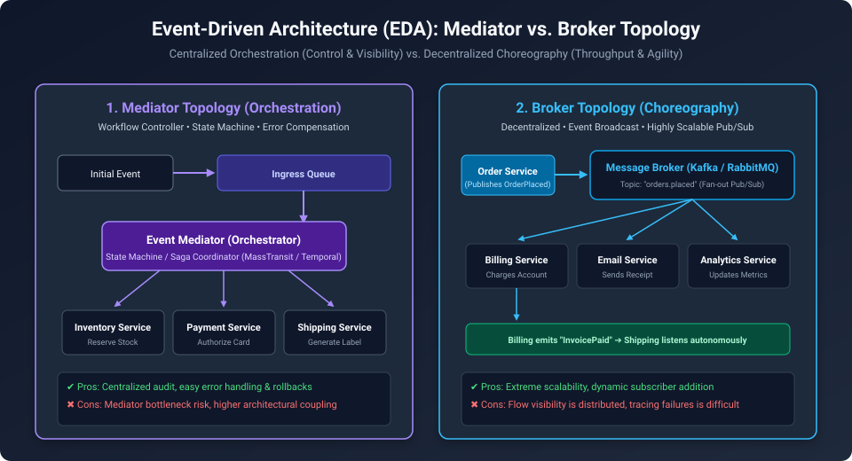
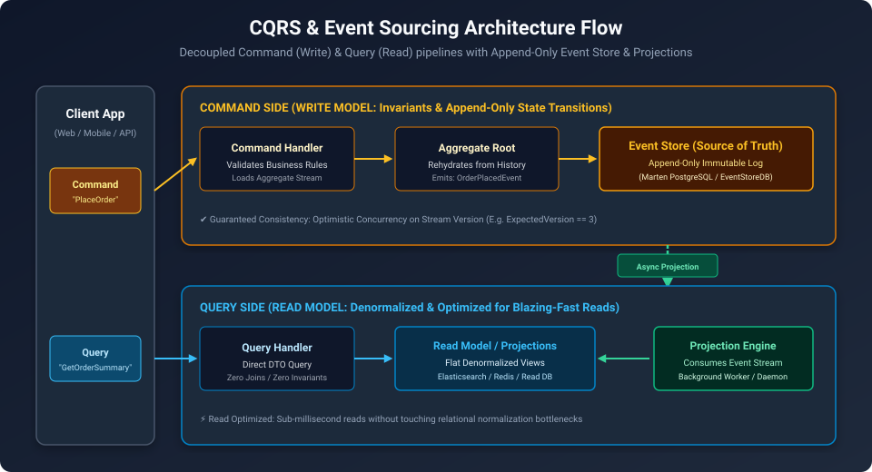

# Software Architecture Guide: System Architecture, Application Architecture & Architectural Patterns

In software engineering and enterprise system design, terms like "Architecture" are often overloaded. A senior or staff-level engineer must distinguish between the **three fundamental levels of architectural abstraction**:

1. **System Architecture (Macro-Level)**: Describes how the entire system is built and connected, including servers, networks, deployment, and communication between applications. Examples: Monolith, Microservices, Distributed Systems.
2. **Application Architecture (Meso-Level)**: Describes how code is organized inside a single application or service, including its layers, modules, and dependencies. Examples: Layered Architecture, Clean Architecture, Modular Monolith, Microkernel.
3. **Architectural Patterns & Mechanisms (Micro/Tactical-Level)**: Describes specific solutions used to solve common software problems, such as handling data consistency, communication, performance, and failures. Examples: CQRS, Event Sourcing, Outbox Pattern, Circuit Breaker, Mediator.



## 1. Architectural Hierarchy Comparison

| Dimension | System Architecture (Macro) | Application Architecture (Meso) | Architectural Patterns (Tactical) |
| :--- | :--- | :--- | :--- |
| **Scope** | Entire distributed ecosystem & infrastructure | Inside a single process, microservice, or host | Specific subsystem mechanism or transaction flow |
| **Boundary** | Network, cloud VPC, clusters, OS processes | Namespaces, assemblies/DLLs, project layers | Classes, interfaces, message contracts, event streams |
| **Key Question** | *"How do our servers and independent services collaborate?"* | *"How is code organized within this service?"* | *"How do we solve this specific structural/data problem?"* |
| **Primary Driver** | Scalability, team autonomy (Conway's Law), availability | Maintainability, testability, domain isolation | Data consistency, ultra-fast queries, resilience |
| **Examples** | N-Tier (Physical Tiers), Microservices, Space-Based, Monolith | Layered (Logical Layers), Clean, Modular Monolith, Microkernel | CQRS, Event Sourcing, Outbox, Saga, Circuit Breaker |

## Part I: System Architecture (Macro-Architecture)

System Architecture governs the overarching deployment topology, physical boundaries, and inter-service communication across the enterprise.





### 1.1 The Monolithic vs. Distributed Spectrum
The system's application functionality is packaged and deployed as one application unit.
Advantages
- Simple deployment and debugging.
- In-process calls are fast.
- Database transactions are easier to manage.
- Less infrastructure and operational overhead.
  
Trade-offs
- Scaling one feature independently is difficult.
- A shared release can affect the whole application.
- Modules can become tightly coupled if boundaries are poorly designed.
- Large teams may conflict when changing the same codebase.

The foundational decision in System Architecture is choosing between a **Single-Process Monolith** and a **Distributed Networked Architecture**:
- **Monolithic System**: Runs within a single OS process memory space (or horizontally replicated identical clusters). In-process method calls take nanoseconds/microseconds with zero serialization overhead and support native ACID database transactions.
- **Distributed System**: Functionality is distributed across multiple autonomous network nodes. Provides independent scaling and fault isolation, but introduces network latency, partial failures, and eventual consistency (*Fallacies of Distributed Computing*).

### 1.2 Microservices Architecture

Microservices architecture structures an enterprise system as a suite of small, autonomous, loosely coupled services organized around business capabilities. Each microservice owns and strictly encapsulates its own storage (**Database-per-Service**).

```
                      ┌─────────────────────────┐
                      │   API Gateway (YARP)    │
                      └────────────┬────────────┘
                                   │
         ┌─────────────────────────┼─────────────────────────┐
         ▼                         ▼                         ▼
┌──────────────────┐      ┌──────────────────┐      ┌──────────────────┐
│  Orders Service  │      │ Payments Service │      │ Shipping Service │
│                  │      │                  │      │                  │
│ ┌──────────────┐ │      │ ┌──────────────┐ │      │ ┌──────────────┐ │
│ │ Orders DB    │ │      │ │ Payments DB  │ │      │ │ Shipping DB  │ │
│ └──────────────┘ │      │ └──────────────┘ │      │ └──────────────┘ │
└──────────────────┘      └──────────────────┘      └──────────────────┘
```

#### Benefits
- **Organizational Alignment (Conway's Law)**: Enables autonomous "two-pizza" teams to develop, test, and release services without blocking other teams.
- **Targeted Elastic Scalability**: Scale only high-demand services (e.g., Checkout, Product Search) without wasting compute resources scaling static admin modules.
- **Fault Isolation**: A catastrophic crash or memory leak in the Recommendations service does not bring down the payment and checkout flows.

#### Drawbacks & Trade-offs
- **Network Latency & Fallacies**: Sub-millisecond memory calls turn into 15-50ms network round-trips with potential packet drops and timeouts.
- **Distributed Data Consistency**: Multi-database ACID transactions are impossible; systems must embrace eventual consistency and Saga compensation workflows.
- **Operational Tax**: Requires complex infrastructure: Kubernetes orchestration, API Gateways, distributed tracing (OpenTelemetry), and centralized logging.

#### Target Technology & NuGet Packages for .NET / C#
- `Yarp.ReverseProxy`: Microsoft's high-performance reverse proxy for API Gateways.
- `Microsoft.Extensions.Http.Resilience` / `Polly`: Resilient HTTP pipelines (Retries, Circuit Breaker, Rate Limiting).
- `Aspire.Hosting`: .NET Aspire for cloud-native orchestration and telemetry.

#### Minimal Production C# Code

```csharp
// Production .NET 9 API Gateway configuration using YARP & Resilient HTTP Client
using Microsoft.AspNetCore.Builder;
using Microsoft.Extensions.DependencyInjection;
using Polly;
using Polly.Retry;

var builder = WebApplication.CreateBuilder(args);

// 1. Configure YARP Reverse Proxy
builder.Services.AddReverseProxy()
    .LoadFromConfig(builder.Configuration.GetSection("ReverseProxy"));

// 2. Configure Resilient Outbound HttpClient with Polly Circuit Breaker & Jitter Retry
builder.Services.AddHttpClient("PaymentService", client =>
{
    client.BaseAddress = new Uri("https://payment-service.internal/");
    client.Timeout = TimeSpan.FromSeconds(5);
})
.AddStandardResilienceHandler(options =>
{
    options.Retry.MaxRetryAttempts = 3;
    options.Retry.BackoffType = DelayBackoffType.Exponential;
    options.Retry.UseJitter = true;

    options.CircuitBreaker.SamplingDuration = TimeSpan.FromSeconds(10);
    options.CircuitBreaker.FailureRatio = 0.5; // Trip if 50% requests fail
    options.CircuitBreaker.BreakDuration = TimeSpan.FromSeconds(30);
});

var app = builder.Build();
app.MapReverseProxy();
app.Run();
```

---

### 1.3 Space-Based Architecture (In-Memory Data Grid)

Space-Based Architecture (derived from David Gelernter's tuple space concept) is engineered specifically for ultra-high concurrency, extreme unpredictable load, and sub-millisecond response times by **eliminating the central database as a synchronous bottleneck**.

```
                         ┌───────────────────────┐
                         │    Virtual Request    │
                         │    Director (Load)    │
                         └───────────┬───────────┘
                                     │
           ┌─────────────────────────┴─────────────────────────┐
           ▼                                                   ▼
┌─────────────────────────┐                         ┌─────────────────────────┐
│ Processing Unit 1 (RAM) │                         │ Processing Unit 2 (RAM) │
│                         │   Replication Engine    │                         │
│ • Business Logic        │◄───────────────────────►│ • Business Logic        │
│ • In-Memory Data Grid   │       (Sync/Async)      │ • In-Memory Data Grid   │
└──────────┬──────────────┘                         └───────────┬─────────────┘
           │                                                    │
           └──────────────────────────┬─────────────────────────┘
                                      ▼
                        ┌───────────────────────────┐
                        │ Async Data Writer (Batch) │
                        └─────────────┬─────────────┘
                                      ▼
                        ┌───────────────────────────┐
                        │   Persistent Database     │
                        └───────────────────────────┘
```

#### Benefits
- **Sub-Millisecond High Concurrency**: Transactions execute exclusively in RAM; read/write operations execute orders of magnitude faster than disk-bound databases.
- **Predictable Elasticity**: Traffic surges (100x bursts) are absorbed by spinning up in-memory Processing Units without database row contention or deadlocks.

#### Drawbacks & Trade-offs
- **High Memory Infrastructure Cost**: Storing high-volume transactional state in RAM is significantly more expensive than SSD persistent storage.
- **Disaster Recovery Risk**: Data modified in RAM that has not yet been asynchronously persisted to disk is vulnerable to loss during total power or cluster failures.

#### Target Technology & NuGet Packages for .NET / C#
- `Microsoft.Orleans`: Virtual Actor framework for distributed in-memory stateful grains with asynchronous persistence.
- `StackExchange.Redis`: In-memory distributed caching and atomic operations.

#### Minimal Production C# Code

```csharp
// Space-Based Virtual Actor Pattern using Microsoft Orleans in .NET 9
using Orleans;

public interface ITradingAccountGrain : IGrainWithGuidKey
{
    Task<decimal> GetBalanceAsync();
    Task<bool> ExecuteOrderAsync(decimal orderAmount);
}

public class TradingAccountGrain : Grain, ITradingAccountGrain
{
    private readonly IPersistentState<AccountState> _state;

    public TradingAccountGrain(
        [PersistentState("tradingAccount", "accountStorage")] IPersistentState<AccountState> state)
    {
        _state = state;
    }

    public Task<decimal> GetBalanceAsync() => Task.FromResult(_state.State.Balance);

    public async Task<bool> ExecuteOrderAsync(decimal orderAmount)
    {
        // Executes in sub-millisecond RAM space with single-threaded actor guarantee
        if (_state.State.Balance < orderAmount)
            return false;

        _state.State.Balance -= orderAmount;
        _state.State.ExecutionCount++;

        // Asynchronously persists state to backing store without blocking caller
        await _state.WriteStateAsync();
        return true;
    }
}

public class AccountState
{
    public decimal Balance { get; set; } = 10_000m;
    public int ExecutionCount { get; set; }
}
```

---

### 1.4 N-Tier Architecture (Physical Deployment Topology)

**N-Tier Architecture** is a **System Architecture (Macro-Level)** pattern that physically distributes an application's execution across **$N$ distinct hardware nodes, server environments, or network boundaries**.

```
┌─────────────────────────────────┐
│ Tier 1: Client Tier (Browser)   │
└────────────────┬────────────────┘
                 │ (Public WAN / HTTPS)
                 ▼
┌─────────────────────────────────┐
│ Tier 2: Web Server / DMZ        │  (Reverse Proxy / Edge TLS)
└────────────────┬────────────────┘
                 │ (Internal LAN / gRPC)
                 ▼
┌─────────────────────────────────┐
│ Tier 3: App Server Tier (Nodes) │  (Business Compute & Services)
└────────────────┬────────────────┘
                 │ (Private VLAN / TCP)
                 ▼
┌─────────────────────────────────┐
│ Tier 4: Database Tier (Cluster) │  (SQL / NoSQL Storage Cluster)
└─────────────────────────────────┘
```

#### Benefits
- **Network Security & DMZ Isolation**: Only Tier 2 (Web/Reverse Proxy) is exposed to the public Internet. The database (Tier 4) and core business servers (Tier 3) sit in private, isolated VLANs without public IPs.
- **Asymmetric Hardware Scaling**: Compute-heavy application tiers scale independently on CPU-optimized cloud instances, while database clusters scale on high-IOPS storage instances.
- **Defense in Depth**: Compromising the public web server does not grant direct access to the database or private network.

#### Drawbacks & Trade-offs
- **Network Latency Tax**: Every tier traversal introduces socket serialization, deserialization, network latency (10–50ms), and connection pool overhead.
- **Operational Complexity**: Requires configuring load balancers, VPC peering, firewall routing tables, and SSL/TLS certificates between tiers.

#### Target Technology & NuGet Packages for .NET / C#
- `Yarp.ReverseProxy`: Handling Tier 2 $\rightarrow$ Tier 3 edge routing, TLS termination, and load balancing.
- `Microsoft.AspNetCore.Authentication.JwtBearer`: Securing cross-tier communication via distributed JWT tokens or mTLS certificates.

### 1.5 Service-Oriented Architecture (SOA)

**Service-Oriented Architecture (SOA)** is an enterprise system topology popular in the 2000s that integrates disparate, coarse-grained business applications across an enterprise using an **Enterprise Service Bus (ESB)**.

```
┌─────────────────┐       ┌─────────────────┐       ┌─────────────────┐
│ Billing Service │       │   CRM Service   │       │   ERP Service   │
└────────┬────────┘       └────────┬────────┘       └────────┬────────┘
         │ (SOAP/XML)              │ (WSDL)                  │ (Binary)
         ▼                         ▼                         ▼
┌─────────────────────────────────────────────────────────────────────┐
│                   Enterprise Service Bus (ESB)                      │
│   • Message Transformation  • Protocol Mediation  • Routing Logic   │
└──────────────────────────────────┬──────────────────────────────────┘
                                   ▼
                      Shared Enterprise Database
```

#### The Essential Comparison: SOA vs. Microservices
- **SOA Philosophy**: *"Smart pipes, dumb endpoints"*. The central ESB holds complex business routing, protocol transformation (SOAP to REST, XML to JSON), and message mediation. Services often share a large enterprise database.
- **Microservices Philosophy**: *"Dumb pipes, smart endpoints"*. The communication layer (RabbitMQ, Kafka, HTTP) contains zero business logic. Services are fine-grained and strictly own their private databases.

#### Benefits
- **Enterprise Legacy Integration**: Excels at connecting legacy mainframes, SAP/ERP systems, and modern web services without rewriting legacy cores.
- **Protocol & Data Format Translation**: The ESB handles format translation transparently between legacy XML and modern protocols.

#### Drawbacks & Trade-offs
- **Single Point of Failure & Bottleneck**: The ESB becomes a massive, complex monolith; if the ESB crashes, the entire enterprise goes down.
- **Complex Vendor Governance**: Heavy reliance on expensive proprietary ESB software (BizTalk, IBM WebSphere, TIBCO) with high licensing costs.

#### Target Technology & NuGet Packages for .NET / C#
- `CoreWCF`: Modern .NET 8/9 port of Windows Communication Foundation (WCF) for enterprise SOAP/XML integration.
- `MassTransit`: Modern lightweight alternative to heavyweight ESBs for message-based enterprise integration.

### 1.6 Serverless (FaaS / BaaS) Architecture

**Serverless Architecture** is a cloud-native system topology where the cloud provider manages dynamic container allocation, scaling, and hardware provisioning. Compute executes as short-lived, event-triggered functions (**Function-as-a-Service - FaaS**) supported by managed cloud storage and database backends (**Backend-as-a-Service - BaaS**).

```
┌─────────────────────────────────┐
│ Event Trigger (HTTP, Queue, S3) │
└────────────────┬────────────────┘
                 │ (Event Invocations)
                 ▼
┌────────────────────────────────────────────────────────┐
│             Ephemeral Compute Cluster (FaaS)           │
│                                                        │
│  ┌──────────────────┐ ┌──────────────────┐ ┌─────────┐ │
│  │ Function Instance│ │ Function Instance│ │ ...     │ │
│  │ (Spins up on-load) │ (Spins up on-load) │         │ │
│  └────────┬─────────┘ └────────┬─────────┘ └────┬────┘ │
└───────────┼────────────────────┼────────────────┼──────┘
            │                    │                │
            └────────────────────┼────────────────┘
                                 ▼
┌────────────────────────────────────────────────────────┐
│             Managed Cloud Backends (BaaS)              │
│  • DynamoDB / Cosmos DB  • Blob Storage  • Event Grid  │
└────────────────────────────────────────────────────────┘
```

#### Benefits
- **Zero Idle Infrastructure Cost**: Pay exclusively for the milliseconds of compute consumed during active execution; zero cost when traffic is idle.
- **Instant Elastic Auto-Scaling**: Automatically scales from 0 to 10,000 parallel function executions in seconds during burst traffic.
- **Eliminated OS Maintenance**: Zero server patching, OS upgrades, or container node management.

#### Drawbacks & Trade-offs
- **Cold Start Latency**: Idle functions experience a latency penalty (100ms - 2s) when spinning up new microVMs or containers upon receiving a request.
- **Stateless Execution Constraint**: Functions cannot maintain in-memory state across requests; all state must be fetched from and persisted to external storage (Redis, Cosmos DB).
- **Vendor Lock-In**: Deep integration with cloud-specific triggers (AWS Lambda + SQS vs. Azure Functions + Service Bus).

#### Target Technology & NuGet Packages for .NET / C#
- `Microsoft.Azure.Functions.Worker`: .NET isolated worker process model for Azure Functions.
- `Amazon.Lambda.AspNetCoreServer`: Running ASP.NET Core Minimal APIs transparently on AWS Lambda.

#### Minimal Production C# Code

```csharp
// Production .NET 9 Isolated-Worker Azure Function
using Microsoft.Azure.Functions.Worker;
using Microsoft.Azure.Functions.Worker.Http;
using Microsoft.Extensions.Logging;
using System.Net;

public class ProcessPaymentFunction(ILogger<ProcessPaymentFunction> logger)
{
    [Function("ProcessPayment")]
    public async Task<HttpResponseData> Run(
        [HttpTrigger(AuthorizationLevel.Function, "post", Route = "payments")] HttpRequestData req,
        FunctionContext executionContext)
    {
        logger.LogInformation("Serverless payment invocation triggered.");

        var response = req.CreateResponse(HttpStatusCode.OK);
        await response.WriteAsJsonAsync(new { Status = "Success", ProcessedAtUtc = DateTime.UtcNow });
        return response;
    }
}
```

---

### 1.7 Cell-Based (Cellular) Architecture

**Cell-Based Architecture** is a cutting-edge **System Architecture** topology employed by hyperscale cloud platforms (e.g., **AWS Route 53**, **Slack Workspaces**, **Netflix**, and **Stripe**) to enforce **strict blast-radius containment** and overcome absolute scale ceilings.

```
                      ┌───────────────────────────────────────┐
                      │    Cell Router / Partition Gateway    │
                      └──────────────────┬────────────────────┘
                                         │
         ┌───────────────────────────────┼───────────────────────────────┐
         ▼                               ▼                               ▼
┌──────────────────┐            ┌──────────────────┐            ┌──────────────────┐
│  Cell 1 (100k)   │            │  Cell 2 (100k)   │            │  Cell 3 (100k)   │
│                  │            │                  │            │                  │
│ • App Instances  │            │ • App Instances  │            │ • App Instances  │
│ • Private DB     │            │ • Private DB     │            │ • Private DB     │
│ • Private Cache  │            │ • Private Cache  │            │ • Private Cache  │
│ (Users A - G)    │            │ (Users H - P)    │            │ (Users Q - Z)    │
└──────────────────┘            └──────────────────┘            └──────────────────┘
```

#### Architecture Anatomy & Mechanics
- **The Cell**: A complete, self-contained, independent deployment of the entire system (application compute, database, cache, message queues). A cell operates as an island with **zero dependencies on other cells**.
- **The Cell Router**: An ultra-reliable gateway that inspects incoming requests (e.g., `TenantId`, `UserId`) and deterministically routes traffic to that tenant's assigned cell.
- **Blast-Radius Containment**: If a catastrophic bug, corrupted deployment, or hardware outage completely destroys Cell 1, **Cell 2, Cell 3, and Cell 4 continue operating with 100% availability**. Only 10% of users are impacted instead of 100%.

#### Benefits
- **Guaranteed Availability & Limited Blast Radius**: Catastrophic outages are mathematically bounded to a fraction of the user base.
- **Predictable Performance**: By capping each cell to a fixed maximum size (e.g., maximum 100k users per cell), database queries and indexing remain within well-tested performance thresholds.
- **Zero-Risk Canary Rollouts**: New application releases can be deployed to Cell 1 first; only when verified under production load are other cells upgraded.

#### Drawbacks & Trade-offs
- **Complex Cell Routing**: The Cell Router itself must be virtually indestructible (simple, highly available, with minimal moving parts).
- **Cross-Cell Operations**: Executing cross-cell queries, global analytics, or migrating a tenant from Cell 1 to Cell 2 requires custom data synchronization pipelines.

#### Target Technology & NuGet Packages for .NET / C#
- `Yarp.ReverseProxy`: Implementing high-throughput tenant-based cell routing rules.

## Part II: Application Architecture (Meso-Architecture)

Describes how code is organized inside a single application or service, including its layers, modules, and dependencies. Examples: Layered Architecture, Clean Architecture, Modular Monolith, Microkernel.

### 2.1 Layered Architecture (Logical Separation of Concerns)

> [!IMPORTANT]
> **The Critical Architectural Distinction: Layers vs. Tiers**
> - **Layers = Logical Organization**: Code components (Presentation, Business Logic, Data Access) separated inside the **same operating system process and memory space**. Communication occurs via nanosecond in-memory method calls.
> - **Tiers = Physical Distribution**: Deployment units separated across **distinct hardware, OS processes, and network boundaries** communicating via serialized network packets (HTTP, gRPC, TCP).
> - *A 3-Layer application can be deployed as 1-Tier (an all-in-one desktop/monolith) or distributed across 3-Tiers (Client $\rightarrow$ API Server $\rightarrow$ Database).*



The Layered architecture organizes code into horizontal logical layers where each layer has a distinct responsibility and relies exclusively on the layer immediately beneath it (*Strict Layering*) or layers below it (*Relaxed Layering*).

```
┌─────────────────────────────────────────┐
│     Presentation Layer (Controllers)    │
└────────────────────┬────────────────────┘
                     ▼
┌─────────────────────────────────────────┐
│   Business Logic Layer (Services/BLL)   │
└────────────────────┬────────────────────┘
                     ▼
┌─────────────────────────────────────────┐
│    Data Access Layer (DAL/Repository)   │
└────────────────────┬────────────────────┘
                     ▼
┌─────────────────────────────────────────┐
│          Relational Database            │
└─────────────────────────────────────────┘
```

#### Benefits
- **Simplicity & Low Cognitive Overhead**: The most universally understood pattern across engineering teams.
- **Clear Separation of Concerns**: Clear demarcation between UI/HTTP concerns and SQL database operations.
- **Rapid Initial Velocity**: Ideal for CRUD portals and rapid MVPs with minimal business rule complexity.

#### Drawbacks & Trade-offs
- **Tight Database Coupling**: The business layer naturally ends up modeled after database tables rather than business invariants.
- **Architecture Sinkhole Anti-Pattern**: Requests frequently pass straight through layers without any business logic transformation, introducing pointless boilerplate.

#### Target Technology & NuGet Packages for .NET / C#
- `Microsoft.Extensions.DependencyInjection`: Standard IoC container.
- `Microsoft.EntityFrameworkCore`: Standard Data Access ORM.

#### Minimal Production C# Code

```c#
    // Layered Architecture: Strict separation between Presentation, BLL, and DAL
    using Microsoft.AspNetCore.Mvc;
    using Microsoft.EntityFrameworkCore;

    public record UserEntity(Guid Id, string Email, string FullName, bool IsActive);

    public class AppDbContext(DbContextOptions<AppDbContext> options) : DbContext(options)
    {
        public DbSet<UserEntity> Users => Set<UserEntity>();
    }

    public interface IUserRepository
    {
        Task<UserEntity?> GetByIdAsync(Guid id, CancellationToken ct = default);
        Task AddAsync(UserEntity user, CancellationToken ct = default);
    }

    public class UserRepository(AppDbContext db) : IUserRepository
    {
        public Task<UserEntity?> GetByIdAsync(Guid id, CancellationToken ct = default) =>
            db.Users.AsNoTracking().FirstOrDefaultAsync(u => u.Id == id, ct);

        public async Task AddAsync(UserEntity user, CancellationToken ct = default)
        {
            await db.Users.AddAsync(user, ct);
            await db.SaveChangesAsync(ct);
        }
    }

    public record CreateUserCommand(string Email, string FullName);
    public record UserDto(Guid Id, string Email, string FullName);

    public interface IUserService
    {
        Task<UserDto> RegisterUserAsync(CreateUserCommand command, CancellationToken ct = default);
    }

    public class UserService(IUserRepository userRepository) : IUserService
    {
        public async Task<UserDto> RegisterUserAsync(CreateUserCommand command, CancellationToken ct = default)
        {
            if (string.IsNullOrWhiteSpace(command.Email) || !command.Email.Contains('@'))
                throw new ArgumentException("Invalid email address format.");

            var entity = new UserEntity(Guid.NewGuid(), command.Email.Trim().ToLowerInvariant(), command.FullName, true);
            await userRepository.AddAsync(entity, ct);

            return new UserDto(entity.Id, entity.Email, entity.FullName);
        }
    }
```

---

### 2.2 Clean / Hexagonal (Ports & Adapters) / Onion Architecture

Clean Architecture is an application-level architectural style that separates business rules from infrastructure and enforces inward-pointing dependencies. It is independent of the system-level deployment architecture, so it can be used in a monolith, modular monolith, or individual microservices.”



#### Benefits
- **Technology & Database Independence**: Switching databases (SQL Server to PostgreSQL) or web frameworks leaves domain logic untouched.
- **100% Deterministic Testability**: Business rules can be unit-tested thoroughly in isolation with zero database or network dependencies.
- **Long-Term Maintainability**: Shields enterprise business rules from third-party library deprecations.

#### Drawbacks & Trade-offs
- **High Layer Indirection & File Sprawl**: Simple features require multiple files across projects (Command, Handler, Port, Adapter, Entity, DTO).
- **Overkill for Simple CRUD**: Introduces excessive cognitive overhead if the domain has minimal business invariants.

#### Target Technology & NuGet Packages for .NET / C#
- `MediatR`: In-process Use Case interactor dispatching.
- `FluentValidation`: Validation across application boundaries before invoking use cases.

#### Minimal Production C# Code

```c#
    // Clean Architecture: Port-and-Adapter flow with MediatR & C# 12
    using MediatR;

    // --- Domain Core (Zero external dependencies) ---
    public sealed class Order
    {
        public Guid Id { get; private set; }
        public decimal TotalAmount { get; private set; }
        public bool IsConfirmed { get; private set; }

        private Order() { }

        public static Order Create(decimal amount)
        {
            if (amount <= 0) throw new ArgumentException("Order amount must be positive.");
            return new Order { Id = Guid.NewGuid(), TotalAmount = amount, IsConfirmed = false };
        }

        public void Confirm()
        {
            if (IsConfirmed) throw new InvalidOperationException("Order already confirmed.");
            IsConfirmed = true;
        }
    }

    // --- Application Layer (Use Cases & Ports) ---
    public interface IOrderRepositoryPort
    {
        Task<Order?> GetByIdAsync(Guid id, CancellationToken ct);
        Task SaveAsync(Order order, CancellationToken ct);
    }

    public record ConfirmOrderCommand(Guid OrderId) : IRequest<bool>;

    public class ConfirmOrderCommandHandler(IOrderRepositoryPort orderRepo) 
        : IRequestHandler<ConfirmOrderCommand, bool>
    {
        public async Task<bool> Handle(ConfirmOrderCommand request, CancellationToken ct)
        {
            var order = await orderRepo.GetByIdAsync(request.OrderId, ct)
                ?? throw new KeyNotFoundException($"Order {request.OrderId} not found.");

            order.Confirm();
            await orderRepo.SaveAsync(order, ct);
            return true;
        }
    }
```

---

### 2.3 Modular Monolith Architecture

A **Modular Monolith** organizes a single deployable application host into strictly isolated, autonomous business modules (DDD Bounded Contexts) communicating via in-memory events or explicit public interfaces.

```
┌─────────────────────────────────────────────────────────────┐
│                    Modular Monolith Host                    │
│                                                             │
│   ┌──────────────────────┐      ┌──────────────────────┐    │
│   │    Orders Module     │      │   Inventory Module   │    │
│   │                      │      │                      │    │
│   │  • Domain Logic      │      │  • Domain Logic      │    │
│   │  • Dedicated Tables  │      │  • Dedicated Tables  │    │
│   └──────────┬───────────┘      └──────────▲───────────┘    │
│              │                             │                │
│              └──── In-Memory Event Bus ────┘                │
│                    (Decoupled Contracts)                    │
└─────────────────────────────────────────────────────────────┘
```

#### Benefits
- **Zero Network Tax**: In-process calls complete in microseconds without JSON serialization or network timeouts.
- **Effortless Refactoring**: If an architectural boundary is wrong, refactoring is an in-memory method signature change rather than a breaking distributed API migration.
- **Architectural Fitness Functions**: Boundaries can be enforced in CI using automated unit test assertions (`NetArchTest.Rules`).

#### Drawbacks & Trade-offs
- **Discipline Required**: Without automated architectural tests, developers will accidentally leak dependencies across modules.
- **Shared Process Risk**: A memory leak or thread starvation in one module impacts the entire monolith.

#### Target Technology & NuGet Packages for .NET / C#
- `NetArchTest.Rules`: Architecture fitness function testing.
- `MassTransit.Mediator`: High-throughput in-memory message bus.

#### Minimal Production C# Code

```c#
    // Modular Monolith: Architecture Fitness Test & In-Memory Eventing
    using NetArchTest.Rules;
    using Xunit;
    using MediatR;

    public class ArchitectureFitnessTests
    {
        [Fact]
        public void OrdersModule_ShouldNotDirectlyDependOn_InventoryModuleInternals()
        {
            var result = Types.InAssembly(typeof(Order).Assembly)
                .That().ResideInNamespace("MyCompany.Modules.Orders")
                .ShouldNot().HaveDependencyOn("MyCompany.Modules.Inventory.Internal")
                .GetResult();

            Assert.True(result.IsSuccessful, "Architecture violation: Orders depends on Inventory internals!");
        }
    }

    namespace MyCompany.Contracts.Events
    {
        public record OrderPlacedIntegrationEvent(Guid OrderId, Guid ProductId, int Quantity) : INotification;
    }

    namespace MyCompany.Modules.Inventory
    {
        public class OrderPlacedEventHandler(IInventoryReservationService inventoryService) 
            : INotificationHandler<MyCompany.Contracts.Events.OrderPlacedIntegrationEvent>
        {
            public async Task Handle(MyCompany.Contracts.Events.OrderPlacedIntegrationEvent notification, CancellationToken ct) =>
                await inventoryService.ReserveStockAsync(notification.ProductId, notification.Quantity, ct);
        }

        public interface IInventoryReservationService
        {
            Task ReserveStockAsync(Guid productId, int quantity, CancellationToken ct);
        }
    }

```

---

### 2.4 Microkernel (Plugin) Architecture

The **Microkernel** architecture consists of a minimal **Core System** and dynamically pluggable **Extension Modules**, enabling runtime extensibility without recompilation.

```
┌────────────────────────────────────────────────────────┐
│                   Core Microkernel                     │
│                                                        │
│  • Lifecycle Management  • Plugin Registry             │
│  • Extension Point Contracts (IPlugin / IProcessor)    │
└───▲────────────────────▲────────────────────▲──────────┘
    │                    │                    │
┌───┴──────────┐   ┌─────┴────────┐   ┌───────┴──────────┐
│  Stripe      │   │  PayPal      │   │  Crypto Payment  │
│  Payment     │   │  Payment     │   │  Plugin          │
│  Plugin      │   │  Plugin      │   │  (External .dll) │
└──────────────┘   └──────────────┘   └──────────────────┘
```

#### Benefits
- **High Extensibility**: New domain adapters (e.g., payment gateways) can be added dynamically without touching core code.
- **Customizability for Multi-Tenant SaaS**: Selectively enable different plugins per customer or environment.

#### Drawbacks & Trade-offs
- **Plugin Contract Evolution**: Breaking changes to the core interface break existing compiled plugins.
- **Security Sandboxing**: Poorly written plugins can consume excessive CPU or leak memory.

#### Target Technology & NuGet Packages for .NET / C#
- `System.Runtime.Loader.AssemblyLoadContext`: Runtime dynamic assembly loading and unloading.

#### Minimal Production C# Code

```c#
    // Microkernel Architecture: Dynamic Plugin Engine using AssemblyLoadContext
    using System.Reflection;
    using System.Runtime.Loader;

    public interface IPaymentPlugin
    {
        string ProviderName { get; }
        Task<bool> ProcessPaymentAsync(decimal amount, CancellationToken ct);
    }

    public class PluginRegistry
    {
        private readonly Dictionary<string, IPaymentPlugin> _plugins = new();

        public void RegisterPlugin(IPaymentPlugin plugin) =>
            _plugins[plugin.ProviderName.ToLowerInvariant()] = plugin;

        public IPaymentPlugin GetPlugin(string providerName) =>
            _plugins.TryGetValue(providerName.ToLowerInvariant(), out var plugin)
                ? plugin
                : throw new NotSupportedException($"Provider '{providerName}' is not installed.");

        public void LoadPluginsFromDirectory(string pluginDirectory)
        {
            foreach (var dllPath in Directory.GetFiles(pluginDirectory, "*.dll"))
            {
                var loadContext = new AssemblyLoadContext(Path.GetFileName(dllPath), isCollectible: true);
                var assembly = loadContext.LoadFromAssemblyPath(Path.GetFullPath(dllPath));

                var pluginTypes = assembly.GetTypes()
                    .Where(t => typeof(IPaymentPlugin).IsAssignableFrom(t) && !t.IsInterface && !t.IsAbstract);

                foreach (var type in pluginTypes)
                {
                    if (Activator.CreateInstance(type) is IPaymentPlugin pluginInstance)
                        RegisterPlugin(pluginInstance);
                }
            }
        }
    }
```

---

### 2.5 UI & Presentation Architecture Patterns (MVC, MVP, MVVM, MVI/Flux, BFF)

UI Architecture Patterns govern how the **Presentation Layer** decouples user interfaces, view state, and domain logic. As frontend and client applications evolved from server-rendered pages to reactive single-page applications (SPAs) and cross-platform native apps, presentation patterns evolved to eliminate manual UI synchronization and unpredictable state bugs.



#### 1. The Core UI Patterns Compared

| Pattern | Flow of Control | View Awareness | State Synchronization | Primary Modern Use Case |
| :--- | :--- | :--- | :--- | :--- |
| **MVC** (Model-View-Controller) | User $\rightarrow$ Controller $\rightarrow$ Model $\rightarrow$ View | Controller selects View; View queries Model | Server request-response cycle | Server-Side Rendered (SSR) web portals (ASP.NET Core MVC, Rails) |
| **MVP** (Model-View-Presenter) | View $\rightleftarrows$ Presenter $\rightleftarrows$ Model | Presenter references `IView` interface | Manual programmatic manipulation | WinForms, desktop legacy, Android MVP with 100% mockable views |
| **MVVM** (Model-View-ViewModel) | View $\rightleftarrows$ Data Binding $\rightleftarrows$ ViewModel $\rightarrow$ Model | View binds to ViewModel; ViewModel knows no View | Declarative two-way or one-way Data Binding | .NET MAUI, WPF, Blazor, Angular, Vue |
| **MVI / Flux** (Unidirectional Flow) | View $\rightarrow$ Intent $\rightarrow$ Reducer $\rightarrow$ State $\rightarrow$ View | View observes single immutable State | Unidirectional Data Flow (UDF) loop | Blazor + Fluxor, React/Redux, Jetpack Compose, SwiftUI |
| **BFF** (Backend for Frontend) | Client UI $\rightarrow$ Dedicated BFF Service $\rightarrow$ Downstream APIs | Tailored 1:1 to a specific client platform | Network API aggregation & formatting | Complex ecosystems with distinct Web, Mobile, and IoT clients |

#### 2. The Backend-for-Frontend (BFF) Pattern
Rather than forcing a single generic API Gateway to cater to mobile apps, desktop browsers, and smartwatch UIs simultaneously, the **BFF Pattern** provides a dedicated, lightweight backend service for each specific frontend client:
- **Mobile BFF**: Aggregates 5 microservice calls into a single compressed JSON response to save cellular battery and bandwidth.
- **Web BFF**: Delivers rich, dense payloads optimized for high-bandwidth desktop screens and handles cookie-based sessions.

#### Benefits
- **Zero UI Code-Behind & High Testability**: In MVVM and MVI, UI logic resides in plain C# classes that can be unit-tested without launching any UI window or browser.
- **Predictable State Transitions (MVI/Flux)**: Because state is immutable and mutated exclusively via pure reducer functions, race conditions and inconsistent UI states are eliminated.
- **Optimized Network Efficiency (BFF)**: Prevents over-fetching and under-fetching on constrained mobile devices.

#### Drawbacks & Trade-offs
- **Two-Way Binding Pitfalls (MVVM)**: In complex forms, two-way data binding can trigger cascading property-changed loops and performance degradation if not carefully managed.
- **Boilerplate Overhead (MVI/Flux)**: Every user interaction requires defining an Action, a Reducer, a State record, and an Effect.
- **Operational Multiplicity (BFF)**: Maintaining separate BFF services per client platform increases deployment pipelines and service governance.

#### Target Technology & NuGet Packages for .NET / C#
- `CommunityToolkit.Mvvm`: High-performance, source-generated MVVM library for .NET MAUI, WPF, and Blazor.
- `Fluxor.Blazor.Web`: Out-of-the-box Redux/MVI state management engine for Blazor WebAssembly & Server.
- `Yarp.ReverseProxy`: High-performance foundation for building BFF gateways in ASP.NET Core.

#### Minimal Production C# Code

```c#
    // 1. MVVM with CommunityToolkit.Mvvm (C# Source Generators in .NET MAUI / WPF / Blazor)
    using CommunityToolkit.Mvvm.ComponentModel;
    using CommunityToolkit.Mvvm.Input;

    public partial class CheckoutViewModel(IOrderRepository orderRepo) : ObservableObject
    {
        [ObservableProperty]
        [NotifyPropertyChangedFor(nameof(CanSubmit))]
        private decimal _orderAmount;

        [ObservableProperty]
        private bool _isProcessing;

        public bool CanSubmit => OrderAmount > 0 && !IsProcessing;

        [RelayCommand(CanExecute = nameof(CanSubmit))]
        private async Task SubmitOrderAsync(CancellationToken ct)
        {
            IsProcessing = true;
            try
            {
                await orderRepo.AddAsync(Order.Create(OrderAmount), ct);
            }
            finally
            {
                IsProcessing = false;
            }
        }
    }

    // 2. MVI / Flux Unidirectional Data Flow (UDF) using Fluxor pattern in Blazor
    public record CartState(IReadOnlyList<string> Items, bool IsLoading);

    public record AddItemAction(string ItemName);

    public static class CartReducers
    {
        // Pure Reducer Function: (PreviousState, Action) => NewImmutableState
        public static CartState ReduceAddItemAction(CartState state, AddItemAction action) =>
            state with { Items = [.. state.Items, action.ItemName] };
    }
```

---

## Part III: Architectural Patterns & Mechanisms (Micro / Tactical)

Architectural Patterns are reusable, tactical mechanisms implemented across system or application boundaries to solve specific data consistency, messaging, query performance, and fault-tolerance requirements.

### 3.1 Event-Driven Patterns: Broker vs. Mediator Topologies

In Event-Driven Architecture (EDA), decoupled components interact by producing and consuming immutable **Events**.



- **Broker Topology (Choreography)**: Components publish events to a message broker (Kafka/RabbitMQ). Autonomous consumers react without any central coordinator. High throughput and extreme scalability.
- **Mediator Topology (Orchestration)**: A central coordinator (Event Mediator / Saga Orchestrator) directs the execution steps of a business transaction, managing compensation on failure.

#### Benefits
- **Temporal Decoupling**: Producers and consumers do not need to be online concurrently; messages queue up safely.
- **Broadcast Scalability**: Fan out messages to unlimited independent consumer groups.

#### Drawbacks & Trade-offs
- **Traceability Challenge**: Distributed debugging requires correlation IDs across message queues.
- **At-Least-Once Delivery**: Consumers must be designed to be strictly idempotent.

#### Target Technology & NuGet Packages for .NET / C#
- `MassTransit`: Message bus abstraction for RabbitMQ, Kafka, Azure Service Bus.

#### Minimal Production C# Code

```c#
    // MassTransit Consumer with Idempotency & Chained Event Emission
    using MassTransit;
    using Microsoft.Extensions.Logging;

    public record OrderSubmittedEvent(Guid OrderId, decimal Amount, DateTime CreatedAt);
    public record InvoiceGeneratedEvent(Guid OrderId, decimal Amount);

    public class OrderSubmittedConsumer(ILogger<OrderSubmittedConsumer> logger) 
        : IConsumer<OrderSubmittedEvent>
    {
        public async Task Consume(ConsumeContext<OrderSubmittedEvent> context)
        {
            var message = context.Message;
            logger.LogInformation("Processing OrderSubmittedEvent: {OrderId}", message.OrderId);

            var messageId = context.MessageId ?? throw new InvalidOperationException("Missing MessageId");
            
            await Task.Delay(50, context.CancellationToken); // Business logic

            // Chained Event emission in same context
            await context.Publish(new InvoiceGeneratedEvent(message.OrderId, message.Amount));
        }
    }
```

---

### 3.2 CQRS & Event Sourcing (ES)

**CQRS** separates writes (Commands) from reads (Queries). **Event Sourcing** stores the state of an entity as an append-only sequence of immutable domain events rather than mutating rows.




Benefits:
- Read and write workloads differ significantly
- Read queries are complex or numerous
- Different screens need different data projections
- The domain has complex business rules
- Read and write sides need to scale independently
- You need multiple specialized read models
- The system already uses events or asynchronous processing

Avoid full CQRS when:
- Your application is mostly simple CRUD.
- Read and write traffic is modest.
- One database and one model already meet performance needs.
- Your team lacks the time or operational capacity to manage the extra complexity.

Trade-offs:
- More handlers, interfaces, and code to maintain
- Additional read-model design and maintenance
- More infrastructure if separately deployed
- Requires discipline to prevent duplicated business rules
- Data synchronization
- Eventual consistency
- Duplicate data
- More deployment components
- More monitoring
- Rebuilding or repairing read models
- More difficult debugging

#### Benefits
- **Complete Audit Trail**: Every state change in history is immutably recorded with actor and timestamp.
- **Time Travel & Projections**: Replay event history from day one to generate brand-new read models or analytics dashboards.
- **Independent Read/Write Optimization**: Optimize read models in Elasticsearch or Redis while writes hit an append-only disk log.

#### Drawbacks & Trade-offs
- **Eventual Consistency Latency**: A slight delay exists between event persistence and read projection updates.
- **Event Schema Evolution**: Requires upcasters and tolerant readers to handle schema changes over time.


#### Event Sourcing:
Event Sourcing is an application-level architectural pattern in which the system stores every state-changing event as an append-only record instead of storing only the latest state of an entity.

| Dimension | Advantages | Disadvantages |
| :--- | :--- | :--- |
| **Auditability** | Complete history of business changes | Sensitive historical data requires careful retention and access control |
| **Debugging** | Reconstruct how the system reached a state | Reproducing production behavior can be complex |
| **Data recovery** | Rebuild projections from events | Rebuilding large histories can be expensive |
| **Business analytics** | Analyze historical behavior and trends | Event schemas and historical semantics must be maintained |
| **Read performance** | Optimized projections support fast queries | Projections require storage and synchronization |
| **Write performance** | Append-only writes can be efficient | Event serialization, concurrency checks and event-store operations add complexity |
| **Distributed systems** | Events can drive asynchronous integrations | Duplicate delivery, ordering, retries and eventual consistency must be handled |
| **Schema evolution** | Historical facts remain available | Old event versions may need upcasting or explicit migration logic |
| **Development** | Business decisions become traceable | More concepts and infrastructure to maintain |

#### Target Technology & NuGet Packages for .NET / C#
- `Marten`: Transactional document DB and Event Store on PostgreSQL.

#### Minimal Production C# Code
```c#
// Event Sourced Aggregate using C# 12 & Marten Event Store pattern
public record BankAccountCreated(Guid AccountId, string Owner, decimal InitialBalance);
public record MoneyDeposited(Guid AccountId, decimal Amount);
public record MoneyWithdrawn(Guid AccountId, decimal Amount);

public class BankAccountAggregate
{
    public Guid Id { get; private set; }
    public decimal Balance { get; private set; }

    public void Apply(BankAccountCreated @event)
    {
        Id = @event.AccountId;
        Balance = @event.InitialBalance;
    }

    public void Apply(MoneyDeposited @event) => Balance += @event.Amount;
    public void Apply(MoneyWithdrawn @event) => Balance -= @event.Amount;

    public MoneyWithdrawn Withdraw(decimal amount)
    {
        if (amount <= 0) throw new ArgumentException("Withdrawal amount must be positive.");
        if (Balance - amount < 0) throw new InvalidOperationException("Insufficient funds.");
        return new MoneyWithdrawn(Id, amount);
    }
}

public record AccountSummaryView(Guid Id, string Owner, decimal Balance, DateTime LastUpdatedUtc);

public class AccountSummaryProjection
{
    public AccountSummaryView Create(BankAccountCreated created) =>
        new(created.AccountId, created.Owner, created.InitialBalance, DateTime.UtcNow);

    public AccountSummaryView Apply(MoneyDeposited deposited, AccountSummaryView current) =>
        current with { Balance = current.Balance + deposited.Amount, LastUpdatedUtc = DateTime.UtcNow };
}
```

---

### 3.3 Transactional Outbox Pattern (Solving Dual-Write)

When an application must update a database and publish a message to a broker, doing both independently creates the **Dual-Write Problem**: if the broker call fails after the database commit, downstream services never receive the event.

```
┌────────────────────────────────────────────────────────┐
│               Single Local Transaction                 │
│                                                        │
│  1. INSERT INTO Orders (...)                           │
│  2. INSERT INTO OutboxMessages (EventPayload, Status)  │
└──────────────────────────┬─────────────────────────────┘
                           │ (Atomic Commit)
                           ▼
                  Relational Database
                           │
             ┌─────────────┴─────────────┐
             ▼                           ▼
    Background Outbox Worker        Debezium CDC
             │                           │
             └─────────────┬─────────────┘
                           ▼
               Message Broker (RabbitMQ)
```

#### Benefits
- **Zero Inconsistency**: Guarantees that events are published if and only if the database transaction commits.
- **At-Least-Once Delivery**: Works reliably even during network outages between application and broker.

#### Drawbacks & Trade-offs
- **Table Polling Overhead**: Requires recurring polling queries on the outbox table or dedicated CDC tooling (Debezium).

#### Target Technology & NuGet Packages for .NET / C#
- `MassTransit.EntityFrameworkCore`: Built-in transactional outbox integration with EF Core.

### 3.4 Data Access & Persistence Patterns: Repository and Unit of Work

The **Repository Pattern** and **Unit of Work Pattern** (formalized by Martin Fowler in *Patterns of Enterprise Application Architecture* and Eric Evans in *Domain-Driven Design*) exist at **Level 3: Tactical Architectural & Design Patterns**. They serve as the foundational data persistence bridge within **Level 2 Application Architecture**:
- In **Layered (N-Tier) Architecture**: They form the **Data Access Layer (DAL)**.
- In **Clean / Hexagonal Architecture**: The repository and unit of work interfaces (`IOrderRepository`, `IUnitOfWork`) reside in the Application Core as **Outbound Ports**, while their database implementations (`EfOrderRepository`, `EfUnitOfWork`) reside in Infrastructure as **Secondary Adapters**.

```
┌─────────────────────────────────────────────────────────────┐
│                 Application Layer (Use Case)                │
│                                                             │
│  var order = await _orderRepo.GetByIdAsync(orderId);       │
│  order.AddDiscount(couponCode);                             │
│  await _orderRepo.UpdateAsync(order);                       │
│  await _unitOfWork.SaveChangesAsync(); // Atomic commit     │
└──────────────┬───────────────────────────────▲──────────────┘
               │ (Calls Ports)                 │
               ▼                               ▼
┌──────────────────────────────┐ ┌─────────────────────────────┐
│      Repository Pattern      │ │    Unit of Work Pattern     │
│   (Collection Abstraction)   │ │  (Transaction Coordinator)  │
│  • GetByIdAsync()            │ │  • Tracks state changes     │
│  • AddAsync()                │ │  • Coordinates rollback     │
│  • Remove()                  │ │  • SaveChangesAsync()       │
└──────────────┬───────────────┘ └─────────────┬───────────────┘
               │                               │
               └───────────────┬───────────────┘
                               ▼
┌─────────────────────────────────────────────────────────────┐
│    Infrastructure / EF Core DbContext (Outbound Adapter)    │
│  • DbContext = Unit of Work   • DbSet<T> = Repository       │
└──────────────────────────────┬──────────────────────────────┘
                               ▼
                      Relational Database
```

#### The Repository Pattern: Mechanics & Purpose
Mediates between the domain and data mapping layers, acting like an in-memory collection of domain entities. It encapsulates the mechanics of querying, caching, and mapping relational rows to rich domain objects.

#### The Unit of Work Pattern: Mechanics & Purpose
Maintains a list of business objects affected by a business transaction and coordinates the writing out of changes and resolution of concurrency problems. It guarantees that operations spanning multiple repositories commit atomically (all-or-nothing).

#### Benefits
- **Separation of Domain from SQL / ORM Concerns**: Domain use cases express data access in domain terms (`_repo.GetPendingOrdersForCustomer(id)`) rather than ORM/SQL syntax.
- **Testability & Mockability**: Application handlers can be unit-tested in isolation by mocking the repository interface without launching an actual database engine.
- **Atomic Transaction Integrity**: The Unit of Work guarantees that multiple entities updated across different repositories save in a single database transaction.

#### Drawbacks & Trade-offs
- **The EF Core Redundancy / "Leaky Abstraction" Debate**: In modern .NET, Entity Framework Core's `DbContext` is **already** an implementation of the Unit of Work pattern, and `DbSet<T>` is **already** an implementation of the Repository pattern.
  - *Anti-Pattern*: Creating a generic `IRepository<T>` that exposes `IQueryable<T>` leaks SQL-generation concerns directly into business services.
  - *Best Practice*: If using repositories on top of EF Core, use **Domain-Specific Repositories** (e.g., `IOrderRepository` with domain-tailored methods like `GetOrderWithItemsAsync`) instead of generic CRUD wrappers.

#### Target Technology & NuGet Packages for .NET / C#
- `Microsoft.EntityFrameworkCore`: Native .NET ORM providing built-in Unit of Work (`DbContext`) and Repository (`DbSet<T>`).
- `Ardalis.Specification`: Type-safe query encapsulation to keep repositories clean and avoid leaky abstractions.

#### Minimal Production C# Code
```c#
  // Production .NET 9: Domain-Specific Repository & Unit of Work with EF Core
  using Microsoft.EntityFrameworkCore;

  // 1. Outbound Port Interfaces (Defined in Application Layer)
  public interface IOrderRepository
  {
      Task<Order?> GetByIdWithItemsAsync(Guid id, CancellationToken ct = default);
      Task AddAsync(Order order, CancellationToken ct = default);
  }

  public interface IUnitOfWork
  {
      Task<int> SaveChangesAsync(CancellationToken ct = default);
  }

  // 2. Outbound Adapters (Implemented in Infrastructure Layer using EF Core)
  public class AppDbContext(DbContextOptions<AppDbContext> options) : DbContext(options), IUnitOfWork
  {
      public DbSet<Order> Orders => Set<Order>();
      // DbContext.SaveChangesAsync() fulfills IUnitOfWork.SaveChangesAsync()
  }

  public class OrderRepository(AppDbContext db) : IOrderRepository
  {
      public async Task<Order?> GetByIdWithItemsAsync(Guid id, CancellationToken ct = default)
      {
          // Encapsulates EF-specific eager loading inside the Infrastructure adapter
          return await db.Orders
              .Include("_items") // Backing field encapsulation
              .FirstOrDefaultAsync(o => o.Id == id, ct);
      }

      public async Task AddAsync(Order order, CancellationToken ct = default)
      {
          await db.Orders.AddAsync(order, ct);
      }
  }

  // 3. Application Use Case invoking Repository & Unit of Work atomically
  public class CancelOrderHandler(IOrderRepository orderRepo, IUnitOfWork unitOfWork)
  {
      public async Task<bool> Handle(Guid orderId, CancellationToken ct)
      {
          var order = await orderRepo.GetByIdWithItemsAsync(orderId, ct)
              ?? throw new KeyNotFoundException($"Order {orderId} not found.");

          order.Confirm(); // Mutate domain state

          // Unit of Work atomically commits changes tracked by EF Core
          await unitOfWork.SaveChangesAsync(ct);
          return true;
      }
  }
```

---

## Part IV: Architectural Selection Matrix & Decision Tree

### Comprehensive Comparison Matrix

| Level | Pattern | Latency | Scalability | Fault Tolerance | Complexity | Primary Use Case |
| :--- | :--- | :--- | :--- | :--- | :--- | :--- |
| **System** | **Microservices** | Medium (Network) | Very High | High | Very High | Large organizations, independent team scaling |
| **System** | **Space-Based** | Ultra-Low (RAM) | Extreme | High (Replicated) | Very High | Extreme concurrency, burst traffic, gaming/trading |
| **System** | **Serverless** | Medium (Cold starts)| High | High (Managed) | Medium | Event-driven burst workloads, low baseline cost |
| **Application**| **Layered (N-Tier)**| Low | Low-Medium | Low (Single process)| Low | Simple CRUD, small teams, enterprise portals |
| **Application**| **Clean / Hexagonal**| Low | Medium | Low (Single process)| Medium | Complex business rules, framework-agnostic |
| **Application**| **Modular Monolith**| Very Low (Memory) | Medium-High | Low (Single process)| Medium | Fast prototyping, clear module boundaries |
| **Application**| **Microkernel** | Low | Medium | Medium (Sandboxed) | Medium | Multi-tenant SaaS, plugin extensibility |
| **Pattern** | **Broker EDA** | Medium (Async) | Extreme | High (Buffered) | High | Decoupled fan-out, independent telemetry |
| **Pattern** | **CQRS / ES** | Low (Read)/Med(Write)| Extreme | High (Audit log) | High | Financial ledger, regulatory compliance, complex reads |

### Architectural Decision Tree
```
                                 What is your primary architectural scope?
                                                    │
         ┌──────────────────────────────────────────┼──────────────────────────────────────────┐
         ▼                                          ▼                                          ▼
   SYSTEM LEVEL                               APPLICATION LEVEL                          PATTERNS LEVEL
(Deployment & Topology)                     (In-Process Structure)                    (Specific Mechanisms)
         │                                          │                                          │
 ┌───────┴───────┐                          ┌───────┴───────┐                          ┌───────┴───────┐
 ▼               ▼                          ▼               ▼                          ▼               ▼
Single        Multiple                   Simple          Complex                    High-Speed      Audit /
Team          Teams                      Domain          Domain                     Reads vs Writes History
 │               │                          │               │                          │               │
 ▼               ▼                          ▼               ▼                          ▼               ▼
Modular       Microservices              Layered         Clean /                     CQRS            Event
Monolith      / EDA                      (N-Tier)        Hexagonal                                  Sourcing
```

## Part V: Staff/Principal-Level Architectural Interview Q&A

### Q1: How do System Architecture, Application Architecture, and Architectural Patterns relate in a single enterprise solution?
**Answer**:
They represent three nested levels of architectural abstraction:
1. **System Architecture (Macro-Level)**: Defines the overarching topology, physical network boundaries, and inter-process communication. For example, the enterprise is architected as an **Asynchronous Microservices Topology** where independent containers communicate via RabbitMQ and are fronted by a reverse proxy gateway (YARP).
2. **Application Architecture (Meso-Level)**: Dictates how source code is organized *inside* a single deployable service process. Inside the `OrderService`, the code follows **Clean Architecture (Ports and Adapters)**, ensuring domain entities and business rules remain decoupled from frameworks (ASP.NET Core) and persistence libraries (EF Core).
3. **Architectural Patterns & Mechanisms (Tactical-Level)**: Targeted structural solutions applied to resolve localized cross-cutting challenges. Inside `OrderService`, the **Transactional Outbox Pattern** guarantees atomic database updates and event publishing without 2PC, while **CQRS** separates high-throughput order queries from command mutations.

### Q2: What is the definitive distinction between Logical Layers and Physical Tiers, and why does confusing them cause catastrophic design failures?
**Answer**:
- **Layers (Logical Boundaries)**: Horizontal divisions of source code (Presentation, Business Logic, Data Access) running within the **same operating system process and memory space**. Communication occurs via nanosecond in-memory function calls with zero serialization cost.
- **Tiers (Physical Boundaries)**: Separation across **distinct physical hardware servers, virtual machines, or network subnets** communicating over serialized network protocols (HTTPS, gRPC, TCP).
- **The Design Failure**: Confusing layers with tiers leads engineers to prematurely distribute logical layers onto separate physical servers (e.g., placing the Service Layer on Server A and DAL on Server B). Every internal layer call pays a 10–50ms network serialization tax, connection pool overhead, and fallible network failure modes, creating a sluggish, brittle distributed monolith. A well-designed 3-Layer system can run as 1 physical Tier (Monolith) or 3 physical Tiers (Client $\rightarrow$ DMZ Proxy $\rightarrow$ App $\rightarrow$ DB Cluster).

### Q3: Why is a Modular Monolith often superior to Microservices for early-stage companies, and how does Conway's Law dictate this?
**Answer**:
- **Domain Uncertainty**: Early-stage companies rarely know their ultimate domain boundaries. Splitting into Microservices prematurely creates incorrect network boundaries. Modifying cross-service boundaries requires network API rewrites, complex database migrations, and cross-team choreography.
- **In-Process Agility**: In a Modular Monolith, modules are bounded in-process via language namespaces and assemblies. Refactoring a boundary is simply moving classes and interfaces within a single solution, refactoring in minutes with IDE tooling.
- **Architectural Fitness Tests**: Boundary erosion is strictly prevented in CI/CD using tools like `NetArchTest.Rules` (e.g., verifying `Ordering.Domain` never references `Billing.Infrastructure`).
- **Conway's Law**: Small teams (e.g., 4–8 engineers) lack the organizational communication lines to operate 20 separate microservices. Microservices only provide leverage when an organization grows into multiple autonomous, cross-functional teams that need independent deployment pipelines.

### Q4: What are the root causes, telltale symptoms, and remediation strategies for the "Distributed Monolith" anti-pattern?
**Answer**:
A Distributed Monolith inherits the operational complexity and network latency of microservices while retaining the tight coupling and brittle fragility of a monolith.
- **Telltale Symptoms**:
  1. *Lockstep Deployments*: Service A cannot be deployed without simultaneously deploying Service B and C due to shared internal contracts.
  2. *Cascading Synchronous HTTP Chains*: Service A calls B, which calls C, which calls D. Total latency is cumulative ($T = t_1 + t_2 + t_3 + t_4$), and availability degrades multiplicatively ($A = a_1 \times a_2 \times a_3 \times a_4$).
  3. *Shared Database Tables*: Multiple microservices directly read and write to the same SQL tables, bypassing domain boundaries.
- **Remediation**:
  1. Shift from synchronous REST to asynchronous event-driven messaging (RabbitMQ/Kafka).
  2. Enforce strict **Database-per-Service** ownership; services must access foreign data only via exposed APIs or replicated read models.
  3. If domain coupling cannot be decoupled, merge the tightly coupled microservices back into a single Modular Monolith.

### Q5: How does Service-Oriented Architecture (SOA) differ fundamentally from Microservices ("Smart Pipes vs. Dumb Endpoints")?
**Answer**:
- **SOA ("Smart Pipes, Dumb Endpoints")**: Centered on an **Enterprise Service Bus (ESB)**. The ESB is intelligent and heavyweight; it contains message routing, XML-to-JSON transformations, orchestration logic, and protocol translation (SOAP to REST). Endpoints are coarse-grained enterprise systems (SAP, mainframes, CRM) that share an enterprise database.
- **Microservices ("Dumb Pipes, Smart Endpoints")**: The transport channel (Kafka, RabbitMQ, HTTP) contains zero business logic—it simply moves raw bytes. All intelligence, routing, validation, and transformations occur strictly within autonomous services that encapsulate their own private databases.
- **Why ESB-Centric SOA Failed**: The ESB became an unmaintainable, monolithic bottleneck governed by specialized vendor teams, creating immense deployment friction.
- **Modern .NET Role**: For legacy integration, .NET 8/9 leverages `CoreWCF` for SOAP endpoints and `MassTransit` as a modern, lightweight message bus without centralized vendor lock-in.

### Q6: How does Cell-Based (Cellular) Architecture achieve blast-radius containment in hyperscale platforms?
**Answer**:
Hyperscale systems (AWS Route 53, Slack, Netflix, Stripe) reach scalability and availability limits with single massive clusters.
- **Cell Anatomy**: The entire system (application compute, database, cache, message broker) is stamped out into multiple identical, isolated units called **Cells**. Each cell operates as an autonomous island with zero runtime dependencies on other cells.
- **The Cell Router**: An ultra-simple, resilient edge router evaluates incoming requests (by `TenantId`, `OrgId`, or partition hash) and routes traffic to that tenant's dedicated cell.
- **Blast-Radius Containment**: If a poison pill request, corrupted database migration, or hardware outage completely crashes Cell 1, **Cells 2, 3, 4, ... N continue running at 100% availability**. An outage affects only 5% of customers instead of causing a global outage.
- **Trade-Off**: Cross-cell operations (global search, cross-tenant analytics) require dedicated asynchronous data pipelines.

### Q7: In Space-Based Architecture, how do you eliminate relational database bottlenecks while guaranteeing zero data loss?
**Answer**:
Space-Based Architecture eliminates central relational database bottlenecks by executing transactions entirely in RAM within replicated **Processing Units**:
1. **In-Memory Data Grid**: Read and write transactions execute in volatile memory, yielding sub-millisecond latencies and high throughput.
2. **Synchronous In-Memory Replication**: Before acknowledging a write to the client, the primary processing unit synchronously replicates the state change to at least one standby node in a separate availability zone.
3. **Write-Ahead Log (WAL) & Disk Persisting**: State changes are sequentially logged to an append-only WAL on durable NVMe storage, and an asynchronous batch writer engine flushes aggregated mutations to persistent databases in the background.
4. **.NET Implementation**: Implemented using the Virtual Actor pattern via `Microsoft.Orleans`, where actors hold in-memory state and Orleans manages distributed grain lifecycle and asynchronous persistence (`IPersistentState<T>`).

### Q8: What are the architectural trade-offs of Serverless (FaaS), and how do you resolve cold starts and DB connection exhaustion in .NET?
**Answer**:
- **Benefits**: True auto-scaling from 0 to 10,000+ instances, zero idle infrastructure cost, and zero OS maintenance.
- **Trade-Offs**: Ephemeral execution (statelessness), cold-start latency (100ms–2s), and execution timeout ceilings.
- **Cold-Start Mitigation in .NET 9**:
  1. Use the **.NET Isolated Worker Model** (`Microsoft.Azure.Functions.Worker`).
  2. Enable **Native AOT (Ahead-of-Time compilation)** to eliminate JIT compilation overhead, slashing startup latency to <50ms.
  3. Keep function packages lightweight by trimming unused dependencies.
- **Database Connection Pool Exhaustion**: Rapidly spawning 1,000 ephemeral function instances will overwhelm relational database connection limits (e.g., PostgreSQL/SQL Server `MaxConnections`).
  - *Solution*: Interpose an external connection pooler (e.g., **Azure SQL Database Hyperscale Serverless**, **AWS RDS Proxy**, or **PgBouncer**), or use HTTP-based serverless data stores like Azure Cosmos DB / AWS DynamoDB.

### Q9: What is the "Dual-Write Problem", and why is the Transactional Outbox Pattern essential in distributed systems?
**Answer**:
- **The Dual-Write Problem**: When a business use case requires updating a database AND publishing a message to a message broker (e.g., saving an Order and publishing `OrderCreatedEvent`), executing them as two separate network calls cannot be atomically bound without distributed 2-Phase Commit (2PC / WS-AtomicTransaction). If the database write succeeds but the broker is unreachable or the application crashes, data becomes permanently inconsistent.
- **The Solution (Transactional Outbox)**:
  1. Inside a single local ACID transaction, the application inserts the domain entity into the business table AND writes the serialized message into an `OutboxMessages` table.
  2. Because both operations occur in the same relational database transaction, atomicity is guaranteed.
  3. A background process (e.g., MassTransit Outbox Worker or a Change Data Capture [CDC] engine like Debezium reading Postgres WAL) polls the outbox table, publishes messages to the broker with **at-least-once delivery**, and marks them as processed.

### Q10: When should you choose Broker Topology (Choreography) vs. Mediator Topology (Orchestration) in Event-Driven Systems?
**Answer**:
- **Broker Topology (Choreography)**:
  - *How it works*: Services publish events to a message broker; downstream consumers subscribe and react autonomously with no central coordinator.
  - *Pros*: Maximum loose coupling, high throughput, zero central bottleneck.
  - *Cons*: Workflow state is implicit; difficult to visualize, monitor, or manage multi-step failures.
  - *Use Case*: Event notifications, real-time analytics, cache invalidation, IoT data streams.
- **Mediator Topology (Orchestration)**:
  - *How it works*: A central orchestrator (e.g., MassTransit State Machine, Temporal, or Azure Durable Functions) directs participants step-by-step, receiving responses and explicitly deciding next steps.
  - *Pros*: Centralized workflow visibility, straightforward compensation logic (Saga rollbacks), deterministic timeout management.
  - *Cons*: The orchestrator can become a single point of failure and bottleneck if overloaded.
  - *Use Case*: Complex financial checkouts, multi-step provisioning, hotel-flight-car booking sagas.

### Q11: What is the "Architecture Sinkhole" anti-pattern in Layered architectures, and how do you resolve it?
**Answer**:
- **The Problem**: In a strictly layered architecture (Presentation $\rightarrow$ Business $\rightarrow$ Data Access), a large percentage (often 60–80%) of operations are simple CRUD reads. When a request passes through controllers, service layers, and repository layers without modifying or executing any business logic, the layers act as a "sinkhole"—generating boilerplate code, allocation overhead, and maintenance drag.
- **Mitigation Strategies**:
  1. **Relaxed Layering**: Allow the Presentation layer to bypass the Service layer and query the Data Access layer directly for read-only queries, enforcing the Service layer only for write operations with domain invariants.
  2. **Vertical Slice Architecture**: Replace horizontal layers with feature-centric slices (e.g., `Features/Orders/GetOrderById`). Using MediatR or FastEndpoints, queries can query the database directly using Dapper or EF Core without intermediate indirection.

### Q12: Is wrapping Entity Framework Core with generic Repository and Unit of Work patterns an anti-pattern?
**Answer**:
- **The Paradox**: EF Core's `DbContext` is already a concrete implementation of the **Unit of Work** pattern (it tracks entity states and atomically commits them in `SaveChangesAsync()`), and `DbSet<T>` is already a concrete **Repository** (in-memory collection abstraction supporting Linq queries).
- **The Anti-Pattern**: Creating generic repositories (`IRepository<T>` with `GetAll()`, `GetById()`, `Add()`, `Update()`) that expose `IQueryable<T>` creates a leaky abstraction. LINQ expressions formulated in application layers bleed EF-specific translation concerns outside the infrastructure boundary.
- **The Staff Engineer Solution**:
  1. If wrapping EF Core, never use generic repositories. Use **Domain-Specific Repositories** (e.g., `IOrderRepository`) exposing business-intent methods like `Task<Order?> GetOrderWithItemsAsync(Guid id)`.
  2. In Clean Architecture, domain-specific repositories serve as **Outbound Ports** in the Application Core, while EF Core `DbContext` serves as the **Outbound Adapter** in the Infrastructure layer, keeping Domain and Application layers pure and testable without direct EF Core dependencies.

### Q13: How does CQRS & Event Sourcing satisfy stringent regulatory compliance (SOC2/GDPR), and how do you handle schema evolution?
**Answer**:
- **Compliance & Security**:
  - In traditional CRUD, an `UPDATE` statement overwrites past states, destroying historical provenance.
  - In **Event Sourcing**, state is represented as an **immutable, append-only log of domain events** (`OrderPlaced`, `AddressChanged`, `PriceOverridden`). Each event cryptographically records the actor, IP, timestamp, and payload. This provides a mathematically complete audit trail satisfying SOC2, HIPAA, and financial regulations.
  - **CQRS** allows separate authorization policies per Command (`ChangeAddressCommand` vs. `ApproveCreditLimitCommand`), preventing blanket "Update" privileges.
- **Schema Evolution (Immutable Events)**:
  1. *Tolerant Reader*: Event deserializers ignore newly added fields when reading legacy events.
  2. *Upcasting*: Middleware intercepts older event schemas (e.g., `UserRegisteredV1`) from storage and transforms them in-memory to the latest contract (`UserRegisteredV2`) before passing them to domain aggregate roots.
  3. *GDPR Right to Be Forgotten (Crypto-Shredding)*: Personal identifiable information (PII) is encrypted with a per-user cryptographic key. When a user requests data erasure, their key is deleted, rendering all historical events cryptographically unreadable without mutating the immutable event log.

### Q14: Why did modern UI architectures evolve from MVC/MVVM to Unidirectional Data Flow (MVI / Redux / Flux), and what problem does the BFF pattern solve?
**Answer**:
- **Evolution of UI State**:
  - **MVC / MVP**: Controllers/Presenters directly mutated views, leading to tightly coupled, untestable UI logic.
  - **MVVM**: Introduced two-way data binding. While productive, complex screens with bidirectional bindings often triggered cascading state changes ("ping-pong" loops between ViewModel and View), making debugging UI state unpredictable.
  - **MVI / Redux (Unidirectional Data Flow - UDF)**: Enforces a single cycle: `User Intent -> Action/Command -> Pure Reducer/State Machine -> Immutable UI State -> Rendered View`. Because state is immutable and flows in a single direction, time-travel debugging, predictability, and reproducible bug reporting become trivial.
- **Backend-for-Frontend (BFF) Pattern**:
  - In distributed systems, mobile apps, web SPA portals, and third-party partner APIs have radically different bandwidth, screen sizes, and data requirements.
  - A single generic API Gateway forces mobile clients to over-fetch data over cellular networks.
  - The **BFF Pattern** introduces dedicated gateway instances tailored for each client interface (e.g., `Web-BFF`, `Mobile-BFF`). The BFF aggregates microservices, filters out unnecessary fields, performs image resizing/caching, and delivers optimized payloads to each platform.

### Q15: How do Circuit Breakers, Exponential Backoff with Jitter, and Bulkhead Isolation prevent catastrophic cascading failures in distributed systems?
**Answer**:
In distributed architectures, transient network failures and service slowdowns are inevitable. Without resilience mechanisms, a single slow downstream service can exhaust connection pools and thread pools across the entire enterprise:
1. **Exponential Backoff with Jitter**:
   - Retrying failed requests immediately creates a **Thundering Herd** problem that crushes a recovering downstream dependency.
   - Adding randomized jitter ($T_{wait} = 2^{attempt} \times \text{Base} + \text{Random}()$) decorrelates retry requests across concurrent clients, smoothing the recovery curve.
2. **Circuit Breaker (Polly / `Microsoft.Extensions.Http.Resilience`)**:
   - Transitions between **Closed** (normal), **Open** (failing, fail fast immediately without making network calls), and **Half-Open** (probing for recovery).
   - Prevents callers from wasting socket resources and thread pool threads waiting for timed-out downstream calls.
3. **Bulkhead Isolation**:
   - Originating from naval ship compartments: if one compartment floods, the ship remains afloat.
   - Limits the maximum concurrent executions or thread allocation for a specific external dependency (e.g., Service A can consume at most 20 concurrent threads for Payment API). If Payment API hangs, only those 20 threads block; the remaining threads continue serving search, browsing, and user profile requests.
