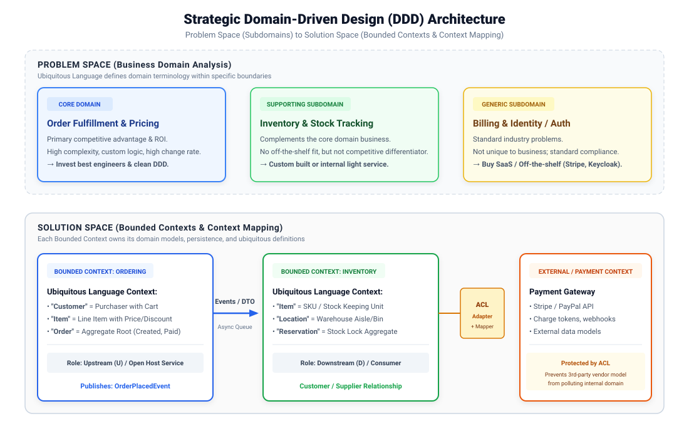
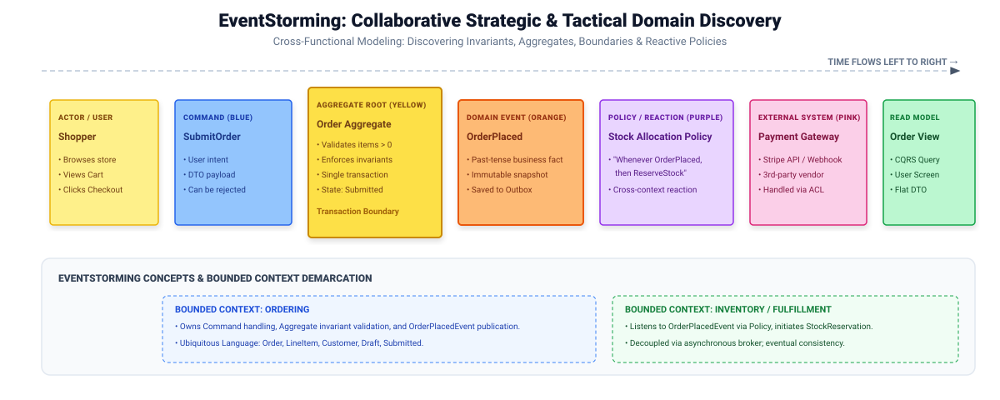
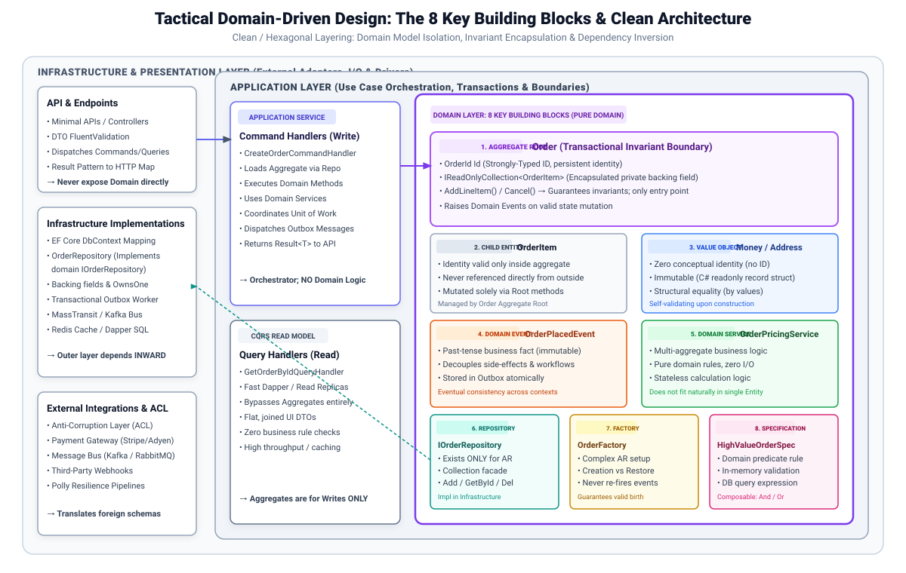
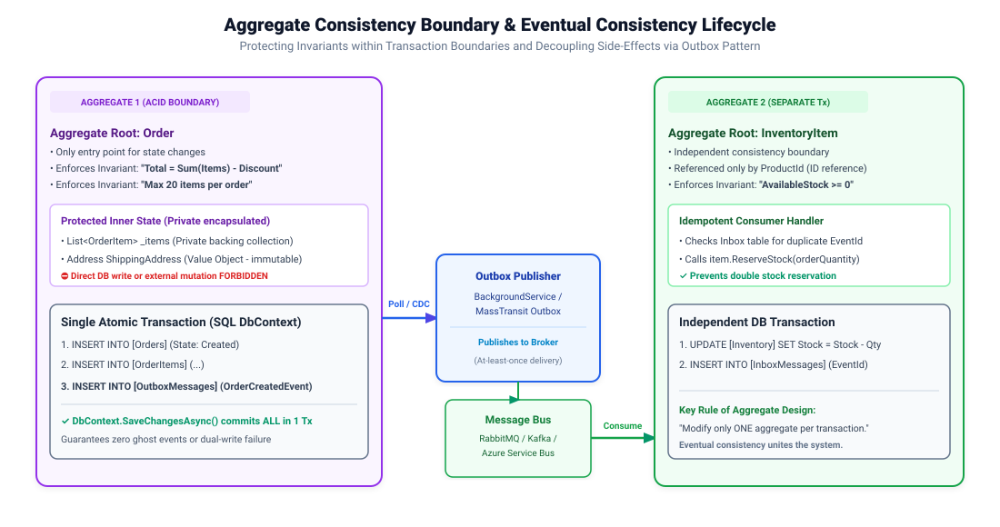

# Domain-Driven Design (DDD): Principles, Architecture & Staff-Level Interview Guide

Domain-Driven Design (DDD), originally coined by Eric Evans in 2003 and popularized by Vaughn Vernon and Martin Fowler, is an approach to software development that centers the design of software on a deeply understood, evolving model of the core business domain.

In modern enterprise architectures—especially distributed systems, modular monoliths, and microservices—DDD provides the strategic clarity and tactical building blocks necessary to manage essential business complexity without degenerating into an unmaintainable "Big Ball of Mud".

---

## 1. Core Philosophy: Problem Space vs. Solution Space

DDD divides software engineering into two fundamental spheres:

| Dimension | Scope | Key Artifacts | Primary Goal |
| :--- | :--- | :--- | :--- |
| **Problem Space** | Business Domain Analysis | Subdomains (Core, Supporting, Generic), Business Capabilities | Understand *what* business problem must be solved and where business value lies. |
| **Solution Space** | Software Architecture & Implementation | Bounded Contexts, Ubiquitous Language, Tactical Patterns (Aggregates, Services) | Define *how* software is designed, bounded, and implemented in code. |

### When to Use DDD vs. When NOT to Use DDD

```
                             Complexity Evaluation
                                       │
                ┌──────────────────────┴──────────────────────┐
                ▼                                             ▼
       Low Business Complexity                       High Business Complexity
   (CRUD, Simple Reporting, Admin)             (Complex Invariants, Evolving Rules)
                │                                             │
                ▼                                             ▼
         DO NOT USE DDD                                   USE DDD
   • Transaction Script / Active Record          • Strategic: Bounded Contexts
   • Rapid Prototyping / Simple MVC              • Tactical: Rich Domain Models
   • Cost & overhead outweigh value              • High ROI on Domain Modeling
```

- **When to Use DDD**:
  - High domain complexity with intricate, frequently changing business rules and invariants.
  - Large cross-functional teams requiring clear boundaries to work autonomously without blocking each other.
  - Long-term strategic enterprise projects where the domain model represents the primary competitive advantage.
- **When NOT to Use DDD**:
  - Simple CRUD (Create, Read, Update, Delete) applications or data-entry portals.
  - Technical-first applications (e.g., ETL pipelines, logging infrastructure, utility microservices).
  - Rapid MVPs with strict 2-week validation windows where the domain is still completely undefined.

---

## 2. Architectural Concept: Anemic Domain Model vs. Rich Domain Model

An **Anemic Domain Model** (Martin Fowler's classic anti-pattern) occurs when domain classes contain only properties (getters and setters) with zero behavior, while all business logic is scattered across procedural "Service" classes. A **Rich Domain Model** encapsulates data alongside the business rules and state transitions that operate on that data.

### Benefits of Rich Domain Model
- **Centralized Invariant Enforcement**: Business rules cannot be bypassed because state mutation is only permitted through validated domain methods.
- **High Cohesion & Testability**: Domain logic can be unit-tested thoroughly in isolation with zero database or framework dependencies.
- **Preventing Code Duplication**: Rules like "cannot cancel an order once shipped" reside in exactly one place (`Order.Cancel()`) instead of multiple controllers and services.

### Drawbacks & Trade-offs
- **Learning Curve**: Requires engineers to shift mindset from table-driven database-first thinking to behavior-first object modeling.
- **Object-Relational Mapping (ORM) Complexity**: Requires careful ORM configuration (such as EF Core backing fields and owned entities) to map private encapsulated fields to relational columns.

### Target Technology & NuGet Packages for .NET / C#
- `Ardalis.GuardClauses`: Minimal, expressive guard clauses for defensive argument and invariant validation.
- `FluentValidation`: Validation across application/DTO boundaries before reaching the rich domain model.
- `Microsoft.EntityFrameworkCore`: Native support for backing fields, private constructors, and owned entities.

```csharp
// Production C# 12 / .NET Example: Anemic vs Rich Domain Model
using System;
using System.Collections.Generic;

// ❌ ANTI-PATTERN: Anemic Domain Model (Just a data bag, logic leaks into services)
public class AnemicOrder
{
    public Guid Id { get; set; }
    public decimal TotalAmount { get; set; }
    public string Status { get; set; } = string.Empty;
    public List<AnemicOrderItem> Items { get; set; } = new();
}

public class AnemicOrderItem
{
    public Guid ProductId { get; set; }
    public int Quantity { get; set; }
    public decimal UnitPrice { get; set; }
}

// ---------------------------------------------------------------------------------

// ✅ BEST PRACTICE: Rich Domain Model (Encapsulation, Invariants, and Business Behavior)
public sealed class OrderId(Guid value)
{
    public Guid Value { get; } = value != Guid.Empty ? value : throw new ArgumentException("OrderId cannot be empty.");
}

public enum OrderStatus { Draft, Submitted, Shipped, Cancelled }

public sealed class RichOrder
{
    private readonly List<RichOrderItem> _items = new();

    public OrderId Id { get; private set; }
    public OrderStatus Status { get; private set; }
    public IReadOnlyCollection<RichOrderItem> Items => _items.AsReadOnly();
    public decimal TotalAmount => CalculateTotal();

    // Private constructor for EF Core / ORM deserialization
    private RichOrder() { }

    public RichOrder(OrderId id)
    {
        Id = id ?? throw new ArgumentNullException(nameof(id));
        Status = OrderStatus.Draft;
    }

    // Business Behavior Method with Invariant Validation
    public void AddItem(Guid productId, int quantity, decimal unitPrice)
    {
        if (Status != OrderStatus.Draft)
            throw new InvalidOperationException("Cannot add items to an order that is not in Draft state.");

        if (quantity <= 0)
            throw new ArgumentOutOfRangeException(nameof(quantity), "Quantity must be greater than zero.");

        if (unitPrice < 0)
            throw new ArgumentOutOfRangeException(nameof(unitPrice), "Price cannot be negative.");

        var existingItem = _items.Find(x => x.ProductId == productId);
        if (existingItem != null)
        {
            existingItem.IncreaseQuantity(quantity);
        }
        else
        {
            _items.Add(new RichOrderItem(productId, quantity, unitPrice));
        }
    }

    public void Submit()
    {
        if (Status != OrderStatus.Draft)
            throw new InvalidOperationException("Only draft orders can be submitted.");

        if (_items.Count == 0)
            throw new InvalidOperationException("Cannot submit an empty order.");

        Status = OrderStatus.Submitted;
    }

    private decimal CalculateTotal()
    {
        decimal sum = 0;
        foreach (var item in _items)
            sum += item.LineTotal;
        return sum;
    }
}

public sealed class RichOrderItem
{
    public Guid ProductId { get; private set; }
    public int Quantity { get; private set; }
    public decimal UnitPrice { get; private set; }
    public decimal LineTotal => Quantity * UnitPrice;

    private RichOrderItem() { }

    internal RichOrderItem(Guid productId, int quantity, decimal unitPrice)
    {
        ProductId = productId;
        Quantity = quantity;
        UnitPrice = unitPrice;
    }

    internal void IncreaseQuantity(int quantity)
    {
        Quantity += quantity;
    }
}
```

---

## 3. Strategic Design: Managing Enterprise Scale

Strategic Design deals with business landscape mapping, team boundary demarcation, and communication contracts between systems.



### 3.1 Ubiquitous Language (UL)
The **Ubiquitous Language** is a single, unambiguous vocabulary rigorously shared between domain experts (business analysts, product managers) and software developers.
- It is bound strictly to a single **Bounded Context**.
- Code reflects the UL directly: class names, method names, and domain events use business terminology (e.g., `policy.Lapse()` instead of `policy.Status = 2`).
- If domain experts do not use technical words like "DTO", "Record", or "Foreign Key", those words do not belong in the domain model.

### 3.2 Domains & Subdomains
Every enterprise business domain consists of three distinct categories of subdomains:

1. **Core Domain**:
   - The primary business differentiator and competitive advantage that makes the company profitable.
   - Example: Amazon's Recommendation Engine; Uber's Dynamic Pricing & Dispatching.
   - Strategy: Build in-house using the best engineering talent and full DDD rigor.
2. **Supporting Subdomain**:
   - Necessary activities to support the Core Domain, but not the primary competitive advantage.
   - Example: Inventory tracking, custom picking slips in an e-commerce warehouse.
   - Strategy: Custom built internally or outsourced, with moderate engineering investment.
3. **Generic Subdomain**:
   - Standard business requirements common to all enterprises with zero competitive differentiation.
   - Example: Authentication/Identity, Billing & Payment Processing, Email Notification Delivery.
   - Strategy: Buy off-the-shelf SaaS or OSS libraries (e.g., Stripe, SendGrid, Keycloak).

### 3.3 Bounded Contexts
A **Bounded Context** is the explicit boundary within which a particular domain model applies. Inside the boundary, all terms in the Ubiquitous Language have exactly one meaning.

> **Example**: The word `Account`
> - In **Sales Context**: An Account represents a prospective lead with contact info and sales pipeline stage.
> - In **Billing Context**: An Account represents an invoicing entity with tax registration and payment credit cards.
> - In **Identity Context**: An Account represents a login credential with salted password hashes and 2FA secrets.
>
> Attempting to merge these into a single "Unified Customer Account" class creates a monstrous God Object with hundreds of null columns. DDD solves this by isolating them into distinct Bounded Contexts.

### 3.4 Context Mapping Relationships
When multiple Bounded Contexts communicate, their relationships must be explicitly categorized:

| Relationship | Description | Autonomy Impact |
| :--- | :--- | :--- |
| **Shared Kernel** | Two teams share a subset of the domain model and database tables. | High coupling; modifications require mutual agreement. |
| **Customer / Supplier** | Upstream (Supplier) must deliver features needed by Downstream (Customer). | Downstream depends on Upstream delivery schedules. |
| **Conformist** | Downstream accepts the Upstream model as-is without translation. | Downstream is at the mercy of Upstream changes. |
| **Partner** | Two contexts have mutual dependency; teams cooperate closely on releases. | High coordination required. |
| **Separate Ways** | Two contexts find no significant value in integrating, so they solve the problem independently. | Absolute zero coupling. |
| **Open Host Service (OHS) / Published Language (PL)** | Upstream provides a stable, documented public API (e.g., REST/gRPC) using standard schemas (JSON/Protobuf). | High decoupling; Upstream manages versioning. |
| **Anti-Corruption Layer (ACL)** | A translating layer that protects Downstream from foreign/legacy models. | Maximizes Downstream isolation and autonomy. |

### 3.5 Strategic Domain Discovery: EventStorming & Domain Storytelling

Domain discovery is the collaborative process through which domain experts and engineers explore the problem space to identify subdomains, bounded contexts, and aggregates.



#### EventStorming Sticky-Note Taxonomy (Alberto Brandolini)
EventStorming uses color-coded sticky notes placed on a horizontal modeling surface where **time flows strictly from left to right**:

| Artifact | Color | Semantic Meaning | Real-World Example |
| :--- | :--- | :--- | :--- |
| **Domain Event** | 🟧 Orange | A significant business fact that occurred in the past (past tense verb). | `OrderPlaced`, `PaymentReceived`, `PackageDispatched` |
| **Command** | 🟦 Blue | An intent or action triggered by a user or system (imperative verb). | `SubmitOrder`, `CancelSubscription`, `AuthorizeCard` |
| **Aggregate Root** | 🟨 Yellow | The business entity / invariant boundary handling commands and emitting events. | `Order`, `CustomerProfile`, `Shipment` |
| **Policy / Reaction** | 🟪 Purple / Lilac | Business rule: *"Whenever [Event], then [Command]"*. | *"Whenever OrderPlaced, then ReserveInventory"* |
| **Read Model** | 🟩 Green | View / projection data needed by an actor to make a business decision. | `OrderSummaryScreen`, `AvailableInventoryDashboard` |
| **User / Actor** | 🟨 Small Yellow | The human persona or role invoking a command. | `Customer`, `WarehouseClerk`, `FraudAnalyst` |
| **External System** | 🌸 Pink | Third-party service, vendor API, or legacy database boundary. | `Stripe Gateway`, `SAP ERP`, `SendGrid Email API` |

#### The Three Levels of EventStorming:
1. **Big Picture EventStorming**: Explores the entire enterprise value chain across all departments. Discovers subdomains, major bottlenecks, and natural boundaries.
2. **Process Modeling EventStorming**: Zooms in on a single end-to-end workflow (e.g., Checkout to Fulfillment). Uncovers policies, read models, and happy/failure paths.
3. **Software Design EventStorming**: Identifies Aggregate boundaries, transactional consistency requirements, and Bounded Context demarcation.

---

## 4. Architectural Concept: Anti-Corruption Layer (ACL)

An **Anti-Corruption Layer (ACL)** is a mediator pattern that translates between two different domain models. It prevents an external or legacy system's foreign terminology, poor design, or leaky abstractions from polluting your clean domain model.

### Benefits of Anti-Corruption Layer
- **Domain Purity**: Protects your core domain model from external breaking schema changes and legacy technical debt.
- **Decoupled Evolution**: The external system can be upgraded, rewritten, or swapped (e.g., replacing Stripe with Adyen) without touching internal domain logic.
- **Contract Enforcement**: Enforces your own Ubiquitous Language internally while translating to/from the external contract.

### Drawbacks & Trade-offs
- **Translation Overhead**: Additional boilerplate classes (Adapters, Mappers, Translators) and minimal memory/CPU translation latency.
- **Data Model Duplication**: Requires maintaining internal domain representations alongside external DTOs.

### Target Technology & NuGet Packages for .NET / C#
- `Mapster` / `AutoMapper`: High-performance object mapping between external DTOs and internal domain models.
- `Microsoft.Extensions.Http.Resilience` / `Polly`: Robust resilience (Retry, Circuit Breaker) wrapping external calls.
- `Refit`: Type-safe REST client library for external upstream integrations.

```csharp
// Production C# 12 / .NET Example: Anti-Corruption Layer (ACL)
using System;
using System.Threading;
using System.Threading.Tasks;

// 1. External 3rd-Party Legacy / Vendor API Payload (Ugly, snake_case, foreign concepts)
public sealed record ExternalLegacyPaymentResponse(
    string tx_id,
    long amt_in_cents,
    string curr,
    string stat_code, // "00" = OK, "05" = Declined, "99" = Error
    string err_msg
);

// 2. Internal Clean Domain Model (Ubiquitous Language)
public readonly record struct TransactionReference(string Value);
public enum PaymentExecutionStatus { Succeeded, Failed, Declined }

public sealed record DomainPaymentResult(
    TransactionReference Reference,
    decimal Amount,
    string Currency,
    PaymentExecutionStatus Status,
    string Reason
);

// 3. ACL Interface (Defined inside Domain / Application layer)
public interface IPaymentGatewayAcl
{
    Task<DomainPaymentResult> ProcessChargeAsync(decimal amount, string currency, CancellationToken ct = default);
}

// 4. ACL Implementation (Infrastructure Layer - Isolates external filth)
public sealed class LegacyPaymentGatewayAcl : IPaymentGatewayAcl
{
    private readonly HttpClient _httpClient;

    public LegacyPaymentGatewayAcl(HttpClient httpClient)
    {
        _httpClient = httpClient;
    }

    public async Task<DomainPaymentResult> ProcessChargeAsync(decimal amount, string currency, CancellationToken ct = default)
    {
        // Translate internal request to external vendor contract
        var vendorPayload = new
        {
            amt_in_cents = (long)(amount * 100),
            curr = currency.ToUpperInvariant()
        };

        // Simulated HTTP call to legacy provider
        // In production: await _httpClient.PostAsJsonAsync("/api/v1/charge", vendorPayload, ct);
        var externalResponse = new ExternalLegacyPaymentResponse(
            tx_id: "TXN_LEGACY_98471204",
            amt_in_cents: (long)(amount * 100),
            curr: currency,
            stat_code: "00",
            err_msg: string.Empty
        );

        // TRANSLATION & CORRUPTION DEFENSE:
        // Convert external vendor representation into internal Ubiquitous Language
        var internalStatus = externalResponse.stat_code switch
        {
            "00" => PaymentExecutionStatus.Succeeded,
            "05" => PaymentExecutionStatus.Declined,
            _ => PaymentExecutionStatus.Failed
        };

        return new DomainPaymentResult(
            Reference: new TransactionReference(externalResponse.tx_id),
            Amount: externalResponse.amt_in_cents / 100m,
            Currency: externalResponse.curr,
            Status: internalStatus,
            Reason: externalResponse.err_msg
        );
    }
}
```

---

## 5. Tactical Design: The Key Building Blocks & Clean Architecture

Tactical DDD provides the code-level building blocks to structure domain models inside clean, layer-isolated architectures.



### 5.1 Value Objects & Strongly-Typed IDs

A **Value Object** is an immutable object defined entirely by its structural attributes rather than an explicit conceptual identity. Two value objects with identical properties are considered completely equal.

#### Architectural Standard: Value Objects
- **Benefits**:
  - Eliminates **Primitive Obsession** (e.g., passing a `Guid customerId` where a `Guid orderId` was expected).
  - Guarantees self-validation and immutability at instantiation.
  - Side-effect-free methods: operations on value objects always return a brand new instance.
- **Drawbacks & Trade-offs**:
  - Requires ORM configuration (`OwnsOne` / `ComplexType` in EF Core) to map to database columns.
  - Slight memory allocation overhead when creating new instances on every modification.
- **Target Technology & NuGet Packages for .NET / C#**:
  - C# `record` and `record struct`: Native value-based equality, `with` expressions, and immutability.
  - `Vogen` / `StronglyTypedId`: Source generators creating zero-overhead strongly-typed IDs with JSON/EF Core serializers.

---

### 5.2 Entities, Aggregates & Aggregate Roots

An **Entity** has a persistent identity that endures across time and different states.

An **Aggregate** is a cluster of associated Entities and Value Objects treated as a single conceptual unit for data changes. The **Aggregate Root (AR)** is the primary gateway entity that guards the aggregate boundary:

#### Vaughn Vernon's 4 Fundamental Rules of Aggregate Design:
1. **Model True Invariants in Consistent Boundaries**: An invariant is a business rule that must remain true at all times within the aggregate transaction boundary.
2. **Design Small Aggregates**: Do not model giant aggregates with hundreds of children; small aggregates minimize database concurrency conflicts and maximize throughput.
3. **Reference Other Aggregates by Identity Only**: Never hold direct object references to other Aggregate Roots (e.g., `Order` holds `CustomerId`, NOT `Customer Customer`).
4. **Update Other Aggregates Using Eventual Consistency**: A single database transaction should modify **only ONE Aggregate instance**. Other aggregates are updated asynchronously via Domain Events.

#### Architectural Standard: Aggregate Root
- **Benefits**:
  - Guarantees total consistency of internal state without exposing child collections to external tampering.
  - Prevents race conditions and transactional deadlocks by strictly bounding the transaction scope.
- **Drawbacks & Trade-offs**:
  - Cannot use cascading ORM saves across multiple aggregate roots in a single SQL transaction.
  - Requires eventual consistency mechanisms (Outbox pattern, message brokers) for cross-aggregate workflows.
- **Target Technology & NuGet Packages for .NET / C#**:
  - `Microsoft.EntityFrameworkCore`: Utilizing `NavigationBuilder.UsePropertyAccessMode(PropertyAccessMode.Field)` to map directly to private backing fields.
  - `Ardalis.GuardClauses`: Guard clauses for invariant protection.

```csharp
// Production C# 12 / .NET Example: Value Objects, Strongly-Typed IDs & Aggregate Root
using System;
using System.Collections.Generic;

// 1. Strongly-Typed ID using C# record struct
public readonly record struct CustomerId(Guid Value)
{
    public static CustomerId New() => new(Guid.NewGuid());
    public static CustomerId Empty => new(Guid.Empty);
}

// 2. Value Object: Money (Immutable, Self-Validating, Currency math)
public sealed record Money
{
    public decimal Amount { get; }
    public string Currency { get; }

    public Money(decimal amount, string currency)
    {
        if (amount < 0)
            throw new ArgumentOutOfRangeException(nameof(amount), "Money amount cannot be negative.");
        if (string.IsNullOrWhiteSpace(currency) || currency.Length != 3)
            throw new ArgumentException("Currency must be a valid 3-letter ISO code.", nameof(currency));

        Amount = amount;
        Currency = currency.ToUpperInvariant();
    }

    public static Money Zero(string currency = "USD") => new(0m, currency);

    public Money Add(Money other)
    {
        if (Currency != other.Currency)
            throw new InvalidOperationException($"Cannot add currency {other.Currency} to {Currency}.");
        return new Money(Amount + other.Amount, Currency);
    }
}

// 3. Domain Event Interface
public interface IDomainEvent
{
    DateTime OccurredOnUtc { get; }
}

public sealed record OrderPlacedDomainEvent(Guid OrderId, CustomerId CustomerId, Money Total) : IDomainEvent
{
    public DateTime OccurredOnUtc { get; } = DateTime.UtcNow;
}

// 4. Aggregate Root Base Class (Tracks Domain Events)
public abstract class AggregateRoot<TId>
{
    public TId Id { get; protected set; } = default!;
    private readonly List<IDomainEvent> _domainEvents = new();
    public IReadOnlyCollection<IDomainEvent> DomainEvents => _domainEvents.AsReadOnly();

    protected void RaiseDomainEvent(IDomainEvent domainEvent) => _domainEvents.Add(domainEvent);
    public void ClearDomainEvents() => _domainEvents.Clear();
}

// 5. Aggregate Root: Order
public sealed class Order : AggregateRoot<Guid>
{
    private readonly List<OrderItem> _items = new();

    public CustomerId CustomerId { get; private set; }
    public Money TotalAmount { get; private set; }
    public IReadOnlyCollection<OrderItem> Items => _items.AsReadOnly();
    public bool IsCancelled { get; private set; }

    // EF Core Private constructor
    private Order() { }

    public Order(Guid id, CustomerId customerId, string currency)
    {
        Id = id;
        CustomerId = customerId;
        TotalAmount = Money.Zero(currency);
        IsCancelled = false;
    }

    // Invariant-enforcing mutation method
    public void AddOrderItem(Guid productId, int quantity, Money unitPrice)
    {
        if (IsCancelled)
            throw new InvalidOperationException("Cannot add items to a cancelled order.");

        if (_items.Count >= 50)
            throw new InvalidOperationException("Order cannot contain more than 50 distinct items.");

        _items.Add(new OrderItem(Guid.NewGuid(), productId, quantity, unitPrice));
        TotalAmount = TotalAmount.Add(new Money(unitPrice.Amount * quantity, unitPrice.Currency));

        // Raise Domain Event to notify other systems
        RaiseDomainEvent(new OrderPlacedDomainEvent(Id, CustomerId, TotalAmount));
    }

    public void Cancel()
    {
        if (IsCancelled) return;
        IsCancelled = true;
    }
}

// Child Entity inside Aggregate Boundary (Never accessed directly from outside)
public sealed class OrderItem
{
    public Guid Id { get; private set; }
    public Guid ProductId { get; private set; }
    public int Quantity { get; private set; }
    public Money Price { get; private set; }

    private OrderItem() { }

    internal OrderItem(Guid id, Guid productId, int quantity, Money price)
    {
        Id = id;
        ProductId = productId;
        Quantity = quantity;
        Price = price;
    }
}
```

---

### 5.3 Repositories in DDD: Aggregates-Only & Collection Semantics

In Domain-Driven Design, a **Repository** provides a collection-oriented abstraction over database persistence. It mimics an in-memory collection (`Add`, `GetById`, `Remove`) so that the domain and application layers remain entirely agnostic of SQL, ORM, or document storage mechanisms.

#### The Cardinal Rule of DDD Repositories:
> [!IMPORTANT]
> **Repositories exist ONLY for Aggregate Roots.**
> There is an `IOrderRepository`, but there is **NEVER** an `IOrderItemRepository`! Child entities and value objects are saved, loaded, and deleted exclusively through their owning Aggregate Root. Violating this rule bypasses aggregate invariants and breaks transactional integrity.

#### Architectural Standard: DDD Repositories
- **Benefits**:
  - **Decoupled Persistence**: Domain layer defines the interface (`IOrderRepository`); Infrastructure layer implements it with EF Core or Dapper.
  - **Invariant Protection**: Because external code cannot load or save child entities directly, aggregate consistency boundaries remain completely sealed.
  - **Testability**: Facilitates easy in-memory mocking for unit and integration testing without database instances.
- **Drawbacks & Trade-offs**:
  - **Query Sub-optimality**: Loading entire aggregates for simple read-only queries causes unnecessary memory allocation and database I/O (solved by CQRS read projections).
  - **Risk of Leaky Abstractions**: Exposing `IQueryable<T>` from a repository leaks ORM-specific query expressions into the domain/application layer. Repositories should return materialized entities or domain specifications.
- **Target Technology & NuGet Packages for .NET / C#**:
  - `Ardalis.Specification` / `Ardalis.Specification.EntityFrameworkCore`: Reusable domain query definitions.
  - `Microsoft.EntityFrameworkCore`: Standard LINQ-based ORM repository implementation.

```csharp
// Production C# 12 / .NET Example: DDD Repository Pattern
using System;
using System.Threading;
using System.Threading.Tasks;
using Microsoft.EntityFrameworkCore;

// 1. Generic Repository Contract for Aggregate Roots ONLY
public interface IRepository<T, TId> where T : AggregateRoot<TId>
{
    Task<T?> GetByIdAsync(TId id, CancellationToken ct = default);
    Task AddAsync(T aggregate, CancellationToken ct = default);
    Task UpdateAsync(T aggregate, CancellationToken ct = default);
    Task DeleteAsync(T aggregate, CancellationToken ct = default);
}

// 2. Aggregate-Specific Repository Contract (Domain Layer)
public interface IOrderRepository : IRepository<Order, Guid>
{
    Task<Order?> GetWithItemsByIdAsync(Guid id, CancellationToken ct = default);
}

// 3. Infrastructure Implementation (EF Core)
public sealed class OrderRepository : IOrderRepository
{
    private readonly DbContext _context;
    private readonly DbSet<Order> _orders;

    public OrderRepository(DbContext context)
    {
        _context = context;
        _orders = context.Set<Order>();
    }

    public async Task<Order?> GetByIdAsync(Guid id, CancellationToken ct = default)
    {
        return await _orders.FirstOrDefaultAsync(o => o.Id == id, ct);
    }

    public async Task<Order?> GetWithItemsByIdAsync(Guid id, CancellationToken ct = default)
    {
        // Eager load child entities within aggregate boundary
        return await _orders
            .Include(o => o.Items)
            .FirstOrDefaultAsync(o => o.Id == id, ct);
    }

    public async Task AddAsync(Order aggregate, CancellationToken ct = default)
    {
        await _orders.AddAsync(aggregate, ct);
    }

    public Task UpdateAsync(Order aggregate, CancellationToken ct = default)
    {
        _orders.Update(aggregate);
        return Task.CompletedTask;
    }

    public Task DeleteAsync(Order aggregate, CancellationToken ct = default)
    {
        _orders.Remove(aggregate);
        return Task.CompletedTask;
    }
}
```

---

### 5.4 Factories: Initial Creation vs. Reconstitution

In DDD, a **Factory** encapsulates the complex instantiation and assembly of Aggregates and Entities. When aggregate creation involves complex invariant checks, calculations, or multi-object assembly, delegating creation to a Factory prevents constructor bloat and guards invariant boundaries.

#### Initial Creation vs. Reconstitution (The Critical Difference):
- **Initial Creation**:
  - The aggregate is being born for the very first time.
  - Must validate all initial business constraints and rules.
  - Sets default timestamps, generated IDs, and initial statuses.
  - **Raises initial Domain Events** (e.g., `OrderPlacedDomainEvent`).
- **Reconstitution**:
  - The aggregate is being reloaded from database storage or replayed from an event stream.
  - It already existed in the past!
  - **MUST NOT re-fire historical Domain Events** (re-firing would trigger duplicate emails, duplicate charges, or phantom outbox messages).
  - **MUST NOT execute initial creation rules** (e.g., "product must be currently in stock" might fail for an order placed 3 years ago).

#### Architectural Standard: DDD Factories
- **Benefits**:
  - **Guaranteed Valid Genesis**: Prevents aggregates from ever existing in an uninitialized or invalid state.
  - **Separation of Concerns**: Keeps constructor logic simple and delegates cross-entity lookup or ID generation to the factory.
- **Drawbacks & Trade-offs**:
  - Added architectural indirection for simple entities where standard constructors or factory methods are sufficient.
- **Target Technology & NuGet Packages for .NET / C#**:
  - C# Static Factory Methods (`Order.Create(...)`) for simple aggregates.
  - Dedicated Factory Classes registered via `Microsoft.Extensions.DependencyInjection` when dependencies (like clock or ID generators) are required.

```csharp
// Production C# 12 / .NET Example: Factory Method & Reconstitution Separation
using System;
using System.Collections.Generic;

public sealed class CustomerOrderFactory
{
    private readonly TimeProvider _timeProvider;

    public CustomerOrderFactory(TimeProvider timeProvider)
    {
        _timeProvider = timeProvider;
    }

    // 1. INITIAL CREATION: Validates invariants, creates new ID, raises Domain Event
    public Order CreateNewOrder(CustomerId customerId, string currency, List<(Guid ProductId, int Qty, Money Price)> initialItems)
    {
        if (initialItems == null || initialItems.Count == 0)
            throw new InvalidOperationException("Cannot create an order without at least one item.");

        var orderId = Guid.NewGuid();
        var order = new Order(orderId, customerId, currency);

        foreach (var item in initialItems)
        {
            order.AddOrderItem(item.ProductId, item.Qty, item.Price);
        }

        return order;
    }

    // 2. RECONSTITUTION: Restores persisted state from DB WITHOUT raising new domain events
    public static Order Reconstitute(
        Guid id, 
        CustomerId customerId, 
        Money totalAmount, 
        bool isCancelled)
    {
        // Rebuilds instance without invoking business rules or raising OrderPlaced events
        var order = new Order(id, customerId, totalAmount.Currency);
        // Uses reflection or internal setters for ORM hydration
        return order;
    }
}
```

---

### 5.5 Specification Pattern: Encapsulating Domain Predicates

The **Specification Pattern** encapsulates business rules, selection criteria, and domain boolean predicates into reusable, composable, first-class domain objects.

#### The Triple Utility of DDD Specifications:
1. **In-Memory Validation**: Checking if an individual domain entity satisfies a business rule (`spec.IsSatisfiedBy(order)`).
2. **In-Memory Filtering**: Filtering an in-memory collection of entities (`orders.Where(spec.ToFunc())`).
3. **Database Query Specification**: Generating a LINQ expression tree (`spec.ToExpression()`) translated into optimized SQL by EF Core.

#### Architectural Standard: Specification Pattern
- **Benefits**:
  - **DRY Business Logic**: Business query rules (e.g., "what constitutes a high-value customer?") are defined in one place instead of scattered across LINQ expressions in multiple queries.
  - **Composability**: Specifications can be chained seamlessly using `.And()`, `.Or()`, and `.Not()` combinators.
- **Drawbacks & Trade-offs**:
  - Can introduce complexity if overused for trivial queries that have zero domain rule significance.
- **Target Technology & NuGet Packages for .NET / C#**:
  - `Ardalis.Specification`: The industry-standard specification library for .NET with EF Core integration, supporting caching, sorting, and includes.

```csharp
// Production C# 12 / .NET Example: Specification Pattern
using System;
using System.Linq.Expressions;

// 1. Specification Base Interface
public interface ISpecification<T>
{
    bool IsSatisfiedBy(T entity);
    Expression<Func<T, bool>> ToExpression();
}

public abstract class CompositeSpecification<T> : ISpecification<T>
{
    public abstract Expression<Func<T, bool>> ToExpression();

    public bool IsSatisfiedBy(T entity)
    {
        var predicate = ToExpression().Compile();
        return predicate(entity);
    }

    public ISpecification<T> And(ISpecification<T> other) => new AndSpecification<T>(this, other);
}

// 2. High-Value Order Specification (Domain Rule: Orders > $1,000 that are not cancelled)
public sealed class HighValueOrderSpecification : CompositeSpecification<Order>
{
    private readonly decimal _threshold;

    public HighValueOrderSpecification(decimal threshold = 1000m)
    {
        _threshold = threshold;
    }

    public override Expression<Func<Order, bool>> ToExpression()
    {
        return order => !order.IsCancelled && order.TotalAmount.Amount >= _threshold;
    }
}

// 3. Composite AND Specification
public sealed class AndSpecification<T> : CompositeSpecification<T>
{
    private readonly ISpecification<T> _left;
    private readonly ISpecification<T> _right;

    public AndSpecification(ISpecification<T> left, ISpecification<T> right)
    {
        _left = left;
        _right = right;
    }

    public override Expression<Func<T, bool>> ToExpression()
    {
        var leftExpr = _left.ToExpression();
        var rightExpr = _right.ToExpression();

        var parameter = Expression.Parameter(typeof(T));
        var combined = Expression.AndAlso(
            Expression.Invoke(leftExpr, parameter),
            Expression.Invoke(rightExpr, parameter)
        );

        return Expression.Lambda<Func<T, bool>>(combined, parameter);
    }
}
```

---

## 6. Architectural Concept: Domain Events & Transactional Outbox Pattern

A **Domain Event** records a significant business occurrence that happened in the past within the domain. It is immutable and named in the past tense (e.g., `OrderPlacedEvent`, `PaymentFailedEvent`).



### In-Process Domain Events vs. Integration Events
- **Domain Events**: Internal to the Bounded Context. Handled synchronously or in-process via MediatR within the same application boundary.
- **Integration Events**: Published across network boundaries via message brokers (RabbitMQ, Kafka, Azure Service Bus) to inform other Bounded Contexts.

### The Dual-Write Problem & Transactional Outbox
When saving an aggregate to SQL and publishing an event to a message broker, a crash between the two creates inconsistency (Dual-Write failure). The **Transactional Outbox Pattern** solves this by saving the event to an `OutboxMessages` table **in the same local database transaction** as the aggregate state change.

#### Architectural Standard: Transactional Outbox Pattern
- **Benefits**:
  - **Guaranteed At-Least-Once Delivery**: No events are ever lost if the broker is down during aggregate commit.
  - **Zero 2-Phase Commit (2PC) Overhead**: Uses the database's native ACID transaction.
- **Drawbacks & Trade-offs**:
  - **Duplicate Messages**: Consumers must implement **Idempotency** (e.g., Inbox pattern or tracking processed message IDs).
  - **Eventual Consistency Lag**: Short delay between local commit and broker dispatching.
- **Target Technology & NuGet Packages for .NET / C#**:
  - `MassTransit` / `MassTransit.EntityFrameworkCoreIntegration`: Built-in, battle-tested Transactional Outbox and Inbox implementations.
  - `MediatR`: For in-process domain event dispatching.
  - `Quartz.NET` / `BackgroundService`: For polling or CDC (Change Data Capture) outbox relays.

```csharp
// Production C# 12 / .NET Example: EF Core Interceptor for Outbox Pattern & Domain Events
using System;
using System.Collections.Generic;
using System.Text.Json;
using System.Threading;
using System.Threading.Tasks;
using Microsoft.EntityFrameworkCore;
using Microsoft.EntityFrameworkCore.Diagnostics;

// 1. Outbox Table Entity
public sealed class OutboxMessage
{
    public Guid Id { get; set; } = Guid.NewGuid();
    public string Type { get; set; } = string.Empty;
    public string Content { get; set; } = string.Empty;
    public DateTime OccurredOnUtc { get; set; }
    public DateTime? ProcessedOnUtc { get; set; }
    public string? Error { get; set; }
}

// 2. EF Core SaveChanges Interceptor: Automates Outbox Population
public sealed class ConvertDomainEventsToOutboxMessagesInterceptor : SaveChangesInterceptor
{
    public override ValueTask<InterceptionResult<int>> SavingChangesAsync(
        DbContextEventData eventData,
        InterceptionResult<int> result,
        CancellationToken cancellationToken = default)
    {
        var dbContext = eventData.Context;
        if (dbContext == null)
            return base.SavingChangesAsync(eventData, result, cancellationToken);

        // Collect all aggregates raising domain events
        var domainEvents = new List<IDomainEvent>();

        foreach (var entry in dbContext.ChangeTracker.Entries<AggregateRoot<Guid>>())
        {
            if (entry.Entity.DomainEvents.Count > 0)
            {
                domainEvents.AddRange(entry.Entity.DomainEvents);
                entry.Entity.ClearDomainEvents();
            }
        }

        // Convert each domain event to an OutboxMessage row within the same transaction
        foreach (var domainEvent in domainEvents)
        {
            var outboxMessage = new OutboxMessage
            {
                Type = domainEvent.GetType().Name,
                Content = JsonSerializer.Serialize(domainEvent, domainEvent.GetType()),
                OccurredOnUtc = domainEvent.OccurredOnUtc
            };

            dbContext.Set<OutboxMessage>().Add(outboxMessage);
        }

        return base.SavingChangesAsync(eventData, result, cancellationToken);
    }
}
```

---

## 7. Architectural Concept: Domain Services vs. Application Services

A frequent point of confusion in DDD is distinguishing between **Domain Services**, **Application Services**, and **Infrastructure Services**.

| Attribute | Domain Service | Application Service | Infrastructure Service |
| :--- | :--- | :--- | :--- |
| **Layer** | Domain Layer (Core) | Application Layer | Infrastructure Layer |
| **Purpose** | Business logic spanning multiple aggregates. | Orchestrates use cases and transactions. | Deals with I/O, networks, files, and DBs. |
| **Dependencies** | Pure domain objects (Zero external dependencies). | Repositories, Domain Services, Event Bus. | Third-party SDKs, EF Core, SMTP, AWS/Azure. |
| **State** | Stateless. | Stateless. | Manages network connections/handles. |
| **Example** | `CurrencyExchangeDomainService`, `OrderPricingService` | `CreateOrderCommandHandler`, `RegisterUserUseCase` | `SmtpEmailSender`, `BlobStorageService` |

### When to Create a Domain Service
Create a Domain Service when a business operation:
1. Involves significant business logic or calculation.
2. Involves multiple aggregates that cannot be naturally placed into a single Aggregate Root without violating responsibility or creating unwanted coupling.
3. Does not belong in an Application Service (which should only orchestrate and contain ZERO business rules).

#### Target Technology & NuGet Packages for .NET / C#
- `MediatR`: Application Service Command & Query handlers (`IRequestHandler<TCommand, TResult>`).
- Dependency Injection (`Microsoft.Extensions.DependencyInjection`): Registering domain services as scoped or transient services.

```csharp
// Production C# 12 / .NET Example: Domain Service vs. Application Service
using System;
using System.Threading;
using System.Threading.Tasks;

// 1. DOMAIN SERVICE (Pure business logic spanning multiple aggregates)
public interface ICurrencyExchangeRateProvider
{
    decimal GetRate(string fromCurrency, string toCurrency);
}

public sealed class OrderPricingDomainService
{
    private readonly ICurrencyExchangeRateProvider _rateProvider;

    public OrderPricingDomainService(ICurrencyExchangeRateProvider rateProvider)
    {
        _rateProvider = rateProvider;
    }

    public Money CalculateDiscountedTotal(Order order, decimal customerVipDiscountPercent, string targetCurrency)
    {
        var rawTotal = order.TotalAmount;
        var discountMultiplier = 1m - (customerVipDiscountPercent / 100m);
        var discountedAmount = rawTotal.Amount * discountMultiplier;

        if (rawTotal.Currency == targetCurrency)
            return new Money(discountedAmount, targetCurrency);

        var exchangeRate = _rateProvider.GetRate(rawTotal.Currency, targetCurrency);
        return new Money(discountedAmount * exchangeRate, targetCurrency);
    }
}

// 2. APPLICATION SERVICE (Orchestration, Transaction boundary, NO business rules)
public sealed record CreateOrderCommand(Guid CustomerId, string Currency) : MediatR.IRequest<Guid>;

public sealed class CreateOrderCommandHandler : MediatR.IRequestHandler<CreateOrderCommand, Guid>
{
    private readonly IOrderRepository _orderRepository;
    private readonly IUnitOfWork _unitOfWork;

    public CreateOrderCommandHandler(IOrderRepository orderRepository, IUnitOfWork unitOfWork)
    {
        _orderRepository = orderRepository;
        _unitOfWork = unitOfWork;
    }

    public async Task<Guid> Handle(CreateOrderCommand request, CancellationToken cancellationToken)
    {
        // 1. Initialize Aggregate Root
        var order = new Order(Guid.NewGuid(), new CustomerId(request.CustomerId), request.Currency);

        // 2. Persist via repository interface
        await _orderRepository.AddAsync(order, cancellationToken);

        // 3. Commit Unit of Work (All events, outbox messages, and aggregate saved atomically)
        await _unitOfWork.CommitAsync(cancellationToken);

        return order.Id;
    }
}

public interface IUnitOfWork
{
    Task CommitAsync(CancellationToken ct);
}
```

---

## 8. Advanced Tactical Patterns: Domain Policies & Result Pattern

### 8.1 Domain Policy / Strategy Pattern

Business domains frequently encounter dynamic, interchangeable rules (e.g., pricing formulas, customer discount tiers, SLA calculations). Hardcoding these into the aggregate creates branching spaghetti code. The **Policy Pattern** encapsulates these algorithms as domain strategies passed into aggregate methods.

#### Architectural Standard: Domain Policy Pattern
- **Benefits**:
  - **Open/Closed Principle (OCP)**: Introduce new business policies without altering Aggregate Root logic.
  - **Dynamic Invariant Calculation**: Allows business analysts to swap rules (e.g., Seasonal Promo Policy vs VIP Policy) seamlessly.
- **Drawbacks & Trade-offs**:
  - Increases method signature complexity when passing policy interfaces into aggregate methods.
- **Target Technology & NuGet Packages for .NET / C#**:
  - Standard C# strategy interfaces registered with DI.

```csharp
// Production C# 12 / .NET Example: Domain Policy Pattern
using System;

public interface IDiscountPolicy
{
    Money ApplyDiscount(Money originalPrice);
}

public sealed class VipCustomerDiscountPolicy : IDiscountPolicy
{
    public Money ApplyDiscount(Money originalPrice) =>
        new(originalPrice.Amount * 0.80m, originalPrice.Currency); // 20% discount
}

public sealed class RegularCustomerDiscountPolicy : IDiscountPolicy
{
    public Money ApplyDiscount(Money originalPrice) => originalPrice; // No discount
}
```

---

### 8.2 Domain Error Handling: Result Pattern vs. Domain Exceptions

In traditional OOP, violations of domain invariants are often handled by throwing CLR exceptions (`throw new InvalidOperationException(...)`). In high-scale DDD systems, throwing exceptions for predictable domain validation failures is considered an architectural anti-pattern:
- **Performance Cost**: CLR exceptions capture full call stacks, causing severe CPU spikes (up to 7,000x slower than returning a value).
- **Hidden Control Flow**: Exceptions act as "invisible gotos", making execution paths difficult to trace.

The **Result Pattern** models domain operations as returning a discriminated union representing either **Success (Value)** or **Failure (DomainError)**.

#### Architectural Standard: Result Pattern
- **Benefits**:
  - **Explicit Method Signatures**: `Result<Order, DomainError>` explicitly warns the caller that the operation can fail.
  - **Railway-Oriented Programming**: Chaining operations via `.Map()` and `.Bind()` without nested `try/catch` blocks.
  - **High Performance**: Zero stack trace overhead for expected business rule rejections.
- **Drawbacks & Trade-offs**:
  - Requires developers to explicitly check results (`result.IsSuccess`) before accessing values.
- **Target Technology & NuGet Packages for .NET / C#**:
  - `ErrorOr`: Lightweight, fluent error-or-value type for .NET.
  - `FluentResults`: Extensible result object with support for errors and metadata.
  - `OneOf`: F#-style discriminated unions for C#.

```csharp
// Production C# 12 / .NET Example: Result Pattern with ErrorOr
using System;
using System.Collections.Generic;
using ErrorOr;

public static class DomainErrors
{
    public static class Order
    {
        public static Error EmptyCart => Error.Validation(
            code: "Order.EmptyCart", 
            description: "Cannot submit an order with zero items.");

        public static Error AlreadyCancelled => Error.Conflict(
            code: "Order.AlreadyCancelled", 
            description: "Cannot mutate an order that has already been cancelled.");
    }
}

public sealed class ResultOrder
{
    private readonly List<RichOrderItem> _items = new();
    public bool IsCancelled { get; private set; }

    public ErrorOr<Success> Cancel()
    {
        if (IsCancelled)
            return DomainErrors.Order.AlreadyCancelled;

        IsCancelled = true;
        return Result.Success;
    }
}
```

---

## 9. Architectural Synergies: CQRS, Event Sourcing & Microservices

### 9.1 DDD + CQRS (Command Query Responsibility Segregation)
In traditional architectures, the same entity model is used for reading and writing data. In complex domains, this creates severe friction:
- **Write Path (Commands)**: Requires fully loaded Aggregate Roots with all child entities to guarantee invariant validation.
- **Read Path (Queries)**: Demands fast, flattened, aggregated DTOs with multiple joins for UI screens.

```
       Write Path (DDD Aggregates)                     Read Path (Fast Projections)
  ┌───────────────────────────────────┐           ┌────────────────────────────────────┐
  │ Command -> Handler -> Aggregate   │           │ Query -> Dapper / Fast SQL View    │
  │ -> Invariants -> EF Core Save     │           │ -> Directly returns UI DTO         │
  └───────────────────────────────────┘           └────────────────────────────────────┘
                    │                                               ▲
                    ▼                                               │
             [Write Database] ─── (CDC / Sync / Projection) ─── [Read Store]
```

By pairing DDD with CQRS:
- **Aggregates are used strictly on the Write side**.
- **Reads bypass Aggregates entirely**, executing fast Dapper SQL queries or hitting read-optimized database projections/Elasticsearch directly.

---

### 9.2 DDD + Event Sourcing
Instead of persisting only the current snapshot of an aggregate to relational columns, **Event Sourcing** persists the complete sequence of domain events that led to that state.
- The Aggregate state is reconstituted by instantiating an empty root and replaying its event stream: `state.Apply(event)`.
- **Snapshots**: For aggregates with thousands of events, snapshots are captured periodically to avoid replaying thousands of records on every load.

---

### 9.3 DDD + Microservices vs. Modular Monolith

A common architectural anti-pattern is assuming **1 Bounded Context = 1 Microservice**.

> [!WARNING]
> Prematurely splitting Bounded Contexts into separate microservices before domain boundaries stabilize leads to the **Distributed Monolith** anti-pattern—inheriting all the complexity of distributed networks (latency, distributed transactions, network partitions) with none of the benefits.

- **Best Practice (Martin Fowler's MonolithFirst)**:
  - Implement Bounded Contexts as distinct, isolated C# projects/assemblies inside a **Modular Monolith**.
  - Enforce boundaries using internal access modifiers and in-process MediatR/C# interfaces.
  - Only carve out a Bounded Context into an independent microservice when differing scaling requirements, separate deployment cycles, or organizational team autonomy demand it.

---

## 10. Comprehensive Staff & Lead Interview Questions & Answers

### Q1: What is Domain-Driven Design and when should you actively avoid using it?
**Answer**:
Domain-Driven Design (DDD) is an architectural philosophy that aligns software design with an evolving model of the business domain. It consists of **Strategic Design** (Ubiquitous Language, Subdomains, Bounded Contexts, Context Mapping) and **Tactical Design** (Entities, Value Objects, Aggregates, Domain Events, Repositories).

**When to avoid DDD**:
1. **Simple CRUD / Data-centric Applications**: When business rules are trivial (e.g., basic admin portals, lookup tables), introducing Aggregates and Value Objects adds massive boilerplate with zero return on investment.
2. **Technical Utilities & Streaming Pipelines**: High-throughput telemetry, raw log ingestion, or ETL pipelines require data streaming frameworks (Kafka Streams, Spark) rather than object-oriented domain invariants.
3. **Early-stage Disposable Prototypes**: When validating a market idea in a 2-week hackathon, the domain is unknown. DDD overhead slows down rapid pivoting. Use Martin Fowler's Transaction Script or Active Record instead.

---

### Q2: What is the fundamental difference between an Entity and a Value Object? Can an Entity in one Bounded Context be a Value Object in another?
**Answer**:
- **Entity**: Defined by an explicit identity (`Id`) that remains constant throughout its lifecycle, even if every other attribute changes. Equality is determined exclusively by its `Id`. Entities are mutable via business methods.
- **Value Object**: Defined entirely by the combination of its attributes. It has no conceptual identity. Two value objects with identical values are interchangeable and structurally equal. Value objects are strictly immutable; modifying an attribute yields a new instance.

**Cross-Context Transformation**:
**Yes**. A concept can be an Entity in one Bounded Context and a Value Object in another:
- In the **Shipping & Logistics Context**, `Address` might be an **Entity** with an `AddressId`, GPS coordinates, delivery history, and status flags indicating whether delivery is blocked.
- In the **Ordering Context**, `Address` is merely a **Value Object** (`Street`, `City`, `PostalCode`) snapshotted onto the Order at checkout time. If the customer later changes their home address, the historical shipping address on that specific past order must remain untouched.

---

### Q3: Explain the Aggregate Root concept and the "Rule of 1 Aggregate per Transaction". What happens if business rules require updating two aggregates simultaneously?
**Answer**:
An **Aggregate** is an invariant consistency boundary. The **Aggregate Root (AR)** is the sole gateway entity through which external callers can interact with the aggregate. External code may hold a reference only to the Aggregate Root, never to child entities.

**Rule of 1 Aggregate per Transaction**:
A single database transaction should modify and commit **exactly ONE Aggregate instance**. This guarantees:
1. Bounded transaction execution time and minimal lock contention.
2. High scalability in distributed storage (aggregates can be partitioned on different database shards).

**When business requires updating two aggregates**:
1. **Embrace Eventual Consistency (Recommended)**: Aggregate A updates its state, raises a Domain Event, and commits. An asynchronous handler consumes the event and updates Aggregate B in a separate transaction. If Aggregate B fails, a compensating action or Saga is triggered.
2. **Evaluate Invariant Boundary (Model Smell)**: If two entities *must* be updated atomically in the same ACID transaction to prevent true business catastrophe, they might actually belong inside the **same Aggregate**. Re-evaluate whether your aggregate boundary is too small.

---

### Q4: Why must Repositories exist ONLY for Aggregate Roots? What happens if you create a repository for a child Entity?
**Answer**:
In DDD, an Aggregate is a cohesive unit of data and business invariants guarded exclusively by the Aggregate Root. 
If a developer creates an `IOrderItemRepository` and executes `orderItemRepo.Update(item)` or `orderItemRepo.Delete(item)`:
1. **Invariant Bypass**: The `Order` Aggregate Root never gets invoked, meaning rules such as `TotalAmount` recalculation or maximum allowed items are completely bypassed.
2. **State Corruption**: The parent aggregate in memory or in cache becomes inconsistent with the database.
3. **Concurrency Violations**: Optimistic concurrency tokens on the Aggregate Root are not incremented, creating subtle race conditions.
Therefore, all mutations to child entities must go through methods on the Aggregate Root, persisted via the Aggregate Root's repository.

---

### Q5: What is the crucial difference between Aggregate Initial Creation and Reconstitution in DDD Factories?
**Answer**:
- **Initial Creation**: Represents the birth of a new business instance. It must run all validation checks, verify initial stock/eligibility, assign fresh IDs, set creation timestamps, and **raise creation Domain Events** (e.g., `OrderPlacedDomainEvent`) so downstream handlers and outbox processors react to the new state.
- **Reconstitution**: Occurs when an existing aggregate is loaded from SQL tables or an event store back into memory. Reconstitution **must NEVER raise creation domain events** (otherwise, every database read would spam customers with order confirmation emails and publish duplicate charges to Stripe). Furthermore, reconstitution must not re-evaluate initial validation constraints that might fail due to business rules having evolved over time.

---

### Q6: What is the Specification Pattern in DDD, and what are its three primary use cases?
**Answer**:
The **Specification Pattern** encapsulates domain selection predicates and business boolean rules into reusable, first-class domain classes instead of scattering LINQ expressions across controllers and services.

Its three primary use cases are:
1. **In-Memory Validation**: Evaluating an individual entity in memory against business criteria (`spec.IsSatisfiedBy(order)`).
2. **In-Memory Filtering**: Filtering an in-memory collection (`orders.Where(spec.ToFunc())`).
3. **Database Querying**: Translating the specification's expression tree (`spec.ToExpression()`) into optimized SQL via EF Core without leaking SQL or ORM syntax into the domain.

Specifications can be combined dynamically using `.And()`, `.Or()`, and `.Not()`.

---

### Q7: Explain the EventStorming methodology. What do the different sticky note colors represent?
**Answer**:
**EventStorming** is a rapid, collaborative modeling method invented by Alberto Brandolini that unites domain experts and developers to discover domains, boundaries, and aggregates. The session is organized chronologically along a timeline from left to right.

Key sticky note colors:
- **Orange**: **Domain Event** (business fact in past tense, e.g., `OrderPlaced`).
- **Blue**: **Command** (user intent or API call, e.g., `SubmitOrder`).
- **Yellow**: **Aggregate Root** (consistency boundary handling the command, e.g., `Order`).
- **Purple / Lilac**: **Policy / Reaction** (*"Whenever [Event], then [Command]"*).
- **Green**: **Read Model** (UI projection screen needed by the actor to make a choice).
- **Small Yellow**: **User / Role** (actor invoking the command).
- **Pink**: **External System** (third-party payment gateway, legacy system, or external API).

---

### Q8: What is an Anemic Domain Model, why is it considered an anti-pattern, and how do you refactor it to a Rich Domain Model in C#?
**Answer**:
An **Anemic Domain Model** contains classes with only public getters and setters (data bags) and zero business behavior. All business validation, calculations, and rules reside in procedural Service classes (`OrderService`).

**Why it is an anti-pattern**:
- **Violates OOP & Encapsulation**: Any developer can mutate any property (`order.Status = Shipped`) from anywhere without validation.
- **Scattered Business Rules**: Logic like order cancellation or discount calculation gets duplicated across multiple services and API controllers.
- **Zero Invariant Guarantee**: The system cannot guarantee that an object in memory is in a valid state.

**How to refactor in C#**:
1. Make all property setters `private` or `internal`.
2. Remove the public parameterless constructor; provide a parameterized constructor or factory method that requires all mandatory invariant data.
3. Replace direct property setters with expressive domain methods that encapsulate rules (e.g., replace `order.Status = Cancelled` with `order.Cancel(string reason)`).
4. Hide child collections behind `IReadOnlyCollection<T>` using private backing fields (`private readonly List<OrderItem> _items;`).

---

### Q9: Why is the Result Pattern preferred over throwing Domain Exceptions for business rule failures in modern .NET DDD?
**Answer**:
Throwing exceptions for expected business invariant violations (e.g., `InsufficientFundsException`, `CartEmptyException`) introduces significant drawbacks:
1. **Severe Performance Overhead**: Constructing and throwing CLR exceptions incurs expensive stack frame inspection and stack unwinding, taking thousands of nanoseconds compared to sub-nanosecond return values.
2. **Hidden Execution Paths**: Exceptions break normal control flow, behaving like arbitrary jumps.
3. **Type Safety & Discoverability**: With the Result pattern (`ErrorOr<Order>` or `Result<Order>`), the method signature explicitly declares all possible outcomes, forcing consumers to handle both success and failure cases gracefully at compile time.

---

### Q10: How do you handle Cross-Aggregate Invariants without distributed 2-Phase Commit (2PC) locks?
**Answer**:
Distributed 2PC (like MSDTC) causes severe latency, locks database rows across networks, and is unavailable in cloud-native microservices. In DDD, cross-aggregate invariants are solved through:

1. **Domain Events + Saga Pattern (Orchestration or Choreography)**:
   - Example: Order Aggregate created in `PendingPayment` status.
   - Raises `OrderPlacedDomainEvent`.
   - Payment Context attempts to charge the card. If successful, raises `PaymentProcessedEvent`, which transitions Order to `Paid`. If declined, transitions Order to `PaymentFailed`.
2. **Reservation / Pre-Allocation Pattern**:
   - For resource contention (e.g., inventory reservation), reserve stock conditionally with a short TTL (time-to-live).
3. **Idempotent Consumers + Inbox Pattern**:
   - Ensure event consumers handle duplicate delivery gracefully by recording processed message IDs in the target database transaction.

---

### Q11: What is an Anti-Corruption Layer (ACL)? Provide a real-world scenario where you implemented one.
**Answer**:
An **Anti-Corruption Layer (ACL)** is a translation and isolation mechanism placed between two Bounded Contexts or between a modern clean domain and a legacy external system. It translates foreign models, data formats, and protocols into your clean internal Ubiquitous Language, preventing external design flaws from leaking in.

**Real-World Scenario**:
- **Context**: Integrating a modern E-commerce checkout platform with a 20-year-old on-premise SAP ERP system.
- **Problem**: SAP returned arcane codes (`VBELN`, `MATNR`, `KUNNR`, `STATUS_FLAG = 'X'`), threw raw COM errors, and required SOAP XML payloads.
- **Solution**: Built an ACL microservice/adapter:
  1. **Facade & Adapter**: Exposed a clean C# interface `IInventoryReservationService`.
  2. **Translator**: Converted clean `ProductId` and `Quantity` into SAP's SOAP schema.
  3. **Resilience**: Wrapped calls in Polly Circuit Breaker and retry policies.
  4. **Domain Mapping**: Mapped cryptic status flags into clean domain results (`ReservationResult.Success`, `ReservationResult.OutOfStock`).
  5. When SAP was eventually replaced by modern Dynamics 365, only the ACL implementation was modified—zero lines of domain code changed.

---

### Q12: How do you publish Domain Events reliably without risking ghost events or dual-write failures?
**Answer**:
The standard solution is the **Transactional Outbox Pattern**:
1. When an Aggregate Root method executes, it records domain events in an internal in-memory list (`_domainEvents.Add(...)`).
2. During `DbContext.SaveChangesAsync()`, an EF Core Interceptor intercepts the transaction.
3. The interceptor serializes all uncommitted domain events into JSON and inserts them into an `OutboxMessages` table **inside the exact same SQL transaction** as the aggregate tables.
4. If the database crashes, both the aggregate change and the event rollback together. If it succeeds, both commit atomically.
5. An asynchronous publisher (MassTransit Outbox Worker, Debezium CDC, or a .NET `BackgroundService`) polls the `OutboxMessages` table and pushes events to RabbitMQ/Kafka.
6. Once published, the message is marked as `ProcessedOnUtc`.

---

### Q13: How do you persist complex DDD Aggregates and Value Objects with Entity Framework Core without breaking encapsulation?
**Answer**:
Modern EF Core (v7/8/9) provides first-class support for DDD patterns:
1. **Private Backing Fields**:
   ```csharp
   builder.Property(x => x.TotalAmount)
          .HasField("_totalAmount")
          .UsePropertyAccessMode(PropertyAccessMode.Field);
   ```
2. **Encapsulated Collections**:
   ```csharp
   builder.HasMany(x => x.Items)
          .WithOne()
          .HasForeignKey("OrderId");
   builder.Metadata.FindNavigation(nameof(Order.Items))!
          .SetPropertyAccessMode(PropertyAccessMode.Field);
   ```
3. **Value Objects via `OwnsOne` / `ComplexProperty`**:
   ```csharp
   builder.ComplexProperty(o => o.ShippingAddress, b => {
       b.Property(a => a.Street).HasColumnName("Street");
       b.Property(a => a.City).HasColumnName("City");
   });
   ```
4. **Strongly-Typed IDs via Value Converters**:
   ```csharp
   builder.Property(o => o.Id)
          .HasConversion(id => id.Value, value => new OrderId(value));
   ```
5. **Private Parameterless Constructors**: EF Core uses reflection to construct entities via private parameterless constructors without requiring public default constructors.

---

### Q14: What is the difference between Domain Services, Application Services, and Infrastructure Services? Give concrete examples.
**Answer**:
- **Domain Service**: Encapsulates pure business rules and domain calculations that span multiple aggregates. It has **zero dependencies on infrastructure, databases, or frameworks**.
  - *Example*: `TaxCalculationDomainService` calculating compound VAT across cross-border tax brackets.
- **Application Service**: Orchestrates the execution of business use cases. It loads aggregates via repositories, coordinates domain services, manages the database transaction/Unit of Work, and returns DTOs. It contains **zero business validation rules**.
  - *Example*: `CheckoutOrderCommandHandler` receiving an HTTP request, loading the `Order` aggregate, invoking `order.Submit()`, and committing the transaction.
- **Infrastructure Service**: Implements technical capabilities dealing with I/O, third-party libraries, networks, and storage.
  - *Example*: `SendGridEmailService`, `AwsS3DocumentStorage`, `RedisCacheService`.

---

### Q15: How do you manage High-Contention Aggregates (e.g., Flash Sale inventory, Ticket reservations) in DDD?
**Answer**:
High-contention aggregates suffer from optimistic concurrency exceptions (`DbUpdateConcurrencyException`) or row-level database locks when thousands of users attempt to mutate the same aggregate root simultaneously.

**Architectural Solutions**:
1. **Aggregate Decomposition / Splitting**:
   - Instead of a single `InventoryItem` aggregate holding a counter of `10,000` items, split the stock into discrete `InventoryBlock` aggregates (e.g., 100 blocks of 100 items each) and route requests randomly across blocks.
2. **Reservation Token Bucket (Inverted Flow)**:
   - Move fast stock decrementing into Redis via atomic Lua scripts (`DECRBY`) during the flash sale.
   - Return a signed `ReservationToken` to the client.
   - The user then submits an order with the token, which is processed asynchronously by the DDD Order Aggregate.
3. **Event Sourcing with Append-Only Streams**:
   - Instead of updating a single row, append immutable `StockReservedEvent` records to an event stream. Read side maintains a projection, eliminating row update locks.

---

### Q16: Does every Bounded Context need to be a separate Microservice? What is the role of Modular Monolith in DDD?
**Answer**:
**No**. A Bounded Context is a *logical domain boundary*, whereas a Microservice is a *physical deployment boundary*.
- You can—and frequently should—host multiple Bounded Contexts within a single codebase as a **Modular Monolith**.
- In a Modular Monolith, each Bounded Context is an independent C# project/assembly with its own DB schema and internal classes. Contexts communicate via C# public interfaces or in-process mediator messages.
- **Benefits of Modular Monolith First**:
  - Refactoring domain boundaries between contexts is trivial (moving folders/classes in C#).
  - In-process call latency (nanoseconds) instead of network HTTP/gRPC overhead (milliseconds).
  - Zero Kubernetes / network partition management complexity.
- Only carve a Bounded Context into a Microservice when independent scaling (e.g., video processing vs user profiles) or organizational team isolation strictly requires independent deployments.
