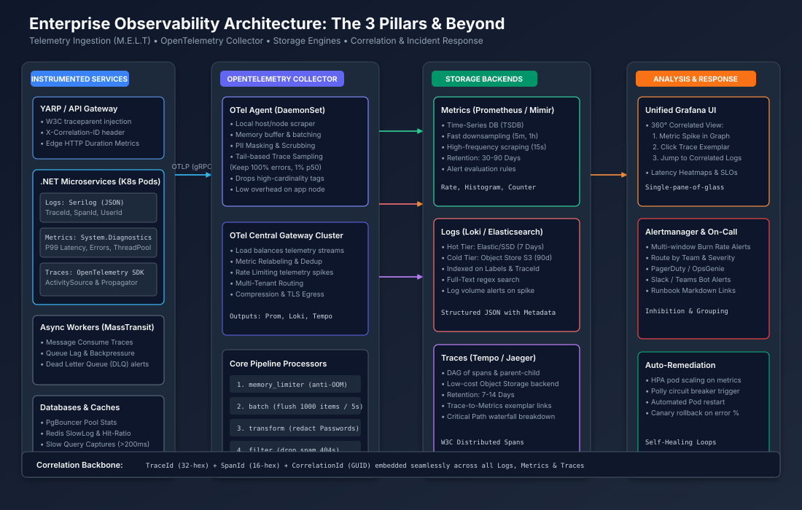

# সিনিয়র সিস্টেম ডিজাইন ইন্টারভিউ: অবজারভেবিলিটি এবং ডিস্ট্রিবিউটেড টেলিমেট্রি (Observability & Distributed Telemetry)

> **ইন্টারভিউয়ারের প্রশ্ন (Interviewer Prompt):**  
> *"একটি বৃহৎ পরিসরের মাইক্রোসার্ভিস প্ল্যাটফর্মের জন্য এন্টারপ্রাইজ-গ্রেড অবজারভেবিলিটি আর্কিটেকচার ডিজাইন করুন যা প্রতি সেকেন্ডে ৫০,০০০ রিকোয়েস্ট (50,000 RPS) হ্যান্ডেল করতে পারে। থ্রি পিলারস (Metrics, Logs, Traces), ডেটা কোরিলেশন স্ট্র্যাটেজি, ক্যাপাসিটি এস্টিমেশন, স্যাম্পলিং ট্রেড-অফ এবং রেজিলিয়েন্স ইন্টিগ্রেশন ব্যাখ্যা করুন।"*

---

## ১. স্টেজ ১: ক্ল্যারিফাইং প্রশ্ন এবং স্কোপ (Clarifying Questions & Scope)

### ফাংশনাল স্কোপ (Functional Scope)
- **টেলিমেট্রি পিলারস (Telemetry Pillars)**: **Metrics, Logs, এবং Traces (M.E.L.T)** এর ডেটা ইনজেশন, প্রসেসিং, স্টোরেজ, কোয়েরি এবং পারস্পরিক কোরিলেশন।
- **রুট-কজ অ্যানালাইসিস (RCA)**: Grafana চার্টে 5xx বা ল্যাটেন্সি স্পাইক দেখা মাত্র কোনো ম্যানুয়াল সার্চিং ছাড়াই সরাসরি নির্দিষ্ট ডিস্ট্রিবিউটেড ট্রেস স্প্যান এবং সেখান থেকে সংশ্লিষ্ট স্ট্রাকচার্ড লগ লাইনে জাম্প করার সক্ষমতা।
- **অ্যাকশনেবিলিটি ও অ্যালার্টিং (Actionability & Alerting)**: কোনো অ্যালার্ট ফ্যাটিগ (Alert Fatigue) তৈরি না করে সরাসরি SLOs/SLIs (Service Level Objectives/Indicators) এর সাথে সম্পর্কিত মাল্টি-উইন্ডো, মাল্টি-বার্ন-রেট অ্যালার্টিং।

### নন-ফাংশনাল রিকোয়ারমেন্টস এবং সীমাবদ্ধতা (Non-Functional Requirements)
- **থ্রুপুট স্কেল (Throughput Scale)**: গড়ে $50,000\text{ RPS}$, এবং $3\times$ পিক ট্রাফিক ($150,000\text{ RPS}$)।
- **টার্গেট এসএলও (Target SLO)**: বিজনেস সার্ভিসের জন্য $99.99\%$ অ্যাভেইল্যাবিলিটি; অবজারভেবিলিটি এজেন্টের ওভারহেড প্রতি অ্যাপ্লিকেশন পডে $< 2\%$ CPU এবং $< 100\text{ MB}$ মেমোরির মধ্যে সীমাবদ্ধ থাকতে হবে।
- **ল্যাটেন্সি বাজেট (Latency Budget)**: অ্যাসিঙ্ক্রোনাস নন-ব্লকিং ইনজেশন; মূল অ্যাপ্লিকেশন রিকোয়েস্টে ল্যাটেন্সি পেনাল্টি $< 1.5\text{ ms}$ হতে হবে।
- **ডেটা রিটেনশন ও টিয়ারিং (Data Retention & Tiering)**:
  - Metrics: ৯০ দিন ডাউনস্যাম্পলড (15s raw $\rightarrow$ 5m rollups $\rightarrow$ 1h rollups)।
  - Traces: ১৪ দিন (১০০% এরর এবং p99.9 আউটলায়ার; সাধারণ ২০০ ওকে ট্রাফিকের জন্য ১% হেড/টেইল স্যাম্পলড)।
  - Logs: এসএসডি-তে ৭ দিনের জন্য হট টিয়ার (Hot Tier), এবং কমপ্লায়েন্সের জন্য অবজেক্ট স্টোরেজে (S3/Azure Blob) ৯০ দিনের জন্য কোল্ড টিয়ার (Cold Tier)।
- **কমপ্লায়েন্স এবং প্রাইভেসি (Compliance & Privacy)**: নেটওয়ার্ক বাউন্ডারি পার হওয়ার আগেই লোকাল নোড এজেন্টে PII রিডাকশন (ক্রেডিট কার্ড, ইমেইল, টোকেন মাস্কিং) সম্পন্ন হতে হবে।

---

## ২. স্টেজ ২: ব্যাক-অফ-দ্য-এনভেলপ ক্যাপাসিটি এস্টিমেশন (Capacity Estimations)

গড়ে **50,000 RPS** এবং পিক আওয়ারের **150,000 RPS** ট্রাফিকের জন্য টেলিমেট্রি ভলিউম, নেটওয়ার্ক ইগ্রেস এবং ডিস্ক স্টোরেজ হিসাব করা যাক:

### ১. মেট্রিক্স ইনজেশন ও TSDB স্টোরেজ (Metrics Ingestion & Storage)
- **অ্যাপ্লিকেশন সার্ভিস**: ১০০টি পৃথক মাইক্রোসার্ভিস, প্রতিটিতে গড়ে ৫টি পড = মোট ৫০০টি অ্যাক্টিভ পড।
- **প্রতি পডে মেট্রিক্স**: ২০০টি টাইম-সিরিজ মেট্রিক্স (HTTP রেট, হিস্টোগ্রাম, রানটাইম জিসি, থ্রেডপুল, ডিবি কানেকশন)।
- **অ্যাক্টিভ টাইম সিরিজ**: $500\text{ pods} \times 200 = 100,000\text{ unique metric series}$।
- **স্ক্র্যাপ ইন্টারভ্যাল (Scrape Interval)**: প্রতি ১৫ সেকেন্ড পর পর ($\approx 4\text{ scrapes/min}$)।
- **প্রতি সেকেন্ডে স্যাম্পল রেট**:
  $$\frac{100,000 \text{ series}}{15\text{ s}} \approx 6,666\text{ metric samples/sec}$$
- **TSDB কম্প্রেশন**: গোরিলা (Gorilla) অ্যালগরিদমে গড়ে স্যাম্পল প্রতি $\approx 1.5\text{ bytes}$ জায়গা লাগে।
- **প্রতিদিনের মেট্রিক্স ইনগ্রেস**:
  $$6,666 \times 1.5\text{ bytes} \times 86,400\text{ s} \approx 864\text{ MB/day} \approx 0.86\text{ GB/day}$$
- **উপসংহার**: কার্ডিনালিটি (Cardinality) নিয়ন্ত্রণে থাকলে মেট্রিক্স স্টোরেজ ভলিউম অত্যন্ত হালকা এবং সাশ্রয়ী।

### ২. স্ট্রাকচার্ড লগ ইনজেশন ও স্টোরেজ (Structured Log Storage)
- **লগ রেট**: প্রতিটি ইনকামিং HTTP রিকোয়েস্টে গড়ে ৩টি স্ট্রাকচার্ড লগ (Request received, DB query summary, Response sent)।
- **প্রতিদিনের মোট রিকোয়েস্ট**: $50,000\text{ RPS} \times 86,400\text{ s} = 4,320,000,000$ (৪.৩২ বিলিয়ন)।
- **প্রতিদিনের লগ ইভেন্ট**: $4.32\text{B} \times 3 \approx ১৩\text{ বিলিয়ন লগ লাইন/দিন}$।
- **গড় JSON লগ সাইজ**: $400\text{ bytes}$ (টাইমস্ট্যাম্প, কোরিলেশন আইডি, সার্ভিস নাম, মেসেজ ইত্যাদি)।
- **র' (Raw) দৈনিক স্টোরেজ**:
  $$13,000,000,000 \times 400\text{ bytes} \approx 5.2\text{ TB/day (uncompressed)}$$
- **কম্প্রেসড স্টোরেজ** (স্টোরেজ ইঞ্জিনে $4\times$ zstandard কম্প্রেশন):
  $$\frac{5.2\text{ TB}}{4} \approx 1.3\text{ TB/day}$$
- **৭ দিনের হট স্টোরেজ (SSD)**: $1.3\text{ TB} \times 7 \approx \mathbf{9.1\text{ TB}}$।
- **৯০ দিনের কোল্ড আর্কাইভ (Object Storage)**: $1.3\text{ TB} \times 90 \approx \mathbf{117\text{ TB}}$।

### ৩. ডিস্ট্রিবিউটেড ট্রেস স্প্যান ও স্যাম্পলিং বাজেট (Trace Sampling)
- **রিকোয়েস্ট প্রতি স্প্যান**: ১টি গেটওয়ে + ২টি ডাউনস্ট্রিম সার্ভিস হপ + ২টি ডেটাবেস/ক্যাশ কল = ট্রেস প্রতি ৫টি স্প্যান।
- **মোট জেনারেটেড স্প্যান**: $50,000\text{ RPS} \times 5 = 250,000\text{ spans/sec}$।
- **স্প্যান সাইজ**: $500\text{ bytes}$ (TraceId, SpanId, ParentSpanId, Baggage, HTTP মেটাডেটা)।
- **স্যাম্পলিং ছাড়া মোট ভলিউম**:
  $$250,000 \times 500\text{ bytes} = 125\text{ MB/s} \approx 10.8\text{ TB/day}$$
- **টেইল-বেসড স্যাম্পলিং (Tail-Based Sampling) প্রয়োগ**:
  - HTTP স্ট্যাটাস $\ge 400$ অথবা ল্যাটেন্সি $> 500\text{ ms}$ হলে ১০০% স্যাম্পল রাখা হবে (ধরা যাক এটি ট্রাফিকের ২%)।
  - সাধারণ সফল রিকোয়েস্টের (200 OK) ক্ষেত্রে মাত্র ১% স্যাম্পল রাখা হবে।
  - ইফেক্টিভ স্যাম্পলিং রেট: $2\% + (98\% \times 0.01) = 2.98\% \approx 3\%$।
- **স্যাম্পলড দৈনিক স্টোরেজ**:
  $$10.8\text{ TB} \times 0.03 \approx \mathbf{324\text{ GB/day}}$$
- **১৪ দিনের ট্রেস রিটেনশন**: $324\text{ GB} \times 14 \approx \mathbf{4.5\text{ TB}}$।

---

## ৩. স্টেজ ৩: হাই-লেভেল অবজারভেবিলিটি আর্কিটেকচার (High-Level Architecture)

নিচের আর্কিটেকচার ডায়াগ্রামটি দেখায় কীভাবে অ্যাপ্লিকেশন পড থেকে লোকাল OpenTelemetry কালেক্টর ডিমনসেট, সেন্ট্রাল গেটওয়ে, ডেডিকেটেড স্টোরেজ ইঞ্জিন এবং ইউনিফাইড গ্রাফানা ড্যাশবোর্ড ও পেজিং অ্যালার্টের মধ্যে ডেটা প্রবাহিত হয়:



### আর্কিটেকচারাল ফ্লো এর মূল ধাপসমূহ:
1. **ইন-প্রসেস ইন্সট্রুমেন্টেশন (In-Process Instrumentation)**: ASP.NET Core অ্যাপ্লিকেশনে `System.Diagnostics.Activity` এবং `System.Diagnostics.Metrics` সহ OpenTelemetry .NET SDK ব্যবহৃত হয়। স্প্যান, মেট্রিক্স এবং JSON লগ OTLP/gRPC প্রোটোকলের মাধ্যমে লোকাল নোডের ডিমনসেটে অ্যাসিঙ্ক্রোনাসভাবে পাঠানো হয়।
2. **নোড এজেন্ট (DaemonSet)**: মেমোরি লিমিটিং, লোকাল ব্যাচিং এবং সংবেদনশীল ডেটা (PII) ফিল্টারিং সম্পন্ন করে।
3. **ক্লাস্টার গেটওয়ে (Cluster Gateway)**: টেইল-বেসড স্যাম্পলিং সিদ্ধান্ত নেয়, ক্ষতিকর হাই-কার্ডিনালিটি ট্যাগ ড্রপ করে এবং স্টোরেজ ক্লাস্টারে ট্রাফিক ব্যালেন্স করে।
4. **বিশেষায়িত স্টোরেজ ইঞ্জিন (Specialized Storage Engines)**:
   - মেট্রিক্সের জন্য টাইম-সিরিজ TSDB (Prometheus / VictoriaMetrics / Mimir)।
   - লগের জন্য ইনডেক্স-ফ্রি অবজেক্ট স্টোরেজ (Grafana Loki) বা সার্চ ক্লাস্টার (Elasticsearch / OpenSearch)।
   - ট্রেসের জন্য ডিস্ট্রিবিউটেড অবজেক্ট স্টোর (Grafana Tempo / Jaeger)।
5. **ইউনিফাইড কোরিলেশন প্লেন (Unified Correlation Plane)**: Grafana এক ছাতার নিচে Metrics $\rightarrow$ Traces (via Exemplars) $\rightarrow$ Logs (via TraceId) কোরিলেশন সম্পন্ন করে।

---

## ৪. স্টেজ ৪: ডিপ ডাইভ — ৪টি অবজারভেবিলিটি লেভার (.NET এন্টারপ্রাইজ স্ট্যান্ডার্ড)

### লেভার ১: W3C TraceContext সহ ডিস্ট্রিবিউটেড ট্রেসিং (Distributed Tracing)

#### মেকানিজম এবং কীভাবে কাজ করে
ডিস্ট্রিবিউটেড ট্রেসিং একাধিক সার্ভার বাউন্ডারির মধ্যে একটি রিকোয়েস্টকে ট্র্যাক করে। এটি একটি গ্লোবালি ইউনিক `TraceId` (৩২ হেক্সাডেসিমেল ক্যারেক্টার) এবং নির্দিষ্ট লোকাল সেগমেন্টের জন্য `SpanId` (১৬ হেক্সাডেসিমেল ক্যারেক্টার) তৈরি করে। W3C স্ট্যান্ডার্ড হেডার `traceparent` আউটগোয়িং HTTP, gRPC অথবা Kafka হেডারে ইনজেক্ট করা হয়।

#### সুবিধাসমূহ (Benefits)
- মাইক্রোসার্ভিস আর্কিটেকচারে ক্রিটিক্যাল পাথ ল্যাটেন্সি বটলনেক তাৎক্ষণিকভাবে চিহ্নিত করে।
- কোন নির্দিষ্ট ডাউনস্ট্রিম সার্ভিস, ধীরগতির ডেটাবেস কোয়েরি বা কিউতে দেরি হয়েছে তা সুনির্দিষ্টভাবে প্রমাণ করে।

#### ড্রব্যাক এবং ট্রেড-অফ (Drawbacks & Trade-offs)
- অতিরিক্ত স্প্যান তৈরি করলে নেটওয়ার্ক ব্যান্ডউইথ এবং মেমোরি ওভারহেড বাড়ে।
- বুদ্ধিমান স্যাম্পলিং কৌশল ছাড়া স্টোরেজের খরচ বিপুল বৃদ্ধি পায়।

#### টার্গেট টেকনোলজি এবং NuGet প্যাকেজ (.NET / C#)
- `OpenTelemetry.Extensions.Hosting`
- `OpenTelemetry.Instrumentation.AspNetCore`
- `OpenTelemetry.Instrumentation.Http`
- `OpenTelemetry.Instrumentation.EntityFrameworkCore`
- `OpenTelemetry.Exporter.OpenTelemetryProtocol` (OTLP)

#### মিনিমাল কোড উদাহরণ (C#)
```csharp
// Program.cs - জিরো-ওভারহেড ওপেন-টেলিমেট্রি কনফিগারেশন
using OpenTelemetry.Resources;
using OpenTelemetry.Trace;

var builder = WebApplication.CreateBuilder(args);

builder.Services.AddOpenTelemetry()
    .ConfigureResource(resource => resource.AddService("OrderService", serviceVersion: "1.2.0"))
    .WithTracing(tracing =>
    {
        tracing
            .AddAspNetCoreInstrumentation(opts =>
            {
                opts.RecordException = true;
                opts.Filter = httpContext => !httpContext.Request.Path.StartsWithSegments("/healthz");
            })
            .AddHttpClientInstrumentation()
            .AddEntityFrameworkCoreInstrumentation(opts => opts.SetDbStatementForText = true)
            .AddSource("Enterprise.OrderProcessing") // কাস্টম বিজনেস ActivitySource
            .AddOtlpExporter(opts =>
            {
                opts.Endpoint = new Uri("http://otel-collector.monitoring:4317"); // লোকাল DaemonSet
                opts.Protocol = OpenTelemetry.Exporter.OtlpExportProtocol.Grpc;
            });
    });
```

---

### লেভার ২: হাই-পারফরম্যান্স স্ট্রাকচার্ড লগিং ও ট্রেস কোরিলেশন

#### মেকানিজম এবং কীভাবে কাজ করে
প্লেইন টেক্সট লগ (`Console.WriteLine`) প্রোডাকশন স্কেলে অকেজো। স্ট্রাকচার্ড লগিং JSON কী-ভ্যালু পেয়ারে লগ সংরক্ষণ করে। সবচেয়ে গুরুত্বপূর্ণ হলো, চলমান রিকোয়েস্টের `TraceId` এবং `SpanId` স্বয়ংক্রিয়ভাবে প্রতিটি লগের কনটেক্সটে যুক্ত করা। এর ফলে Loki বা Elasticsearch-এ একটি ট্রেস আইডি দিয়ে সার্চ করলেই ১০টি মাইক্রোসার্ভিস জুড়ে ওই রিকোয়েস্টের সমস্ত লগ মুহূর্তের মধ্যে ফিল্টার হয়ে যায়।

#### সুবিধাসমূহ (Benefits)
- ডিস্ট্রিবিউটেড নোডের কোটি কোটি লগের ভেতর থেকে নির্দিষ্ট ইউজারের সমস্যার লগ এক ক্লিকে বের করা যায়।
- মেমোরি ও সার্চিংয়ে মেশিন-রিডেবল ফরম্যাট তৈরি করে।

#### ড্রব্যাক এবং ট্রেড-অফ (Drawbacks & Trade-offs)
- প্রতি রিকোয়েস্টে স্ট্রিং ইন্টারপোলেশন (`$"Order {id}"`) করলে অতিরিক্ত মেমোরি অ্যালোকেশন এবং গার্বেজ কালেকশন (GC) প্রেসার তৈরি হয়। এজন্য C# **Source Generators** (`[LoggerMessage]`) ব্যবহার করা আবশ্যক।

#### টার্গেট টেকনোলজি এবং NuGet প্যাকেজ (.NET / C#)
- `Serilog.AspNetCore`
- `Serilog.Enrichers.Span`
- `Serilog.Sinks.OpenTelemetry` অথবা `Serilog.Sinks.Elasticsearch`

#### মিনিমাল কোড উদাহরণ (C#)
```csharp
// Program.cs - ট্রেস আইডি সমৃদ্ধ হাই-পারফরম্যান্স সেরিলগ কনফিগারেশন
using Serilog;
using Serilog.Enrichers.Span;

Log.Logger = new LoggerConfiguration()
    .Enrich.FromLogContext()
    .Enrich.WithSpan() // Activity.Current থেকে স্বয়ংক্রিয়ভাবে TraceId ও SpanId যুক্ত করে
    .WriteTo.Console(new Serilog.Formatting.Json.JsonFormatter())
    .WriteTo.OpenTelemetry(opts =>
    {
        opts.Endpoint = "http://otel-collector.monitoring:4317";
        opts.Protocol = Serilog.Sinks.OpenTelemetry.OtlpProtocol.Grpc;
    })
    .CreateLogger();

builder.Host.UseSerilog();

// C# Source Generator এর সাহায্যে জিরো-অ্যালোকেশন হাই-পারফরম্যান্স লগিং
public static partial class OrderLogExtensions
{
    [LoggerMessage(
        EventId = 1001,
        Level = LogLevel.Information,
        Message = "Order {OrderId} successfully placed for customer {CustomerId} with total {Amount}")]
    public static partial void LogOrderPlaced(
        this ILogger logger, string orderId, string customerId, decimal amount);
}
```

---

### লেভার ৩: স্ট্রাকচার্ড মেট্রিক্স ও কার্ডিনালিটি সুরক্ষা (Metrics & Cardinality)

#### মেকানিজম এবং কীভাবে কাজ করে
মেট্রিক্স হলো সময়ের সাথে সংখ্যার সংকলন (Counters, Gauges, Histograms)। কাউন্টার শুধু সংখ্যা গণনা করে (যেমন: মোট রিকোয়েস্ট), আর হিস্টোগ্রাম ডেটাকে বিভিন্ন বাকেটে (Buckets) সাজিয়ে p50, p95 এবং p99 পারসেন্টাইল তৈরি করে।

#### সুবিধাসমূহ (Benefits)
- রিকোয়েস্ট ভলিউমের তুলনায় স্টোরেজ কস্ট অপরিবর্তনীয় ($O(1)$)। দশ লাখ রিকোয়েস্ট হলেও তা মাত্র কয়েকটি নিউমেরিক্যাল বাকেটে স্টোর হয়।
- রিয়েল-টাইম ড্যাশবোর্ড এবং তাত্ক্ষণিক অ্যালার্টিংয়ের জন্য আদর্শ।

#### ড্রব্যাক এবং ট্রেড-অফ (Drawbacks & Trade-offs)
- **হাই-কার্ডিনালিটি ফাঁদ (The High Cardinality Trap)**: মেট্রিক্সে যদি লেবেল ডাইমেনশন হিসেবে ইউনিক আইডি (যেমন `UserId`, `OrderId`) যুক্ত করা হয়, তবে মেমোরিতে টাইম-সিরিজের সংখ্যা এক্সপোনেনশিয়ালি বিস্ফোরিত হয় এবং প্রোমেথিউস ওওএম (OOM) ক্র্যাশ করে।

#### টার্গেট টেকনোলজি এবং NuGet প্যাকেজ (.NET / C#)
- `System.Diagnostics.Metrics` (.NET নেটিভ)
- `OpenTelemetry.Extensions.Hosting`
- `OpenTelemetry.Instrumentation.Runtime`

#### মিনিমাল কোড উদাহরণ (C#)
```csharp
// System.Diagnostics.Metrics ব্যবহার করে বিজনেস মেট্রিক্স
using System.Diagnostics.Metrics;

public sealed class OrderMetrics
{
    private static readonly Meter EnterpriseMeter = new("Enterprise.OrderService", "1.0.0");
    private readonly Counter<long> _orderCounter;
    private readonly Histogram<double> _orderProcessingDuration;

    public OrderMetrics()
    {
        _orderCounter = EnterpriseMeter.CreateCounter<long>(
            name: "orders_placed_total",
            unit: "orders",
            description: "মোট সফল অর্ডারের সংখ্যা");

        _orderProcessingDuration = EnterpriseMeter.CreateHistogram<double>(
            name: "order_processing_duration_seconds",
            unit: "s",
            description: "চেকআউট প্রসেস হতে মোট সময়");
    }

    public void RecordOrder(string orderType, string paymentMethod, double durationSec)
    {
        // নিরাপদ: লো-কার্ডিনালিটি ডাইমেনশন (orderType, paymentMethod)
        // অ্যান্টি-প্যাটার্ন সতর্কতা: কখনও ট্যাগ হিসেবে OrderId বা UserId পাঠাবেন না!
        var tags = new TagList
        {
            { "order_type", orderType },
            { "payment_method", paymentMethod }
        };

        _orderCounter.Add(1, tags);
        _orderProcessingDuration.Record(durationSec, tags);
    }
}
```

---

### লেভার ৪: সিন্থেটিক প্রোবিং ও ব্ল্যাকবক্স হেলথ ভেরিফিকেশন (Synthetic Probing)

#### মেকানিজম এবং কীভাবে কাজ করে
অভ্যন্তরীণ মেট্রিক্স শুধুমাত্র তখনই এরর রিপোর্ট করতে পারে যখন ইউজাররা সার্ভিসে পৌঁছাতে পারে। যদি এজ রাউটার বা ক্লাউড ডিএনএস (DNS) নষ্ট হয়ে যায়, তবে অভ্যন্তরীণ মেট্রিক্স কোনো ট্রাফিক না পাওয়ায় শূন্য এরর দেখাবে (Silent Outage)। সিন্থেটিক মনিটরিং বাইরে থেকে প্রতি মিনিটে নির্ধারিত এন্ডপয়েন্টগুলোতে টেস্ট রিকোয়েস্ট পাঠিয়ে সার্ভিসের প্রাপ্যতা নিশ্চিত করে।

#### সুবিধাসমূহ (Benefits)
- কাস্টমার অভিযোগ জানানোর আগেই নেটওয়ার্ক গেটওয়ে, SSL সার্টিফিকেট মেয়াদোত্তীর্ণ বা ডিএনএস ফেইলিউর ধরা পড়ে।
- এসএলএ (SLA) আপটাইমের নিরপেক্ষ প্রমাণ দেয়।

#### টার্গেট টেকনোলজি এবং NuGet প্যাকেজ (.NET / C#)
- `AspNetCore.HealthChecks.UI`
- `AspNetCore.HealthChecks.Npgsql` / `AspNetCore.HealthChecks.Redis`
- এক্সটার্নাল প্রোব: Prometheus Blackbox Exporter অথবা Datadog Synthetics

#### মিনিমাল কোড উদাহরণ (C#)
```csharp
// Program.cs - ডিপ হেলথ চেক (Readiness & Liveness)
builder.Services.AddHealthChecks()
    .AddNpgSql(builder.Configuration.GetConnectionString("PostgresDb")!, name: "postgres_db")
    .AddRedis(builder.Configuration.GetConnectionString("RedisCache")!, name: "redis_cache");

app.MapHealthChecks("/healthz/ready", new HealthCheckOptions
{
    Predicate = check => check.Tags.Contains("ready")
});

app.MapHealthChecks("/healthz/live", new HealthCheckOptions
{
    Predicate = _ => false // শুধুমাত্র Kestrel সার্ভার রেসপন্সিভ কিনা তা যাচাই করে
});
```

---

## ৫. স্টেজ ৫: রেজিলিয়েন্স, ইনসিডেন্ট ড্রিল ও অ্যালার্টিং স্ট্র্যাটেজি

### ড্রিল ১: গুগল এসআরই মাল্টি-উইন্ডো মাল্টি-বার্ন-রেট অ্যালার্টিং (Burn Rate Alerting)
- **সমস্যা**: স্ট্যাটিক থ্রেশহোল্ড অ্যালার্ট (যেমন `Error Rate > 1%`) ক্ষণস্থায়ী নেটওয়ার্ক বাউন্সে শত শত ফলস অ্যালার্ম দেয়, আবার দীর্ঘ সময় ধরে চলা ধীরগতির বিপর্যয় ধরতে ব্যর্থ হয়।
- **সমাধান**: **SLO Error Budget Burn Rate** এর ওপর অ্যালার্ট বসানো।
  - একটি সার্ভিসের $99.9\%$ SLO থাকলে ৩০ দিনে তার এরর বাজেট থাকে $0.1\%$।
  - একটি **$14.4\times$ বার্ন রেট** ১ ঘণ্টার মধ্যে পুরো মাসের বাজেটের ২% পুড়িয়ে ফেলে $\rightarrow$ **তাত্ক্ষণিক ক্রিটিক্যাল পেজ (PagerDuty)**।
  - একটি **$6\times$ বার্ন রেট** ৬ ঘণ্টায় ৫% বাজেট নষ্ট করে $\rightarrow$ **স্ল্যাক/টিকেট নোটিফিকেশন**।

```yaml
# Prometheus Alertmanager Rule
groups:
  - name: order_service_slo_alerts
    rules:
      - alert: ErrorBudgetBurnRateCritical
        expr: (
            sum(rate(http_requests_total{status=~"5.."}[1h])) 
            / 
            sum(rate(http_requests_total[1h]))
          ) > (14.4 * 0.001)
        for: 2m
        labels:
          severity: page
        annotations:
          summary: "১ ঘণ্টার বার্ন রেট ১৪.৪ গুণ অতিক্রম করেছে (১ ঘণ্টায় ২% এরর বাজেট বিনষ্ট)"
          runbook_url: "https://wiki.enterprise.com/runbooks/order-service-error-burn"
```

### ড্রিল ২: হাই কার্ডিনালিটি ক্র্যাশ ও মেমোরি সুরক্ষা (High Cardinality Outage)
- **ঘটনা**: একজন ডেভেলপার ভুলে মেট্রিক্স ট্যাগ হিসেবে `user_id` পাস করে দেয়। ১৫ মিনিটের মধ্যে প্রোমেথিউসের মেমোরি ৮ জিবি থেকে ৬৪ জিবি হয়ে OOM ক্র্যাশ লুপে পড়ে যায়।
- **সমাধান**:
  1. **কালেক্টর ফিল্টারিং রুল**: OpenTelemetry কালেক্টরে মেট্রিক রিল্যাবেলিং বসিয়ে অননুমোদিত লেবেল (`user_id`, `email`) তৎক্ষণাৎ ড্রপ করা।
  2. **কালেক্টর মেমোরি লিমিটার**: OTel কালেক্টরে `memory_limiter` প্রসেসর সক্রিয় করা, যেন বাফার মেমোরি ৮০% ছুঁলে অতিরিক্ত মেট্রিক্স ড্রপ করে নোড ক্র্যাশ ঠেকানো যায়।
  3. **সিআই/সিডি চেকার**: Roslyn স্ট্যাটিক অ্যানালাইজার ব্যবহার করে বিল্ড টাইমে হাই-কার্ডিনালিটি স্ট্রিং পাস করা ব্লক করা।

### ড্রিল ৩: হেড-বেসড বনাম টেইল-বেসড স্যাম্পলিং (Trace Sampling)
- **হেড-বেসড স্যাম্পলিং**: গেটওয়েতে রিকোয়েস্ট ঢোকার সময়ই সিদ্ধান্ত নেওয়া হয় (যেমন ৫% ট্রাফিক ট্র্যাক করা হবে)।
  - *বিপদ*: বাকি ৯৫% ট্রাফিকের মধ্যে কোনো মারাত্মক ক্র্যাশ বা ধীরগতি হলেও তার কোনো ট্রেস থাকে না।
- **টেইল-বেসড স্যাম্পলিং**: কালেক্টর রিকোয়েস্ট শেষ হওয়া পর্যন্ত সমস্ত স্প্যান মেমোরিতে ধরে রাখে।
  - *প্রোডাকশন স্ট্র্যাটেজি*:
    - যদি `status_code >= 400` হয় $\rightarrow$ ১০০% সংরক্ষণ।
    - যদি `duration >= 500ms` (p99 ল্যাটেন্সি) হয় $\rightarrow$ ১০০% সংরক্ষণ।
    - সফল সাধারণ ২০০ ওকে রিকোয়েস্ট $\rightarrow$ মাত্র ১% সংরক্ষণ।
  - এটি ৯৭% স্টোরেজ খরচ বাঁচায় এবং প্রোডাকশন আউটেজের শতভাগ ভিজিবিলিটি নিশ্চিত করে।

---

## ৬. স্টেজ ৬: সিনিয়র আর্কিটেকচারাল ডিসিশন মেট্রিক্স

| মাত্রা (Dimension) | Metrics (Prometheus / Mimir) | Logs (Loki / OpenSearch) | Traces (Tempo / Jaeger) |
| :--- | :--- | :--- | :--- |
| **মূল প্রশ্নের উত্তর দেয়** | *"কোথাও কি কোনো সমস্যা হচ্ছে?"* | *"কোডের ঠিক কোন লাইনে কেন ফেইল হলো?"* | *"একাধিক সার্ভিসের মধ্যে ঠিক কোথায় সময় নষ্ট হলো?"* |
| **ডেটা ফরম্যাট** | নিউমেরিক্যাল টাইম সিরিজ (Float64 + টাইমস্ট্যাম্প) | স্ট্রাকচার্ড JSON ও টেক্সট স্ট্রিং | স্প্যানের ডিরেক্টেড আসাইক্লিক গ্রাফ (DAG) |
| **স্টোরেজ খরচ** | অত্যন্ত কম ($O(1)$) | অত্যন্ত বেশি ($O(N)$) | মাঝারি ($O(N)$, টেইল স্যাম্পলিং সাশ্রয়ী করে) |
| **স্যাম্পলিং সম্ভাব্যতা** | প্রযোজ্য নয় (সব ডেটা এগ্রিগেটেড) | লগ লেভেল ফিল্টারিং (Error বনাম Debug) | টেইল-বেসড স্যাম্পলিং (১-৫% ইফেক্টিভ) |
| **কার্ডিনালিটি সহনশীলতা** | **চরম সংবেদনশীল** (কেবলমাত্র সীমিত লেবেল) | অত্যন্ত বেশি (যেকোনো টেক্সট অনুমোদিত) | অত্যন্ত বেশি (প্রতি রিকোয়েস্টে নতুন TraceId) |
| **সেরা ওপেন-সোর্স ইঞ্জিন** | Prometheus, VictoriaMetrics, Grafana Mimir | Grafana Loki, Elasticsearch, OpenSearch | Grafana Tempo, Apache SkyWalking, Jaeger |
| **এন্টারপ্রাইজ ক্লাউড অপশন** | Azure Monitor Metrics, AWS CloudWatch | Azure Log Analytics, CloudWatch Logs | AWS X-Ray, Azure App Insights |

---

## ৭. ইন্টারভিউতে সবচেয়ে বেশি জিজ্ঞাসিত প্রশ্ন এবং পূর্ণাঙ্গ উত্তর (Most Asked Interview Q&A)

### প্রশ্ন ১: "Metrics বনাম Logs বনাম Traces — কোন পরিস্থিতিতে কোনটি ব্যবহার করবেন এবং তাদের অর্থনৈতিক ট্রেড-অফ কী?"
- **মডেল উত্তর**:
  - **মেট্রিক্স (Metrics)** উত্তর দেয় *"সিস্টেম কি সুস্থ আছে এবং সামগ্রিক অসঙ্গতি কোথায়?"*। এটি নিউমেরিক্যাল টাইম-সিরিজ ডেটা যার স্টোরেজ কস্ট রিকোয়েস্ট ভলিউমের তুলনায় $O(1)$ (এক লক্ষ রিকোয়েস্ট আসলেও একই ফিক্সড কাউন্টার বাকেটে সংখ্যা বাড়ে)। এটি রিয়েল-টাইম ড্যাশবোর্ড এবং তাত্ক্ষণিক অ্যালার্ট ট্রিগার করার জন্য সবচেয়ে সাশ্রয়ী ও কার্যকর।
  - **ট্রেসেস (Traces)** উত্তর দেয় *"১৫টি পৃথক মাইক্রোসার্ভিসের মধ্য দিয়ে যাওয়া একটি রিকোয়েস্টের ক্রিটিক্যাল পাথে কোথায় সবচেয়ে বেশি ল্যাটেন্সি খরচ হয়েছে?"*। এটি রিকোয়েস্টকে প্যারেন্ট-চাইল্ড স্প্যানের ডিরেক্টেড আসাইক্লিক গ্রাফ (DAG) হিসেবে মডেল করে। এর স্টোরেজ খরচ $O(N)$ হারে বাড়ে, ফলে প্রোডাকশনে খরচ নিয়ন্ত্রণে টেইল-বেসড স্যাম্পলিং (Tail-Based Sampling) আবশ্যক।
  - **লগস (Logs)** উত্তর দেয় *"কোডের ঠিক কোন লাইনে কোন প্যারামিটারের কারণে এরর ঘটল?"*। এটি টেক্সচুয়াল সত্য (স্ট্যাক ট্রেস, মেমোরি স্টেট) প্রদান করে। তবে লগিং হলো অবজারভেবিলিটির **সবচেয়ে ব্যয়বহুল** মাধ্যম ($O(N)$ ভলিউম, ডিস্কে ভারী ইনডেক্সিং এবং বিশাল JSON সিরিয়ালাইজেশন ওভারহেড)।
  - **সিনিয়র ইঞ্জিনিয়ারিং সিন্থেসিস**: অনুসন্ধানের শুরু হবে Metrics থেকে (অ্যালার্ট পেলে) $\rightarrow$ Distributed Tracing দিয়ে ধীরগতির সার্ভিসটি চিহ্নিত হবে $\rightarrow$ Correlated Structured Log লাইনে গিয়ে আসল কোড এররটি ধরা পড়বে।

### প্রশ্ন ২: "Push বনাম Pull টেলিমেট্রি কালেকশন: প্রমিথিউস কেন Pull ব্যবহার করে আর ওপেন-টেলিমেট্রি/ক্লাউডওয়াচ কেন Push ব্যবহার করে? কোনটি বেশি কার্যকর?"
- **মডেল উত্তর**:
  - **Pull মেকানিজম (Prometheus)**:
    - *পদ্ধতি*: প্রমিথিউস সার্ভার কুবারনেটিস এপিআই বা কনসাল ব্যবহার করে অ্যাপ্লিকেশন ইনস্ট্যান্স খুঁজে বের করে এবং তাদের `/metrics` এন্ডপয়েন্ট থেকে ডেটা টেনে (Pull) নেয়।
    - *সুবিধা*: সেন্ট্রাল সার্ভার থেকে স্ক্র্যাপিং ইন্টারভ্যাল নিয়ন্ত্রণ করা যায়; কোনো নোড ডাউন হলে সহজে ধরা পড়ে; ক্লায়েন্ট ট্রাফিকের অতিরিক্ত চাপে মনিটরিং সার্ভার ক্র্যাশ করার ঝুঁকি থাকে না।
    - *সীমাবদ্ধতা*: ক্লাস্টারের ভেতর ইনগ্রেস নেটওয়ার্ক অ্যাক্সেস প্রয়োজন; ফায়ারওয়াল বা ক্ষণস্থায়ী সার্ভারলেস ফাংশনে (যেমন AWS Lambda) পুশগেটওয়ে ছাড়া কাজ করা কঠিন।
  - **Push মেকানিজম (OpenTelemetry / StatsD / CloudWatch)**:
    - *পদ্ধতি*: অ্যাপ্লিকেশন সার্ভিসগুলো সক্রিয়ভাবে OTLP/gRPC প্রোটোকলে মেট্রিক্স/ট্রেস ব্যাচ আকারে কালেক্টরের দিকে ঠেলে (Push) দেয়।
    - *সুবিধা*: সার্ভারলেস ল্যাম্বডা, এজ ক্লায়েন্ট এবং কঠোর ফায়ারওয়ালের পেছনের আর্কিটেকচারের জন্য একদম স্বাভাবিক সমাধান।
    - *সীমাবদ্ধতা*: ট্রাফিক হঠাৎ বৃদ্ধি পেলে মনিটরিং ব্যাকএন্ড ওভারলোড হতে পারে (এর জন্য ক্লায়েন্ট সাইড বাফারিং ও ড্রপ পলিসি দরকার)।
  - **স্টাফ-লেভেল রায় (Hybrid Push-Pull)**: আধুনিক এন্টারপ্রাইজ স্ট্যান্ডার্ড হলো **হাইব্রিড আর্কিটেকচার** — অ্যাপ্লিকেশন নোডের লোকাল OpenTelemetry Collector DaemonSet-এ `localhost` দিয়ে লাইটওয়েট *Push* করে, এরপর কালেক্টর বাফারিং ও পিআইআই ফিল্টারিং সম্পন্ন করে প্রমিথিউস বা ক্লাউড স্টোরেজে আউটপুট প্রদান করে।

### প্রশ্ন ৩: "HTTP, gRPC এবং অ্যাসিঙ্ক্রোনাস মেসেজ ব্রোকার (Kafka/RabbitMQ) জুড়ে Distributed Context Propagation কীভাবে বাস্তবে কাজ করে?"
- **মডেল উত্তর**:
  - যখন একটি ইনকামিং রিকোয়েস্ট এজ গেটওয়েতে প্রবেশ করে, গেটওয়ে হেডার চেক করে। কোনো ট্রেস কনটেক্সট না থাকলে এটি একটি নতুন **W3C TraceContext** তৈরি করে:
    1. `traceparent`: `00-{trace-id}-{parent-id}-{trace-flags}` (যেমন `00-4bf92f3577b34da6a3ce929d0e0e4736-00f067aa0ba902b7-01`)।
    2. `tracestate`: ভেন্ডর-স্পেসিফিক অপেক কী-ভ্যালু।
    3. `baggage`: ঐচ্ছিক বিজনেস মেটাডেটা যা প্রতিটি হপে প্রবাহিত হয় (যেমন `tenant-id=enterprise-42`)।
  - **HTTP/gRPC এর ক্ষেত্রে**: `HttpClientHandler` ইন্টারসেপ্টরের মাধ্যমে আউটগোয়িং রিকোয়েস্ট হেডারে ইনজেক্ট হয়।
  - **অ্যাসিঙ্ক্রোনাস মেসেজ ব্রোকারের ক্ষেত্রে (Kafka/RabbitMQ)**:
    - মেসেজ পাবলিশার বর্তমান `Activity.Current` থেকে কনটেক্সট বের করে তা **Kafka Record Headers** (বাইট অ্যারে) হিসেবে সিরিয়ালাইজ করে পাঠায়।
    - কনজিউমার ব্যাকগ্রাউন্ড ওয়ার্কার মেসেজ প্রসেস করার আগেই রেকর্ড হেডার থেকে `traceparent` পড়ে এবং `ActivitySource.StartActivity("ProcessOrder", ActivityKind.Consumer, parentContext)` কল করে ট্রেস লিংক পুনরুদ্ধার করে।
  - এর ফলে অ্যাসিঙ্ক্রোনাস ইভেন্ট-ড্রিভেন পাইপলাইনেও কোনো ছেদ ছাড়াই সম্পূর্ণ এন্ড-টু-এন্ড ডিস্ট্রিবিউটেড ট্রেস ভিজ্যুয়ালাইজেশন পাওয়া যায়।

---

## ৮. হাই-প্রেসার ফলো-আপ প্রশ্ন ও প্রোডাকশন সমাধান (Follow-Up Scenarios & Counter-Answers)

### ফলো-আপ ১: "যদি অবজারভেবিলিটি ব্যাকএন্ড (Elasticsearch বা Kafka) ডাউন হয়ে যায়, তবে আপনার ব্যবসায়িক কোর প্রোডাকশন সার্ভিস যেন ক্র্যাশ না করে তা কীভাবে নিশ্চিত করবেন?"
- **ইন্টারভিউয়ারের ফাঁদ**: আপনার লগিং ফ্রেমওয়ার্ক মূল অ্যাপ্লিকেশনের থ্রেড ব্লক করে বা মেমোরি ফুল করে ওওএম (OOM) ক্র্যাশ ঘটায় কিনা তা যাচাই করা।
- **অভিজ্ঞ সিনিয়র ইঞ্জিনিয়ারের উত্তর**:
  1. **নন-ব্লকিং অ্যাসিঙ্ক্রোনাস ইগ্রেস**: অ্যাপ্লিকেশন কোড থেকে কখনো সিনক্রোনাসভাবে নেটওয়ার্ক সকেটে লগ বা ট্রেস লেখা যাবে না। Serilog এবং OpenTelemetry বাউন্ডেড ইন-মেমোরি বাফার (`Channel<T>` with `DropOldest` মোড) ব্যবহার করে ব্যাকগ্রাউন্ডে ফ্ল্যাশ করে।
  2. **ফেইল-ওপেন ড্রপ পলিসি (Fail-Open Drop Policy)**: টেলিমেট্রি হলো নন-ক্রিটিক্যাল ডেটা। যদি লোকাল মেমোরি বাফার পূর্ণ হয়ে যায়, **তাত্ক্ষণিকভাবে নতুন টেলিমেট্রি ড্রপ করতে হবে** এবং একটি লোকাল ড্রপড-প্যাকেট কাউন্টার বাড়াতে হবে। কোনো অবস্থাতেই মূল বিজনেস থ্রেড ব্লক করা যাবে না।
  3. **লোকাল ডিমনসেট ডিকপলিং**: অ্যাপ্লিকেশন সরাসরি `localhost:4317`-এ পাঠায়। সেন্ট্রাল ক্লাস্টার ডাউন থাকলেও নোড লেভেলের কালেক্টর লোকাল ডিস্ক বাফার (`file_storage`) দিয়ে সাময়িক চাপ সামাল দেয় এবং অ্যাপকে সম্পূর্ণ নিরাপদ রাখে।

### ফলো-আপ ২: "HTTP এন্ডপয়েন্টগুলো ২০০ ওকে (200 OK) রিটার্ন করছে কিন্তু ইন্টারনাল বিজনেস লজিক নষ্ট হয়ে গেছে — এই ধরনের 'Silent Partial Failure' কীভাবে শনাক্ত করবেন?"
- **ইন্টারভিউয়ারের ফাঁদ**: আপনি কি শুধু HTTP 500 এরর রেটের ওপর নির্ভর করেন কিনা তা পরীক্ষা করা।
- **অভিজ্ঞ সিনিয়র ইঞ্জিনিয়ারের উত্তর**:
  1. **সিম্যান্টিক বিজনেস মেট্রিক্স**: সিস্টেমের বিজনেস ইনভেরিয়েন্ট ট্র্যাক করা (যেমন `orders_placed_total`, `empty_search_results_ratio`)। যদি ট্রাফিক স্বাভাবিক ১০,০০০ আরপিএস ২০০ ওকে দেখায় কিন্তু `orders_placed_total` হঠাৎ শূন্যে নেমে যায়, সাথে সাথে অ্যালার্ম বাজবে।
  2. **সিন্থেটিক ক্যানারি বটস (Synthetic Canaries)**: প্রতি ৬০ সেকেন্ডে ক্লাউডের ভিন্ন ভিন্ন রিজিয়ন থেকে হেডলেস ব্রাউজার (Playwright) চালিয়ে সম্পূর্ণ ইউজার জার্নি (সার্চ $\rightarrow$ কার্টে যোগ $\rightarrow$ মক পেমেন্ট) পরীক্ষা করা।
  3. **পেলোড কন্ট্রাক্ট ভ্যালিডেশন**: রেসপন্স সাইজ বা স্কিমা প্রত্যাশার চেয়ে অস্বাভাবিক ছোট হলে (যেমন বড় ক্যাটালগ এপিআই ২০০ ওকে দিচ্ছে কিন্তু বডিতে `{ "items": [] }` পাঠাচ্ছে) কাউন্টার মেট্রিক্সে অসঙ্গতি রেকর্ড করা।

### ফলো-আপ ৩: "ডেভেলপারদের প্রোডাক্টিভিটি নষ্ট না করে লগ ও ট্রেসে PII / GDPR ডেটা লিক হওয়া কীভাবে স্থায়ীভাবে বন্ধ করবেন?"
- **ইন্টারভিউয়ারের ফাঁদ**: ডেভেলপারদের শুধু 'সাবধানে কোড করার' উপদেশ দিয়ে দায় এড়ানো যায় কিনা তা দেখা।
- **অভিজ্ঞ সিনিয়র ইঞ্জিনিয়ারের উত্তর**:
  1. **কালেক্টরে অটোমেটিক PII স্ক্রাবিং**: নোডের OpenTelemetry Collector-এ `transform` প্রসেসর ব্যবহার করে রেজেক্সের মাধ্যমে ক্রেডিট কার্ড নম্বর (Luhn অ্যালগরিদম), জাতীয় পরিচয়পত্র এবং অথরাইজেশন বিয়ারার টোকেনকে মাস্ক করে `***REDACTED***` এ রূপান্তর করা।
  2. **কম্পাইল-টাইম টাইপ সেফটি (.NET)**: C# Source Generated `[LoggerMessage]` ব্যবহার নিশ্চিত করা যেখানে শুধুমাত্র সুনির্দিষ্ট টাইপের প্যারামিটার লগ করা যায়। সংবেদনশীল DTO প্রপার্টিতে কাস্টম `[PersonalData]` অ্যাট্রিবিউট বসিয়ে সিরিয়ালাইজার লেভেলেই মাস্কিং করা।
  3. **রোল-বেসড ফিল্ড মাস্কিং**: Elasticsearch/Loki-তে ফিল্ড-লেভেল সিকিউরিটি (FLS) কনফিগার করে সাধারণ ডেভেলপারদের জন্য ইমেইল বা আইপি অ্যাড্রেস লুকিয়ে রাখা, যা শুধুমাত্র অডিট কমপ্লায়েন্স টিমের জন্য উন্মুক্ত থাকবে।

---

## ৯. ইন্টারভিউ ডেলিভারি রুনবুক (দ্রুত চেকলিস্ট)

1. **প্রথমে স্কেল ক্ল্যারিফাই করুন**: ডেটাবেস বাছাইয়ের আগেই ৫০,০০০ আরপিএস, পিক ট্রাফিক ফ্যাক্টর এবং ডেটা রিটেনশন উইন্ডো উল্লেখ করুন।
2. **ক্যাপাসিটি ম্যাথ উপস্থাপন করুন**: প্রমাণ করুন মেট্রিক্স স্টোরেজ মাত্র ~১ জিবি/দিন হলেও আনকম্প্রেসড লগ (>৫ টিবি/দিন) এবং র' ট্রেস (>১০ টিবি/দিন) অপ্টিমাইজ করা জরুরি।
3. **কনটেক্সট প্রোপাগেশন ব্যাখ্যা করুন**: W3C `traceparent` হেডার এবং .NET এর নেটিভ `Activity` / `ActivitySource` এপিআই উল্লেখ করুন।
4. **তিনটি পিলারের মিলন ঘটান**: কীভাবে Grafana Exemplars ব্যবহার করে একটি মেট্রিক স্পাইক থেকে সরাসরি Tempo ট্রেস এবং Loki লগে জাম্প করা যায় তা ব্যাখ্যা করুন।
5. **টেইল-বেসড স্যাম্পলিং**: এরর সম্পূর্ণ সংরক্ষণ করে ৯৭% ট্রেস স্টোরেজ বিল বাঁচানোর কৌশল তুলে ধরে সিনিয়র লেভেল দক্ষতা দেখান।
6. **গুগল এসআরই বার্ন রেট**: স্ট্যাটিক এরর রেট অ্যালার্ট বাদ দিয়ে মাল্টি-উইন্ডো বার্ন রেট অ্যালার্টিং তুলে ধরুন।
7. **প্রোডাকশন সেলফ-ডিফেন্স**: নন-ব্লকিং বাফারিং, লোকাল ডিমনসেট শিল্ডিং এবং স্বয়ংক্রিয় PII ফিল্টারিং উল্লেখ করে বাস্তব প্রোডাকশন অভিজ্ঞতা প্রমাণ করুন।
