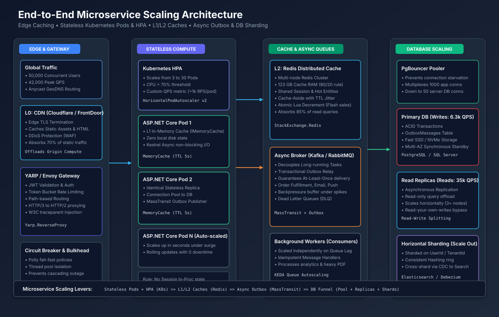

# Senior System Design Interview: Scaling a Microservice

---

## 1. Overview & Interview Prompt

**Prompt**: *Design a microservice that can handle rapid growth in traffic while keeping latency low, cost reasonable, and ensuring high availability.*

You will be expected to discuss **architecture evolution**, **capacity estimation**, and **concrete .NET/C# patterns** you would apply.

---

## 2. Stage 1 – Clarifying Questions & Scope

| Category | Typical Questions |
|----------|-------------------|
| Functional | What are the core APIs? Do we have long‑running operations (e.g., file processing, report generation)? |
| Non‑functional | Target **QPS**, latency SLA (p99), availability (%), data consistency model, expected data volume, geographic distribution |
| Deployment | Preferred cloud provider? Existing CI/CD pipelines? Constraints on language or framework? |
| Operational | Desired observability (metrics, tracing), rate‑limiting policies, fail‑over requirements |

Collecting these answers guides every later decision.

---

## 3. Stage 2 – Back‑of‑the‑Envelope Capacity Estimations

> **Assume**: 50 k concurrent active users, average 10 requests per user per minute → 8.3 k QPS (average) with a 5× peak factor → **≈ 42 k peak QPS**.

| Metric | Calculation |
|--------|-------------|
| **Average QPS** | `(50,000 users * 10 req/min) / 60 ≈ 8,300 QPS` |
| **Peak QPS** | `8,300 * 5 ≈ 42,000 QPS` |
| **Read/Write Split** (common) | 85 % reads, 15 % writes → 35.7 k read QPS / 6.3 k write QPS |
| **Daily Write Volume** | `6,300 QPS * 86,400 sec * 1 KB ≈ 540 GB/day` |
| **Cache RAM (80/20 rule)** | `Read data volume * 0.20` → assume 2 KB payload → `35.7k * 2 KB * 86,400 * 0.20 ≈ 123 GB RAM` |

These numbers drive autoscaling thresholds, cache sizing, and network provisioning.

---

## 4. Stage 3 – High‑Level Architecture Diagram



The diagram (SVG) shows the evolution from a single instance to a fully distributed, multi‑region deployment.

---

## 5. Stage 4 – Deep Dive – Scaling Levers (Step‑by‑Step)

### 5.1 Make the Service **Stateless**
- **Why**: Enables horizontal pod autoscaling without sticky sessions.
- **Action**: Move session state, in‑process caches, and temporary files to external stores.

```csharp
// Externalize session to Redis
builder.Services.AddStackExchangeRedisCache(o =>
{
    o.Configuration = "redis:6379";
    o.InstanceName = "SessionStore:";
});
builder.Services.AddSession(o => o.IdleTimeout = TimeSpan.FromMinutes(30));
```

### 5.2 Containerize & Deploy with an Orchestrator
- Build a minimal multi‑stage Docker image.
- Deploy via Kubernetes (or ECS, AKS) with a **Deployment** and **Service**.

```yaml
apiVersion: apps/v1
kind: Deployment
metadata:
  name: myservice
spec:
  replicas: 3
  selector:
    matchLabels:
      app: myservice
  template:
    metadata:
      labels:
        app: myservice
    spec:
      containers:
      - name: myservice
        image: myregistry/myservice:latest
        ports:
        - containerPort: 80
        resources:
          limits:
            cpu: "500m"
            memory: "256Mi"
```

### 5.3 Autoscaling – Horizontal Pod Autoscaler (HPA)
- **Metrics**: CPU ≤ 70 % *or* custom QPS metric from Prometheus.
- **Spec** (k8s v2):

```yaml
apiVersion: autoscaling/v2
kind: HorizontalPodAutoscaler
metadata:
  name: myservice-hpa
spec:
  scaleTargetRef:
    apiVersion: apps/v1
    kind: Deployment
    name: myservice
  minReplicas: 2
  maxReplicas: 20
  metrics:
  - type: Resource
    resource:
      name: cpu
      target:
        type: Utilization
        averageUtilization: 70
  - type: Pods
    pods:
      metric:
        name: http_requests_per_second
      target:
        type: AverageValue
        averageValue: 1000
```

### 5.4 Multi‑Level Caching (L0‑L2)
| Layer | Purpose | Tech |
|------|---------|------|
| **L0 – CDN** | Static assets, images, JS, CSS | Cloudflare / Azure Front Door |
| **L1 – In‑process (`MemoryCache`)** | Hot‑key reads, zero network latency | `builder.Services.AddMemoryCache();` |
| **L2 – Distributed (`Redis`)** | Shared cache across pods, survive restarts | `builder.Services.AddStackExchangeRedisCache(...);` |

*Cache‑aside pattern (C#):*

```csharp
public async Task<T> GetOrAddAsync<T>(string key, Func<Task<T>> factory, TimeSpan ttl)
{
    var cached = await _redisCache.GetStringAsync(key);
    if (cached != null) return JsonSerializer.Deserialize<T>(cached);

    var result = await factory();
    await _redisCache.SetStringAsync(key, JsonSerializer.Serialize(result), new DistributedCacheEntryOptions { AbsoluteExpirationRelativeToNow = ttl });
    return result;
}
```

### 5.5 Async Event‑Driven Decoupling
- Move long‑running work (email, PDF, analytics) to a message broker.
- Use **Transactional Outbox** for exactly‑once guarantees.

```csharp
// MassTransit + Outbox (Postgres)
builder.Services.AddMassTransit(x =>
{
    x.AddEntityFrameworkOutbox<AppDbContext>(o =>
    {
        o.UsePostgres();
        o.UseBusOutbox();
        o.QueryDelay = TimeSpan.FromSeconds(1);
    });
    x.UsingRabbitMq((ctx, cfg) =>
    {
        cfg.Host("rabbitmq://localhost");
        cfg.ConfigureEndpoints(ctx);
    });
});
```

### 5.6 Database Scaling Funnel
1. **Read‑Write Splitting** – Primary for writes, read replicas for SELECTs.
2. **Connection Pooling** – PgBouncer or `Npgsql` built‑in pool.
3. **Sharding** – Consistent hashing on `UserId` or tenant ID.
4. **CQRS** – Separate query and command models.

```csharp
// Polly circuit‑breaker for DB calls
var circuitBreaker = Policy
    .Handle<Exception>()
    .CircuitBreakerAsync(5, TimeSpan.FromSeconds(30));

await circuitBreaker.ExecuteAsync(async () =>
{
    await dbContext.SaveChangesAsync();
});
```

### 5.7 Observability & Rate Limiting
- **Metrics**: Prometheus exporter (`prometheus‑net`).
- **Tracing**: OpenTelemetry → Jaeger.
- **Rate Limiting**: Token bucket via `Microsoft.AspNetCore.RateLimiting`.

```csharp
app.UseRateLimiter(new RateLimiterOptions
{
    GlobalLimiter = PartitionedRateLimiter.CreateTokenBucketLimiter(
        partition => new TokenBucketRateLimiterOptions
        {
            TokenLimit = 1000,
            QueueProcessingOrder = QueueProcessingOrder.OldestFirst,
            QueueLimit = 100,
            ReplenishmentPeriod = TimeSpan.FromSeconds(1),
            TokensPerPeriod = 1000,
            AutoReplenishment = true
        })
});
```

### 5.8 Service Mesh (Optional for Large Deployments)
- Deploy **Istio** or **Linkerd** to centralize retries, circuit breaking, mTLS, and telemetry.
- Define **VirtualService** and **DestinationRule** YAMLs to control traffic routing.

---

## 6. Stage 5 – Interview‑Style Summary Card

| Scaling Lever | Naïve Approach | Production‑Grade Solution |
|--------------|----------------|---------------------------|
| **Statelessness** | Store session in memory | External Redis / JWT (no affinity) |
| **Vertical Scaling** | Bigger VM | Horizontal pods + HPA |
| **Caching** | No cache → DB overload | L0 CDN, L1 MemoryCache, L2 Redis cluster |
| **Sync Processing** | Do everything in request thread | Async event + Outbox pattern |
| **DB Throughput** | Single master DB | Read replicas → Sharding → CQRS |
| **Resilience** | Unlimited retries | Polly circuit‑breaker + exponential backoff + jitter |
| **Observability** | ad‑hoc logs | Prometheus + OpenTelemetry + Rate limiting |

---

## 7. Quick Checklist for the Interview
1. **Stateless** – external session, no local file writes.  
2. **Container + Orchestrator** – Docker + k8s deployment.  
3. **Autoscale** – HPA on CPU & custom QPS metric.  
4. **Cache hierarchy** – CDN → MemoryCache → Redis.  
5. **Async decoupling** – MassTransit + Outbox.  
6. **DB funnel** – replicas → sharding → CQRS.  
7. **Resilience** – Polly circuit‑breaker, token‑bucket rate limiting.  
8. **Observability** – Prometheus + OpenTelemetry.  
9. **(Optional) Service mesh** – Istio for global patterns.

Feel free to adapt any part for the specific tech stack you’re discussing.

