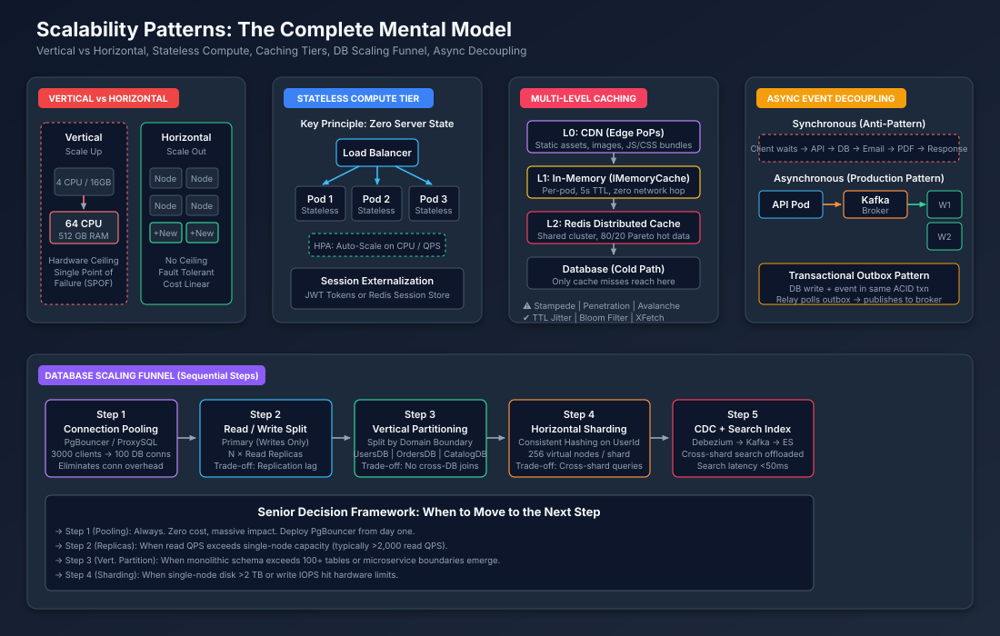

# Senior System Design Interview: Scalability Concepts & Patterns (বাংলা)

> **ইন্টারভিউয়ার প্রশ্ন:**  
> *"Scalability নিয়ে আপনার সম্পূর্ণ মানসিক মডেল ব্যাখ্যা করুন। মৌলিক প্যাটার্নগুলো কী এবং কোন পরিস্থিতিতে কোন কৌশল প্রথমে প্রয়োগ করবেন?"*

---

## ১. Stage 1: Clarifying Questions & Scope (প্রশ্ন স্পষ্টকরণ ও পরিধি)

### সিনিয়র ইঞ্জিনিয়াররা উত্তর দেওয়ার আগে যে প্রশ্নগুলো করেন:
১. **Workload Type**: Read-heavy (কন্টেন্ট প্ল্যাটফর্ম, সোশ্যাল ফিড)? Write-heavy (IoT টেলিমেট্রি, ব্যাংকিং লেজার)? Mixed (ই-কমার্স)?
২. **বর্তমান স্কেল ও সমস্যার জায়গা**: বিদ্যমান DAU/QPS কত? সিস্টেম প্রথমে কোথায় ব্যর্থ হচ্ছে — CPU, মেমোরি, ডিস্ক IOPS, নেটওয়ার্ক, নাকি কানেকশন পুল?
৩. **Consistency Model**: প্রতিটি Read-এ একদম সর্বশেষ ডাটা দরকার (Strong Consistency / ACID), নাকি কয়েক সেকেন্ডের পুরোনো ডাটা গ্রহণযোগ্য (Eventual Consistency)?
৪. **Latency Budget**: গ্রহণযোগ্য p99 লেটেন্সি কত? (ইন্টারেক্টিভ UI-এর জন্য $< 100\text{ ms}$, ব্যাচ অ্যানালিটিক্সের জন্য $< 1\text{ s}$)।
৫. **Availability SLA**: $99.9\%$ (বছরে ৮.৭ ঘণ্টা ডাউনটাইম) বনাম $99.99\%$ (বছরে ৫২ মিনিট) — এটি রিডান্ড্যান্সি ডিজাইনকে মৌলিকভাবে পরিবর্তন করে।

---

## ২. Stage 2: Back-of-the-Envelope Capacity Estimation (ক্যাপাসিটি হিসাব)

### ৪-সংখ্যার ক্যাপাসিটি টুলকিট

প্রতিটি Scalability ইন্টারভিউ প্রশ্ন ৪টি সংখ্যা হিসাব করতে নেমে আসে:

### সংখ্যা ১: Traffic Throughput (QPS)
$$\text{Average QPS} = \frac{\text{দৈনিক রিকোয়েস্ট}}{100,000 \text{ সেকেন্ড (রাউন্ডেড)}}$$
$$\text{Peak QPS} = \text{Average QPS} \times (2\text{ থেকে }5)$$

**কাজ করে দেখানো** (100M DAU সোশ্যাল প্ল্যাটফর্ম, প্রতি ব্যবহারকারী ১০টি অ্যাকশন/দিন):
$$\text{দৈনিক রিকোয়েস্ট} = 100\text{M} \times 10 = 1,000,000,000 = 10^9$$
$$\text{Average QPS} = \frac{10^9}{10^5} = 10,000\text{ QPS}$$
$$\text{Peak QPS} = 10,000 \times 3 = \mathbf{30,000\text{ QPS}}$$

### সংখ্যা ২: Storage Growth (৫ বছর)
$$\text{দৈনিক স্টোরেজ} = \text{দৈনিক Writes} \times \text{গড় Payload আকার}$$
$$\text{৫-বছরের স্টোরেজ} = \text{দৈনিক} \times 365 \times 5 \approx \text{দৈনিক} \times 2,000$$

**কাজ করে দেখানো** (20% Writes = দৈনিক 200M Writes, প্রতিটি 500 Bytes):
$$\text{দৈনিক} = 200\text{M} \times 500\text{ B} = 100\text{ GB/day}$$
$$\text{৫-বছর} = 100\text{ GB} \times 2,000 = \mathbf{200\text{ TB}}$$

### সংখ্যা ৩: Network Bandwidth
$$\text{Egress (Read BW)} = \text{Read QPS} \times \text{Response Payload আকার}$$

**কাজ করে দেখানো** (24,000 Read QPS × 10 KB রেসপন্স):
$$\text{Egress} = 24,000 \times 10\text{ KB} = 240,000\text{ KB/s} = \mathbf{240\text{ MB/s}} \approx \mathbf{1.9\text{ Gbps}}$$

> **সিদ্ধান্ত**: একটি মাত্র 1 Gbps NIC যথেষ্ট নয়। 10 Gbps NIC অথবা Load Balancer-এর পেছনে একাধিক সার্ভার প্রয়োজন।

### সংখ্যা ৪: Cache Memory (80/20 Pareto Rule)
$$\text{Cache RAM} = \text{দৈনিক Read ডাটা ভলিউম} \times 0.20$$

**কাজ করে দেখানো** (দৈনিক 800M Reads × 2 KB প্রতিটি):
$$\text{দৈনিক Read ভলিউম} = 800\text{M} \times 2\text{ KB} = 1.6\text{ TB}$$
$$\text{Cache RAM} = 1.6\text{ TB} \times 0.20 = \mathbf{320\text{ GB RAM}}$$

> **সিদ্ধান্ত**: ১০-নোডের Redis Cluster (প্রতিটি 32 GB RAM) ফেইলওভার রেপ্লিকা সহ স্থাপন করা।

---

## ৩. Stage 3: High-Level Architecture — Scalability Patterns Map



### ৫টি মূল Scalability স্তম্ভ

| # | স্তম্ভ | কী সমস্যার সমাধান করে | মূল প্রযুক্তি (.NET / C#) |
| :---: | :--- | :--- | :--- |
| ১ | **Vertical vs. Horizontal Scaling** | রিসোর্স ক্যাপাসিটি সিলিং | Kubernetes HPA, VM Scale Sets |
| ২ | **Stateless Compute Tier** | সার্ভার অ্যাফিনিটি ও সেশন হটস্পট | JWT Tokens, Redis Session Store, `Yarp.ReverseProxy` |
| ৩ | **Multi-Level Caching** | Read বিবর্ধন ও DB লোড | `IMemoryCache` (L1), `StackExchange.Redis` (L2), CDN (L0) |
| ৪ | **Async Event Decoupling** | দীর্ঘস্থায়ী কাজের ব্লকিং ও টাইট কাপলিং | RabbitMQ, Kafka, `MassTransit`, Transactional Outbox |
| ৫ | **Database Scaling Funnel** | Write থ্রুপুট ও স্টোরেজ সীমা | PgBouncer, Read Replicas, Consistent Hashing Sharding |

---

## ৪. Stage 4: Deep Dive — প্রতিটি স্তম্ভের বিস্তারিত ব্যাখ্যা

### স্তম্ভ ১: Vertical Scaling বনাম Horizontal Scaling

#### Vertical Scaling (Scale Up)
- একক সার্ভারে বেশি CPU, RAM অথবা দ্রুততর ডিস্ক যোগ করা।
- **সুবিধা**:
  - কোনো কোড পরিবর্তনের প্রয়োজন নেই। শুধু VM রিসাইজ করলেই হয়।
  - ডিস্ট্রিবিউটেড কোঅর্ডিনেশন ওভারহেড নেই।
- **অসুবিধা ও ট্রেড-অফ**:
  - হার্ডওয়্যার সিলিং ($96$ কোর / $24\text{ TB}$ RAM ক্লাউডের সর্বোচ্চ ব্যবহারিক সীমা)।
  - Single Point of Failure — মেশিন মারা গেলে পুরো সিস্টেম বন্ধ।
  - খরচ এক্সপোনেনশিয়ালি বাড়ে ($2\times$ CPU-র সার্ভারের দাম $3\text{–}4\times$)।

#### Horizontal Scaling (Scale Out)
- Load Balancer-এর পেছনে আরো সার্ভার (Node/Pod) যোগ করা।
- **সুবিধা**:
  - কোনো হার্ডওয়্যার সিলিং নেই। চাহিদা অনুযায়ী রৈখিকভাবে নোড যোগ করা যায়।
  - Fault Tolerant — একটি নোড ক্র্যাশ করলে সিস্টেম চলতে থাকে।
  - সাশ্রয়ী (কমোডিটি হার্ডওয়্যার ব্যবহার করা যায়)।
- **অসুবিধা ও ট্রেড-অফ**:
  - অ্যাপ্লিকেশন অবশ্যই **Stateless** হতে হবে।
  - ডিস্ট্রিবিউটেড সিস্টেমের জটিলতা আসে (Network Partition, Consistency চ্যালেঞ্জ)।
- **Target Technology (.NET)**:
  - Kubernetes Horizontal Pod Autoscaler (HPA)।
  - `Yarp.ReverseProxy` ইন্টেলিজেন্ট L7 রাউটিং-এর জন্য।

> **সিনিয়র নিয়ম**: সরলতার জন্য প্রথমে Vertical দিয়ে শুরু করুন। যখন খরচ-কার্যকারিতার ক্রসওভার পয়েন্টে পৌঁছাবেন (সাধারণত প্রতি ইনস্ট্যান্সে ৪–৮ কোরের আশেপাশে) তখন Horizontal-এ যান।

---

### স্তম্ভ ২: Stateless Application Tier

Horizontal Scaling-এর জন্য Compute Tier কেন অবশ্যই Stateless হতে হবে?

| Stateful Server (অ্যান্টি-প্যাটার্ন) | Stateless Server (প্রোডাকশন প্যাটার্ন) |
| :--- | :--- |
| লোকাল মেমোরিতে সেশন রাখা (`InProc`) | Redis বা JWT-তে সেশন সংরক্ষণ |
| Sticky Session প্রয়োজন (L7 Affinity) | যেকোনো সার্ভার যেকোনো রিকোয়েস্ট সামলাতে পারে |
| সার্ভার রিস্টার্ট = সব সেশন হারানো | পড রিস্টার্টে কোনো ডাটা হারায় না |
| নিরাপদে Auto-Scale করা যায় না | HPA অবাধে পড স্কেল করতে পারে |

**.NET বাস্তবায়ন**:
```csharp
// Redis-এ সেশন এক্সটার্নালাইজ করা
builder.Services.AddStackExchangeRedisCache(options =>
{
    options.Configuration = "redis-cluster:6379";
    options.InstanceName = "SessionStore:";
});
builder.Services.AddSession(options =>
{
    options.IdleTimeout = TimeSpan.FromMinutes(30);
    options.Cookie.IsEssential = true;
});
```

---

### স্তম্ভ ৩: Multi-Level Caching Strategy

ক্যাশ অ্যাপ্লিকেশন এবং ডাটাবেজের মাঝে বসে পুনরাবৃত্তিমূলক Read শোষণ করে:

```text
Request Flow:
  Client → CDN (L0) → App Pod (L1: IMemoryCache) → Redis (L2) → Database (Cold Path)

Hit Rates (আনুমানিক):
  L0 CDN:   ৬০-৭০% স্ট্যাটিক অ্যাসেট রিকোয়েস্ট আপনার সার্ভারে পৌঁছায় না
  L1 Mem:   ২০-৩০% ডায়নামিক Read লোকাল RAM থেকেই সার্ভ হয়
  L2 Redis:  ৪০-৫০% বাকি Read ডিস্ট্রিবিউটেড ক্যাশ থেকে সার্ভ হয়
  DB:        মূল রিকোয়েস্টের মাত্র ৫-১৫% প্রকৃতপক্ষে ডাটাবেজে পৌঁছায়
```

#### Cache-এর ব্যর্থতা মোড ও প্রতিরোধ কৌশল

| ব্যর্থতার ধরন | কী ঘটে | প্রতিকার |
| :--- | :--- | :--- |
| **Cache Penetration** | অস্তিত্বহীন কি-র জন্য কুয়েরি ক্যাশ বাইপাস করে DB-তে আঘাত করে | Bloom Filter অথবা Null ভ্যালু ৩০s TTL সহ ক্যাশ করা |
| **Cache Avalanche** | অনেক কি একসাথে মেয়াদোত্তীর্ণ হয়ে DB-তে তীব্র চাপ সৃষ্টি করে | TTL-এ র‍্যান্ডম জিটার: `TTL = baseTTL + Random(0, 30s)` |
| **Cache Stampede** | জনপ্রিয় কি মেয়াদোত্তীর্ণ হলে ১০০০টি থ্রেড একসাথে DB-তে কুয়েরি করে | Distributed Lock (Redlock) অথবা XFetch Early Expiration |
| **Hot Key Problem** | সেলিব্রিটি/ভাইরাল কন্টেন্ট একটি Redis শার্ড ওভারলোড করে | Key Salting: র‍্যান্ডম সাফিক্স যোগ করা, L1 লোকাল ক্যাশ দিয়ে শোষণ |

---

### স্তম্ভ ৪: Asynchronous Event Decoupling

#### সিনক্রোনাস প্রসেসিং-এর সমস্যা:
ব্যবহারকারী অর্ডার দিলে সিনক্রোনাস সিস্টেম HTTP রিকোয়েস্টের ভেতরেই সব করে:
১. অর্ডার ভ্যালিডেট → ২. পেমেন্ট চার্জ → ৩. ইনভেন্টরি আপডেট → ৪. ইমেইল পাঠানো → ৫. PDF চালান তৈরি → ৬. HTTP 200 রিটার্ন

ধাপ ৪-এ ইমেইল ৩ সেকেন্ড সময় নিলে ব্যবহারকারী পুরো চেইনের জন্য ৩+ সেকেন্ড অপেক্ষা করে।

#### Async সমাধান (Event-Driven Architecture):
১. API অর্ডার গ্রহণ → DB-তে লিখে + `OrderPlacedEvent` মেসেজ ব্রোকারে পাঠায় → তৎক্ষণাৎ HTTP 202 Accepted রিটার্ন করে।
২. স্বাধীন Worker Consumer-রা নিজেদের গতিতে ইমেইল, PDF, অ্যানালিটিক্স প্রসেস করে।

#### Transactional Outbox Pattern:
- **সমস্যা**: অ্যাপ DB-তে লিখল কিন্তু Kafka-তে ইভেন্ট পাঠানোর আগেই ক্র্যাশ করল — ইভেন্ট হারিয়ে গেল।
- **সমাধান**: একই ডাটাবেজ ট্রানজ্যাকশনের ভেতরে `OutboxMessages` টেবিলে ইভেন্ট লেখা। একটি Relay সার্ভিস Outbox পোল করে ব্রোকারে পাবলিশ করে।

**.NET বাস্তবায়ন** (`MassTransit`):
```csharp
builder.Services.AddMassTransit(x =>
{
    x.AddEntityFrameworkOutbox<AppDbContext>(o =>
    {
        o.UsePostgres();
        o.UseBusOutbox();
        o.QueryDelay = TimeSpan.FromSeconds(1);
    });
    x.UsingRabbitMq((context, cfg) =>
    {
        cfg.Host("rabbitmq://localhost");
        cfg.ConfigureEndpoints(context);
    });
});
```

---

### স্তম্ভ ৫: Database Scaling Funnel

ডাটাবেজ হলো সবচেয়ে কঠিন কম্পোনেন্ট স্কেল করার জন্য কারণ এটি Mutable State ধারণ করে। এই ক্রমিক ফানেল অনুসরণ করুন — সরল বিকল্প শেষ না করে কখনোই Sharding-এ যাবেন না:

| ধাপ | কখন প্রয়োগ করবেন | কী করে | .NET প্রযুক্তি |
| :---: | :--- | :--- | :--- |
| **১. Connection Pooling** | সর্বদা (প্রথম দিন থেকে) | ৩,০০০ অ্যাপ কানেকশনকে ১০০টি DB কানেকশনে মাল্টিপ্লেক্স করে | PgBouncer, ADO.NET `MaxPoolSize` |
| **২. Read/Write Splitting** | Read QPS > ২,০০০ হলে | N রেপ্লিকায় Read রাউট করে, Primary-তে Write | EF Core, Npgsql রাউটিং |
| **৩. Vertical Partitioning** | স্কিমা > ১০০ টেবিল বা মাইক্রোসার্ভিস বাউন্ডারি তৈরি হলে | ডোমেন অনুযায়ী DB বিভক্ত করে (UsersDB, OrdersDB) | প্রতি ডোমেইনে আলাদা `DbContext` |
| **৪. Horizontal Sharding** | একক-নোডের ডিস্ক > ২ TB বা Write IOPS সম্পৃক্ত হলে | Row-গুলো N ডাটাবেজ নোডে হ্যাশ-পার্টিশন করে | Consistent Hashing, Citus, Vitess |
| **৫. CDC + Search Index** | জটিল ক্রস-শার্ড কুয়েরি প্রয়োজন হলে | DB পরিবর্তন Elasticsearch-এ স্ট্রিম করে | Debezium CDC, `NEST` (.NET ES) |

---

## ৫. Stage 5: Resilience, Bottlenecks & Interview Drills (রেজিলিয়েন্স ও ড্রিল)

### Drill 1: *"আপনার Redis ক্যাশ ক্লাস্টার সম্পূর্ণ বন্ধ হয়ে গেলে কী হবে?"*
- **তাৎক্ষণিক পদক্ষেপ**: Circuit Breaker ট্রিপ করে। অ্যাপ Read Replicas থেকে সরাসরি পড়া শুরু করে (লেটেন্সি বাড়বে, কিন্তু সম্পূর্ণ আউটেজ হবে না)।
- **সুরক্ষা**: ফলব্যাক পাথে Rate Limit প্রয়োগ করে DB ওভারলোড রোধ করা। যেখানে সম্ভব L1 In-Memory ক্যাশ থেকে স্টেল ডাটা ফেরত দেওয়া।

### Drill 2: *"Cache Key মেয়াদোত্তীর্ণ হওয়ার পর Thundering Herd কীভাবে সামলাবেন?"*
- **Distributed Lock**: শুধুমাত্র একটি থ্রেড লক অধিগ্রহণ করে, DB কুয়েরি করে এবং ক্যাশ রিপপুলেট করে। বাকি থ্রেডগুলো অপেক্ষা করে নতুন ক্যাশ পড়ে।
- **XFetch (Probabilistic Early Expiration)**: প্রতিটি Read সম্ভাব্যভাবে TTL-এর আগেই ক্যাশ রিফ্রেশ করে।

### Drill 3: *"ফ্ল্যাশ সেলের সময় Primary Database ক্র্যাশ করলে কী হবে?"*
- **Automated Failover**: Patroni (PostgreSQL) অথবা Always On AG (SQL Server) ৩০ সেকেন্ডের মধ্যে Synchronous Standby-কে প্রাইমারিতে রূপান্তর করে।
- **Idempotent Retries**: ক্লায়েন্ট একই `Idempotency-Key` হেডার দিয়ে পুনরায় চেষ্টা করে। সার্ভার Redis কি বা DB Unique Constraint ব্যবহার করে ডুপ্লিকেট প্রতিরোধ করে।

---

## ৬. Senior Summary: Scalability Decision Matrix

| জিজ্ঞাসা | যদি উত্তর হয়... | স্কেলিং পদক্ষেপ |
| :--- | :--- | :--- |
| অ্যাপ কি Stateful (মেমোরিতে সেশন)? | হ্যাঁ | সেশন Redis / JWT-তে স্থানান্তর করা |
| > ৬০% রিকোয়েস্ট কি স্ট্যাটিক কন্টেন্টের জন্য? | হ্যাঁ | CDN + Blob Storage স্থাপন করা |
| Read QPS কি একক DB-র সক্ষমতা ছাড়িয়ে গেছে? | হ্যাঁ | L1/L2 ক্যাশিং + Read Replicas যোগ করা |
| Write QPS কি একক DB-র সক্ষমতা ছাড়িয়ে গেছে? | হ্যাঁ | Connection Pooling → Sharding |
| দীর্ঘ কাজ (Email, PDF) কি HTTP সাইকেলে হচ্ছে? | হ্যাঁ | Message Broker + Outbox দিয়ে Decouple করা |
| ডাটাসেট কি > ২ TB বা IOPS সীমায়? | হ্যাঁ | Horizontal Sharding (Consistent Hashing) |
| ব্যবহারকারীরা কি একাধিক মহাদেশে ছড়িয়ে? | হ্যাঁ | Multi-Region with GeoDNS + Regional Stacks |

