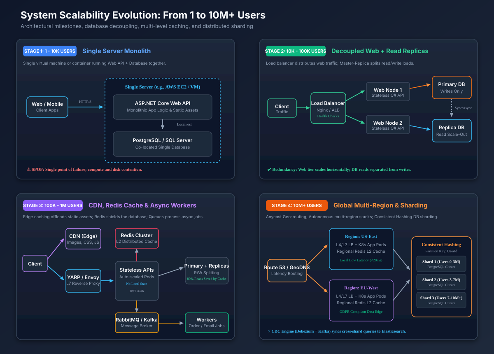

# Senior System Design Interview: Scalability (১ থেকে ১০M+ Users)

## ১. Overview & Problem Statement (সংক্ষিপ্ত বিবরণ ও সমস্যা)
- **Role/Level**: Senior / Staff Software Engineer
- **Question**: এমন একটি এন্ড-টু-এন্ড ওয়েব আর্কিটেকচার ডিজাইন করুন যা প্রথম দিন ১ জন ব্যবহারকারী থেকে শুরু করে ১০ মিলিয়ন Daily Active Users (DAU) পর্যন্ত নির্বিঘ্নে স্কেল করতে পারে। আর্কিটেকচারাল মাইলস্টোন, বটলনেক, ডাটাবেজ ইভোলিউশন, ক্যাশিং টিয়ার এবং রেজিলিয়েন্স ট্রেড-অফ ব্যাখ্যা করুন।

---

## ২. Stage 1: Clarifying Questions & Scope (প্রশ্ন স্পষ্টকরণ ও পরিধি)

### Functional Requirements (কার্যকরী প্রয়োজনীয়তা)
- উচ্চ ভলিউমের Read/Write সম্পন্ন ই-কমার্স প্ল্যাটফর্ম (Catalog browsing, User profiles, Shopping carts, Order processing)।
- কোটি কোটি পণ্যের মধ্যে দ্রুত Search এবং Filtering সুবিধা।

### Non-Functional Requirements & SLAs (অ-কার্যকরী প্রয়োজনীয়তা ও SLAs)
- **Availability Target**: $99.99\%$ (Four Nines $\approx$ বছরে সর্বোচ্চ ৫২.৬ মিনিট ডাউনটাইম)।
- **Latency Constraints**: p99 read latency $< 100\text{ ms}$, p99 write latency $< 500\text{ ms}$।
- **Consistency**: Catalog/Search এবং Analytics-এর জন্য Eventual Consistency; Checkout, Payments এবং Inventory-এর জন্য Strong Consistency (ACID)।
- **Geographic Scale**: Latency-based DNS routing সহ গ্লোবাল মাল্টি-রিজিয়ন অ্যাক্সেস।

---

## ৩. Stage 2: Back-of-the-Envelope Capacity Estimations (ক্যাপাসিটি হিসাব)

### ১. Request Throughput (QPS)
- **Daily Active Users (DAU)**: ১০,০০০,০০০ ($10\text{M}$)।
- **ব্যবহারকারী প্রতি দৈনিক অ্যাকশন**: গড়ে ২০টি Read রিকোয়েস্ট, ২টি Write রিকোয়েস্ট।
- **দৈনিক মোট Read Requests**: $10\text{M} \times 20 = 200,000,000$ রিকোয়েস্ট।
- **দৈনিক মোট Write Requests**: $10\text{M} \times 2 = 20,000,000$ রিকোয়েস্ট।
- **প্রতি দিনের সেকেন্ড সংখ্যা**: $\approx ১০০,০০০$ সেকেন্ড (প্রকৃত: ৮৬,৪০০)।
- **গড় Read QPS**:
  $$\frac{200,000,000}{100,000} = 2,000\text{ QPS}$$
- **Peak Read QPS** ($3\times$ ফ্যাক্টর):
  $$2,000 \times 3 = 6,000\text{ QPS}$$
- **Peak Write QPS** ($3\times$ ফ্যাক্টর):
  $$\frac{20,000,000}{100,000} \times 3 = 600\text{ QPS}$$

### ২. Storage Projections (৫ বছরের হিসাব)
- **গড় Write Payload**: $2\text{ KB}$ (Metadata, Order items, Timestamps)।
- **দৈনিক স্টোরেজ বৃদ্ধি**:
  $$20,000,000 \times 2\text{ KB} = 40\text{ GB/day}$$
- **৫ বছরের মোট স্টোরেজ**:
  $$40\text{ GB} \times 365 \times 5 \approx 73\text{ TB}$$

### ৩. Memory & Cache Sizing (80/20 Pareto Rule)
- দৈনিক Read রিকোয়েস্টের ২০% ক্যাশে রাখা হবে।
- দৈনিক Read ডাটার পরিমাণ: $200\text{M} \times 2\text{ KB} = 400\text{ GB}$।
- **ক্যাশের জন্য প্রয়োজনীয় RAM**:
  $$400\text{ GB} \times 0.20 = 80\text{ GB RAM}$$
  *(৩২ জিবি র্যামের ৩টি Redis নোডের ক্লাস্টার নিরাপদ হেডরুম সহ এটি সামলাতে পারবে)।*

---

## ৪. Stage 3: High-Level Evolutionary Architecture (আর্কিটেকচারাল বিবর্তন)



### বিবর্তনের মূল মাইলস্টোনসমূহ:
১. **Stage 1: 1 - 10K Users (Single Server Monolith)**:
   - একক ভার্চুয়াল মেশিনে ASP.NET Core Web API এবং PostgreSQL ডাটাবেজের সহাবস্থান।
   - *সীমাবদ্ধতা*: Single Point of Failure (SPOF) এবং কম্পিউট ও ডিস্ক রিসোর্সের ভাগাভাগি জনিত বাধা।
২. **Stage 2: 10K - 100K Users (Decoupled Web + Read Replicas)**:
   - Layer 4/7 Load Balancer-এর পেছনে স্টেটলেস ওয়েব নোড স্থাপন।
   - ডাটাবেজ পৃথক করে Primary (Write) এবং Asynchronous Read Replicas-এ ভাগ করা।
৩. **Stage 3: 100K - 1M Users (CDN, Redis Distributed Cache & Async Queues)**:
   - Cloudflare CDN-এর মাধ্যমে নেটওয়ার্ক প্রান্তে স্ট্যাটিক অ্যাসেট ক্যাশ করা।
   - Redis ক্লাস্টার ৮০% পুনরাবৃত্তিমূলক Read কুয়েরি ডাটাবেজে যাওয়া থেকে বাঁচায়।
   - RabbitMQ/Kafka-এর মাধ্যমে দীর্ঘস্থায়ী কাজগুলো (Order fulfillment, Email) ব্যাকগ্রাউন্ড ওয়ার্কারের কাছে অ্যাসিনক্রোনাসলি পাঠানো।
৪. **Stage 4: 10M+ Users (Global Multi-Region & Consistent Hashing Sharding)**:
   - Anycast GeoDNS-এর মাধ্যমে ব্যবহারকারীদের স্বায়ত্তশাসিত আঞ্চলিক ডিপ্লয়মেন্টে (US-East, EU-West) রাউট করা।
   - `UserId`-এর উপর Consistent Hashing প্রয়োগ করে রিলেশনাল ডাটাবেজকে একাধিক শার্ডে ভাগ করা।
   - Asynchronous Change Data Capture (Debezium + Kafka) ক্রস-শার্ড অনুসন্ধানের জন্য Elasticsearch-এ ডাটা স্ট্রিম করে।

---

## ৫. Stage 4: Deep Dive — Scaling Tier-by-Tier (টিয়ার ভিত্তিক স্কেলিং)

### ১. Web & Application Tier (Stateless Scaling)
- **Session Affinity বর্জন**: ইউজার সেশন Redis-এ সংরক্ষণ করুন অথবা সেলফ-কন্টেইন্ড স্টেটলেস JWT টোকেন ব্যবহার করুন।
- **Horizontal Pod Autoscaling (HPA)**: কাস্টম মেট্রিক (HTTP request queue depth, CPU > 70%) অনুযায়ী স্বয়ংক্রিয়ভাবে API পড স্কেল করুন।
- **.NET Enterprise Stack**:
  - Reverse Proxy: `Yarp.ReverseProxy` (L7 routing, SSL termination, Health checks)।
  - Server Runtime: HTTP/2 এবং HTTP/3 মাল্টিপ্লেক্সিং সহ Kestrel।

### ২. Caching Tier (Preventing Stampedes & Hotkeys)
- **Multi-Level Caching (L1 + L2)**:
  - **L1 In-Memory Cache**: লোকালি সেলিব্রিটি রিড সামলাতে স্বল্প TTL (যেমন: ৫ সেকেন্ড) সহ `MemoryCache`।
  - **L2 Distributed Cache**: Consistent Hashing দ্বারা পার্টিশন করা Redis ক্লাস্টার।
- **ব্যর্থতা প্রতিরোধ কৌশল**:
  - *Cache Penetration*: গেটওয়েতে Bloom Filter অথবা ৩০ সেকেন্ড TTL সহ Null ভ্যালু ক্যাশ করা।
  - *Cache Avalanche*: ক্যাশ কি-এর TTL-এ র‍্যান্ডম জিটার যোগ করা (`TTL = baseTTL + Random(0, 30s)`)।
  - *Cache Stampede*: ডিস্ট্রিবিউটেড লক অথবা প্রবাবিলিস্টিক আর্লি কম্পিউটেশন (XFetch)।

### ৩. Database Tier (Single Instance থেকে Sharding)
- **Read/Write Splitting**: `SELECT` কুয়েরিগুলো Read Replica-তে পাঠানো এবং `INSERT/UPDATE/DELETE` পাঠানো Primary ডাটাবেজে।
- **Vertical Partitioning**: ডোমেন বাউন্ডারি অনুযায়ী একক ডাটাবেজ টেবিলগুলোকে আলাদা করা (`UsersDB`, `OrdersDB`, `CatalogDB`)।
- **Horizontal Partitioning (Sharding)**:
  - Shard Key: `UserId`, যাতে ব্যবহারকারী-ভিত্তিক ট্রানজ্যাকশন একক শার্ডে সম্পন্ন হয়।
  - নির্বিঘ্ন রি-ব্যালান্সিং নিশ্চিত করতে ফিজিক্যাল শার্ড প্রতি ২৫৬টি ভার্চুয়াল নোড সহ Consistent Hashing।
  - ক্রস-শার্ড কুয়েরির জন্য Asynchronous Change Data Capture (Debezium/Kafka) ব্যবহার করে Elasticsearch/OpenSearch-এ সিঙ্ক করা।

---

## ৬. Stage 5: Resilience, Bottlenecks & Interview Drills (রেজিলিয়েন্স ও ড্রিল)

### Drill 1: Primary Database Failover
- **সমস্যা**: পিক ট্রাফিকের সময় Primary Database ক্র্যাশ করেছে।
- **সমাধান**:
  - Patroni/Raft অথবা AWS Aurora Multi-AZ-এর মাধ্যমে স্বয়ংক্রিয় ফেইলওভার (৩০ সেকেন্ডের মধ্যে স্ট্যান্ডবাই প্রাইমারিতে রূপান্তরিত হয়)।
  - ওয়েব টিয়ারে `Polly` (`Microsoft.Extensions.Http.Resilience`)-এর সার্কিট ব্রেকার, যাতে কানেকশন পুল নষ্ট না করে দ্রুত HTTP 503 ফেরত দেওয়া যায়।
  - Read-your-own-writes consistency: নতুন আপডেট করা ব্যবহারকারীকে ৫ সেকেন্ড প্রাইমারিতে পিন করে রাখা যাতে রেপ্লিকা ল্যাগ এড়ানো যায়।

### Drill 2: Flash Sale Concurrency
- **সমস্যা**: ১০০,০০০ ব্যবহারকারী একই সাথে সীমিত ৫০০টি পণ্য কেনার চেষ্টা করছে।
- **সমাধান**:
  - ডাটাবেজে রো-লেভেল লকিং (`SELECT ... FOR UPDATE`) এড়িয়ে চলা।
  - Redis Lua স্ক্রিপ্টের মাধ্যমে অ্যাটমিক ডিক্রিমেন্ট:
    ```lua
    local current = redis.call('GET', KEYS[1])
    if tonumber(current) > 0 then
        redis.call('DECR', KEYS[1])
        return 1
    else
        return 0
    end
    ```
  - সফল ডিক্রিমেন্টের পর RabbitMQ/Kafka-তে মেসেজ পাঠানো; ব্যাকগ্রাউন্ড ওয়ার্কার Outbox প্যাটার্ন ব্যবহার করে ট্রানজ্যাকশন সম্পন্ন করবে।

### Drill 3: Cascading Failure Protection
- `Microsoft.AspNetCore.RateLimiting`-এর মাধ্যমে Token Bucket রেট লিমিটিং প্রয়োগ।
- Bulkhead isolation ব্যবহার করে ক্রিটিক্যাল চেকআউট সার্ভিস এবং সার্চ সার্ভিসের থ্রেড পুল আলাদা রাখা।

---

## ৭. Senior Architectural Summary Card

| Scaling Challenge | Naive Approach | Senior/Staff Production Solution |
| :--- | :--- | :--- |
| **Traffic Spikes** | Vertical Scaling (বড় সার্ভার) | Stateless Horizontal Pods + Anycast CDN + Autoscaling |
| **Read Bottleneck** | সরাসরি Master DB-তে কুয়েরি | L1 MemoryCache + Redis Cluster + Read Replicas |
| **Write Bottleneck** | একক ডাটাবেজ সার্ভার | Vertical separation $\rightarrow$ Sharding with Consistent Hashing |
| **Complex Search** | SQL `LIKE '%keyword%'` | Asynchronous CDC (Debezium) into Elasticsearch/OpenSearch |
| **Flash Sale Contention** | SQL Row Locks (`FOR UPDATE`) | Redis Atomic Lua decrement + Kafka Queue + Outbox Pattern |
| **Cascading Failures** | অনিয়ন্ত্রিত রিট্রাই | Exponential Backoff with Jitter + Circuit Breaker (`Polly`) |

