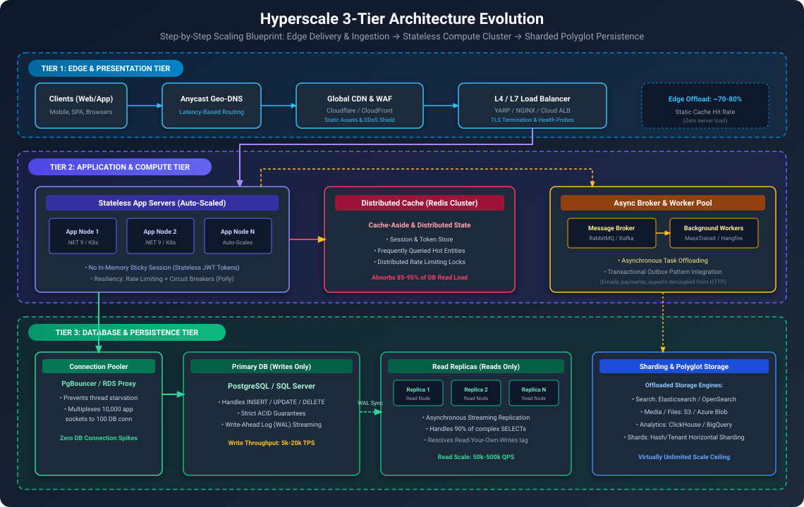

# Senior System Design Interview: 3-Tier অ্যাপ্লিকেশন কীভাবে স্কেল করবেন?

## ১. Overview & Problem Statement (সংক্ষিপ্ত বিবরণ ও সমস্যা)
- **Role/Level**: Senior / Staff Software Engineer
- **Interview Question**: *"আপনাকে একটি প্রচলিত 3-Tier Web Application (Presentation Tier, Application Tier, Data Tier) দেওয়া হলো যা উচ্চ ট্রাফিকের কারণে ধীরগতির হয়ে পড়েছে। আপনি কীভাবে ধাপে ধাপে এটি স্কেল করবেন? আপনার মানসিক মডেল, প্রতিটি টিয়ারের বটলনেক এবং বাস্তবায়ন কৌশল বিস্তারিত ব্যাখ্যা করুন।"*

---

## ২. Stage 1: Clarifying Questions & Scope (প্রশ্ন স্পষ্টকরণ ও পরিধি)

সিনিয়র ইঞ্জিনিয়ার কখনো অনুমান নির্ভর সমাধান দেন না; বরং সিস্টেমের বাস্তব অবস্থা স্পষ্ট করতে সঠিক প্রশ্ন করেন:

### গুরুত্বপূর্ণ প্রশ্নসমূহ:
১. **Workload Profile**: এটি কি Read-heavy (ই-কমার্স ক্যাটালগ, সোশ্যাল ফিড) নাকি Write-heavy (টেলিমেট্রি, ব্যাংকিং লেজার)?
   - *ইন্টারভিউ অনুমান*: Read-heavy (৮৫% Reads, ১৫% Writes)।
২. **বর্তমান আর্কিটেকচারাল অবস্থা**: স্টেট (State) বর্তমানে কোথায় সংরক্ষিত হচ্ছে?
   - *ইন্টারভিউ অনুমান*: মনোলিথিক ওয়েব সার্ভারের লোকাল মেমোরিতে (`InProc` সেশন) এবং একটি মাত্র রিলেশনাল ডাটাবেজ ইনস্ট্যান্সে (PostgreSQL অথবা SQL Server)।
৩. **বটলনেকের লক্ষণ**: সিস্টেমটি প্রথমে কোথায় ক্র্যাশ করছে?
   - *ইন্টারভিউ অনুমান*: DB Connection Pool ফুরিয়ে যাওয়া (HTTP 500 এরর), অ্যাপ সার্ভারের উচ্চ CPU ব্যবহার এবং দীর্ঘ p99 লেটেন্সি (> ৩ সেকেন্ড)।
৪. **SLAs ও RTO/RPO**:
   - Availability: ৯৯.৯৯% (মাল্টিপল Availability Zone-এ হাই-অ্যাভেইলেবিলিটি)।
   - Latency: p95 $< 150\text{ ms}$, p99 $< 300\text{ ms}$।

---

## ৩. Stage 2: Back-of-the-Envelope Capacity Estimations (ক্যাপাসিটি হিসাব)

সংখ্যা ও ডাটার ভিত্তিতে স্কেলিং পরিকল্পনা সাজানো যাক:

- **Active Concurrency**: ৫০,০০০ কনকারেন্ট সক্রিয় ব্যবহারকারী।
- **গড় QPS**:
  $$\text{দৈনিক রিকোয়েস্ট} = ৫০,০০০,০০০ \implies \text{Avg QPS} = \frac{50,000,000}{86,400} \approx 600\text{ QPS}$$
- **পিক ট্রাফিক QPS** (ক্যাম্পেইনের সময় ৫ গুণ বৃদ্ধি):
  $$\text{Peak QPS} = 600 \times 5 = 3,000\text{ QPS}$$
  - **Peak Read QPS** (৮৫%): $3,000 \times 0.85 = 2,550\text{ QPS}$
  - **Peak Write QPS** (১৫%): $3,000 \times 0.15 = 450\text{ QPS}$
- **ডাটাবেজ কানেকশন লিমিট বটলনেক**:
  - একটি একক PostgreSQL/SQL Server ইনস্ট্যান্স সাধারণত ২০০ থেকে ৫০০টি অ্যাক্টিভ কানেকশন স্বাচ্ছন্দ্যে সামলাতে পারে; এর বেশি হলে মেমোরি ও লক কনটেনশনে থ্রুপুট ভেঙে পড়ে।
  - পিক ট্রাফিকের ৩,০০০ QPS-এ ক্যাশিং বা কানেকশন পুলিং ছাড়া ডাটাবেজ বন্ধ হয়ে যাবে।

---

## ৪. Stage 3: High-Level Architecture (3-Tier Scaling Flow)



### 3-Tier স্কেলিং-এর মূল মানসিক মডেল:
১. **Presentation / Web Tier (Edge ও Ingress)**: ব্যবহারকারীর যত কাছে সম্ভব প্রসেসিং সরিয়ে নেওয়া (DNS, CDN, L4/L7 Load Balancers)।
২. **Application / Business Logic Tier (Stateless Compute)**: সার্ভার থেকে স্টেট দূর করা, স্টেটলেস পড অটো-স্কেল করা এবং দীর্ঘস্থায়ী কাজ অ্যাসিনক্রোনাস কিউতে পাঠানো।
৩. **Data Tier (Persistence ও Caching)**: মাল্টি-লেয়ার ক্যাশিং, কানেকশন পুলিং, রিড রেপ্লিকা এবং পার্টিশনিং-এর মাধ্যমে ডাটাবেজ সুরক্ষিত রাখা।

---

## ৫. Stage 4: Deep Dive — Scaling Tier-by-Tier (টিয়ার ভিত্তিক স্কেলিং)

### Tier 1: Presentation Tier (Edge ও Ingress স্কেলিং)

#### ১. Global CDN ও Anycast Routing
- ব্যবহারকারীর DNS রিকোয়েস্ট Anycast (Cloudflare / AWS Route 53)-এর মাধ্যমে নিকটস্থ Point of Presence (PoP)-এ পাঠানো।
- **স্ট্যাটিক ফাইল পৃথকীকরণ**: ইমেজ, জাভাস্ক্রিপ্ট বান্ডেল ও সিএসএস ক্লাউড স্টোরেজে (S3 / Azure Blob) রেখে CDN দিয়ে ক্যাশ করা। এতে মূল ওয়েব সার্ভারের ৬০%–৭০% ট্রাফিক অবিলম্বে কমে যায়।

#### ২. Layer 4 বনাম Layer 7 Load Balancing
- **L4 (Transport Layer - NLB / IPVS)**: TCP/UDP পোর্ট ও আইপির ভিত্তিতে উচ্চগতির প্যাকেট ফরওয়ার্ডিং। কম CPU খরচ করে লক্ষ লক্ষ কনকারেন্ট কানেকশন সামলায়।
- **L7 (Application Layer - YARP / Envoy / NGINX)**: HTTP হেডার, কুকি এবং পাথ বিশ্লেষণ করে:
  - TLS/SSL Termination (নেটওয়ার্কের সীমানাতেই ডিক্রিপশন সম্পন্ন করে অ্যাপ সার্ভারের CPU মুক্ত রাখা)।
  - ইন্টেলিজেন্ট পাথ রাউটিং (যেমন: `/api/checkout` $\rightarrow$ Checkout Service; `/api/catalog` $\rightarrow$ Catalog Service)।
  - ক্লায়েন্টের সাথে HTTP/2 এবং HTTP/3 মাল্টিপ্লেক্সিং।

---

### Tier 2: Application Tier (Business Logic ও Compute স্কেলিং)

#### ১. সম্পূর্ণ স্টেটলেসনেস (Stateless Architecture)
- **সমস্যা**: প্রচলিত 3-Tier অ্যাপে মেমোরিতে সেশন রাখা হয় (`Session["User"]`)। সার্ভার রিস্টার্ট হলে বা অন্য সার্ভারে রিকোয়েস্ট গেলে সেশন হারিয়ে যায় (ফলে "Sticky Session" ব্যবহার করতে হয় যা ট্রাফিক অসম বণ্টন করে)।
- **সমাধান**:
  - সেশন ডাটা ডিস্ট্রিবিউটেড ক্যাশে (`Redis`) সংরক্ষণ করা।
  - স্টেটলেস ক্রিপ্টোগ্রাফিক JWT টোকেন ব্যবহার করা (যা ডাটাবেজ কল ছাড়াই লোকালি পাবলিক কি দিয়ে ভ্যালিডেট করা যায়)।

#### ২. Horizontal Pod Autoscaling (HPA)
- ASP.NET Core API কে Kubernetes পডে কন্টেইনারাইজ করা।
- কাস্টম মেট্রিক অনুযায়ী HPA কনফিগার করা:
  - CPU ব্যবহার ৭০%-এর বেশি হলে অথবা পড প্রতি HTTP Request Queue ডেপথ ১০০ অতিক্রম করলে স্বয়ংক্রিয়ভাবে নতুন পড তৈরি হবে।

#### ৩. Asynchronous Worker Offloading (ইভেন্ট-ড্রিভেন আর্কিটেকচার)
- ভারী কাজ (PDF চালান তৈরি, ক্রেডিট কার্ড চার্জ, ইমেইল পাঠানো) কখনোই HTTP রিকোয়েস্ট-রেসপন্স সাইকেলে সিনক্রোনাসলি করা উচিত নয়।
- **Transactional Outbox Pattern** ব্যবহার করে মেসেজ ব্রোকারে (RabbitMQ / Kafka / Azure Service Bus) মেসেজ পাঠানো।
- স্বাধীন ব্যাকগ্রাউন্ড ওয়ার্কার পডগুলো কিউ থেকে মেসেজ তুলে প্রসেস করবে।

---

### Tier 3: Data Tier (Database ও Persistence স্কেলিং)

ডাটাবেজ হলো সিস্টেমের প্রধান বটলনেক, কারণ কম্পিউট খুব সহজেই বাড়ানো যায়, কিন্তু ডাটার সমন্বয় করা কঠিন। আমরা **Database Scaling Funnel** অনুসরণ করি:

```text
[HTTP Requests: 3,000 QPS]
         |
         v
[L1/L2 Cache: ৮৫% রিড প্রতিহত করে] ---> ২,৫৫০ QPS ক্যাশ থেকেই উত্তর পায়
         |
         v (বাকি ৪৫০ রাইট + ক্যাশ মিস)
[Connection Pooler: PgBouncer / ProxySQL]
         |
    +----+----+
    |         |
    v         v
[Primary DB] [Read Replicas]
 (Writes)      (Reads)
```

#### ১. Caching Strategy (Cache-Aside + Multi-Level)
- **L1 In-Memory Cache**: অতি-ব্যবহৃত ডাটার জন্য ASP.NET Core-এর ভেতরে `IMemoryCache` (৫ সেকেন্ড TTL)।
- **L2 Distributed Cache**: ইউজার প্রোফাইল ও প্রোডাক্ট তথ্যের জন্য Redis ক্লাস্টার।
- **Cache Eviction**: ক্যাশ স্ট্যাম্পিড রোধ করতে LRU এলগরিদম এবং TTL-এর সাথে র‍্যান্ডম জিটার যুক্ত করা।

#### ২. Database Connection Pooling
- PostgreSQL বা SQL Server-এ নতুন TCP কানেকশন খোলা ও অথেনটিকেশন সম্পন্ন করতে ১০–৩০ মিলি-সেকেন্ড সময় এবং প্রচুর মেমোরি খরচ হয়।
- অ্যাপ্লিকেশন এবং ডাটাবেজের মাঝে একটি ডেডিকেটেড কানেকশন পুলার (**PgBouncer** অথবা **Azure Database Proxy**) বসানো, যা হাজার হাজার ক্লায়েন্ট কানেকশনকে মাত্র ১০০টি ফিজিক্যাল কানেকশনে মাল্টিপ্লেক্স করে।

#### ৩. Read/Write Splitting (ডাটাবেজ স্তরে CQRS)
- সমস্ত `INSERT/UPDATE/DELETE` অপারেশন শুধুমাত্র **Primary Database**-এ পাঠানো।
- সমস্ত `SELECT` কুয়েরি একাধিক **Read Replicas**-এ অ্যাসিনক্রোনাস রেপ্লিকেশনের মাধ্যমে পাঠানো।
- *ট্রেড-অফ*: Replication Lag (< ১০০ মিলি-সেকেন্ড)। প্রোফাইল আপডেটের পর ব্যবহারকারীর বিভ্রান্তি এড়াতে **Read-Your-Own-Writes** প্যাটার্ন বাস্তবায়ন করা: আপডেটকারী ব্যবহারকারীকে ৫ সেকেন্ডের জন্য প্রাইমারিতে পিন করে রাখা।

#### ৪. Partitioning ও Sharding
- **Vertical Partitioning**: ডোমেন বাউন্ডারি অনুযায়ী একক ডাটাবেজের টেবিলগুলোকে আলাদা ডাটাবেজে রূপান্তর করা (`OrdersDB`, `UsersDB`, `InventoryDB`)।
- **Horizontal Partitioning (Sharding)**: ডাটার আকার যখন একক সার্ভারের ধারণক্ষমতা (> ২ টেরাবাইট) ছাড়িয়ে যায়:
  - **Consistent Hashing** ব্যবহার করে `TenantId` বা `UserId`-এর উপর হ্যাশ শার্ডিং প্রয়োগ করা।

---

## ৬. Stage 5: Reliability, Resilience & Enterprise Patterns (.NET Focus)

### ১. Circuit Breaker ও Retries with Jitter (`Polly`)
ডাউনস্ট্রিম সার্ভিস ধীরগতির হলে অন্ধভাবে পুনঃচেষ্টা করলে **Retry Storm** তৈরি হয়।
- **.NET বাস্তবায়ন**:
  ```csharp
  // Program.cs - Microsoft.Extensions.Http.Resilience ব্যবহার করে
  builder.Services.AddHttpClient("DataServiceClient")
      .AddStandardResilienceHandler(options =>
      {
          options.Retry.MaxRetryAttempts = 3;
          options.Retry.Delay = TimeSpan.FromMilliseconds(200);
          options.Retry.BackoffType = DelayBackoffType.Exponential;
          options.Retry.UseJitter = true; // সিঙ্ক্রোনাইজড রিট্রাই ঝড় প্রতিরোধ করে

          options.CircuitBreaker.SamplingDuration = TimeSpan.FromSeconds(10);
          options.CircuitBreaker.FailureRatio = 0.5; // ৫০% রিকোয়েস্ট ব্যর্থ হলে সার্কিট ট্রিপ করবে
          options.CircuitBreaker.BreakDuration = TimeSpan.FromSeconds(30);
      });
  ```

### ২. Distributed Locking (কনকারেন্সি সুরক্ষা)
একই আসন দুবার বুকিং বা ইনভেন্টরি ওভারসোলিং ঠেকাতে:
- Redis ডিস্ট্রিবিউটেড লক (**Redlock** অ্যালগরিদম) ব্যবহার করা।

### ৩. Graceful Degradation (ফিচার ফ্ল্যাগ)
পিক ট্রাফিকের সময় সিস্টেম বাঁচাতে:
- কম গুরুত্বপূর্ণ ফিচারগুলো (যেমন: রিকমেন্ডেশন ইঞ্জিন, রিভিউ উইজেট) সাময়িকভাবে বন্ধ করা (`Microsoft.FeatureManagement`)।

---

## ৭. Senior Interview Summary Card

| Tier | বটলনেক | সিনিয়র আর্কিটেকচারাল সমাধান |
| :--- | :--- | :--- |
| **Presentation** | উচ্চ ব্যান্ডউইথ, SSL ওভারহেড | Anycast GeoDNS + Global CDN + L4/L7 Load Balancers with TLS Offloading |
| **Application** | মেমোরিতে সেশন রাখা, CPU স্পাইক | Stateless JWT/Redis সেশন + Kubernetes HPA + Async Message Queues |
| **Data (Reads)** | উচ্চ Read QPS-এ ডাটাবেজ ধীরগতি | মাল্টি-লেভেল ক্যাশ (L1 In-Memory + L2 Redis) + Read Replicas |
| **Data (Writes)** | কানেকশন পুল সংকট ও রো লক | PgBouncer Connection Pooling + Consistent Hashing Sharding |
| **Resilience** | ক্যাসকেডিং ফেইলিউর ও রিট্রাই ঝড় | Polly Circuit Breaker + Exponential Backoff with Jitter + Rate Limiting |

